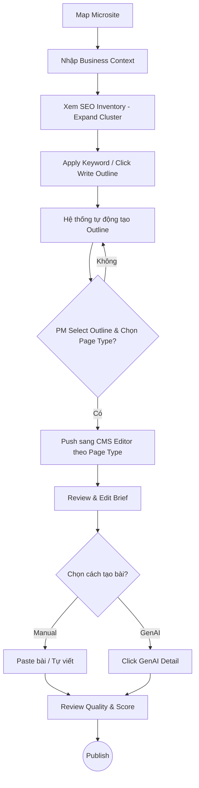
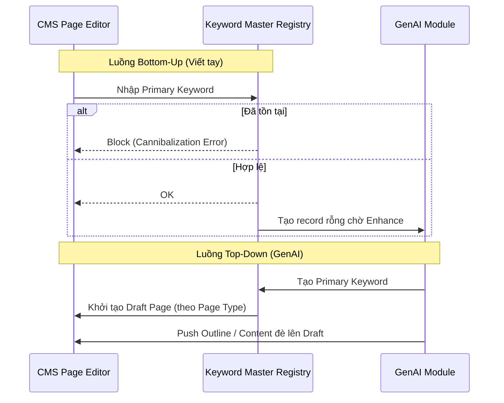
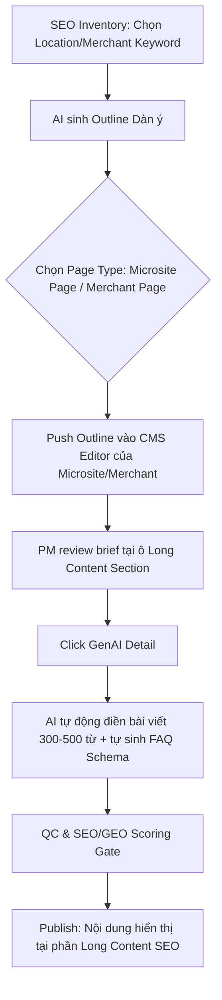

# MoSpark - GenAI Content Engine
Nền tảng sản xuất nội dung bằng AI

> - **Project Name:** MoSpark Web Platform
> - **Division:** GPD (Growth Platform Division)
> - **Owner:** Hiến
> - **PIC:** Trọng (Tech), Lộc (User Role)
> - **Version:** 4.13 · June 2026

---

## 1. Executive Summary

### 1.1. Bối cảnh (Situation)
MoSpark cần một "cỗ máy" sản xuất nội dung không chỉ nhanh mà phải **chuẩn hóa**. Hiện tại, việc sử dụng AI cá nhân (ChatGPT/Claude) đang bị phân mảnh, thiếu tính đồng bộ và không kiểm soát được chất lượng Prompt, dẫn đến đầu ra không nhất quán với thương hiệu MoMo.

### 1.2. Vấn đề cốt lõi (Complication)
- **Tốc độ vs Chất lượng:** Content Writer mất quá nhiều thời gian để "mớm" ngữ cảnh cho AI.
- **Prompt Fragmentation:** Mỗi người dùng AI theo một cách khác nhau, không có Guideline chung cho SEO, AEO (Answer Engine Optimization) và GEO.
- **Thiếu Source of Truth:** AI dễ bị ảo giác (hallucination) nếu không được bám sát vào mô tả sản phẩm và các URL tham chiếu cụ thể của dự án.

### 1.3. Giải pháp (Resolution)
Tạo ra **PLG Project Management Hub & AI Content Engine** - một không gian quản lý tập trung dựa trên 6 trụ cột chiến lược v5.1:
- **PLG Project Management & Mapping:** Hoạt động như trung tâm quản trị dự án, bắt buộc ánh xạ 1-1 với Microsite đích để tự động kiểm soát URL và phân cấp.
- **GEO Moat & AI Citation Tracking:** Tự động hóa sinh 20 query prompts mô phỏng search intent trên AI Search (ChatGPT, Perplexity) để lưu trữ phục vụ đo lường Citation Rate, kết hợp nén nội dung bài viết thành llms.txt cho AI Crawlers.
- **Multi-Agent Quality Guardrails:** 3 Sub-agents tự động hóa khâu rà soát: YMYL & Legal Compliance Agent (kiểm tra từ khóa cấm, quy định NHNN), Information Gain Scraper (cào quét đối thủ real-time để tìm Content Gap), và Internal Linker (chống cannibalization).
- **Reparaphrase & Content Refinement (Qwen 3.5 Engine):** Tích hợp mô hình Qwen 3.5 nội bộ trên MoSpark với prompt chuyên dụng để rà soát lỗi diễn đạt, mượt hóa câu chữ (Humanize), bẻ nhỏ câu dài và khử văn mẫu AI sáo rỗng, đồng thời bảo toàn tuyệt đối thực thể SEO và số liệu tài chính YMYL.
- **Programmatic pSEO Factory:** Tự động hóa sản xuất nội dung quy mô lớn qua CSV (dành cho use case phân mảnh địa phương như Phạt Nguội, eSIM).
- **Closed-Loop Auto-Refresh:** Đồng bộ dữ liệu GSC/GA4 qua BigQuery để tự động cảnh báo Content Decay và đề xuất cập nhật bài viết.

### 1.4. Tam giác Dữ liệu (The Data Triangle)
Kiến trúc của GenAI Content được thiết kế dựa trên sự phân tách và kết hợp rõ ràng của 3 nguồn lực:
1. **Business Context (Từ BU/PM):** Thông tin sản phẩm, USPs, định vị thương hiệu và rào cản pháp lý. Trả lời câu hỏi: *Viết cái gì cho đúng?*
2. **SEO Inventory (Từ Hiến - SEO Tools):** Số liệu định lượng (Volume, Keyword) phân tầng TOFU/MOFU/BOFU theo Customer Journey. Trả lời câu hỏi: *Viết cho ai, keyword nào, funnel stage nào?*
3. **GenAI Content Engine:** Tiếp nhận Primary Keyword (từ SEO Inventory) và viết Content chuẩn SEO/GEO bám sát Business Context. Output đi qua Outline Selection (hard gate) trước khi push sang CMS Page Editor. Tại đây, PM quyết định định dạng phân phối (Page Type: Blog, Landing Page, Merchant Page, FAQ, etc.).

**Luồng tương tác:**

<table style="width:100%; border-collapse:collapse; border:1.5px solid #64748b; margin:1em 0; font-size:0.9em;">
  <thead>
    <tr style="background-color:#f1f5f9;">
      <th style="border:1.5px solid #64748b; padding:8px 12px; text-align:left; font-weight:700;">Input</th>
      <th style="border:1.5px solid #64748b; padding:8px 12px; text-align:left; font-weight:700;">Xử lý</th>
      <th style="border:1.5px solid #64748b; padding:8px 12px; text-align:left; font-weight:700;">Output</th>
      <th style="border:1.5px solid #64748b; padding:8px 12px; text-align:left; font-weight:700;">Gate</th>
    </tr>
  </thead>
  <tbody>
    <tr>
      <td style="border:1px solid #94a3b8; padding:8px 12px; text-align:left;">Business Context (PM) + SEO Inventory (Hiến)</td>
      <td style="border:1px solid #94a3b8; padding:8px 12px; text-align:left;">GenAI Content Engine tiếp nhận context + keyword</td>
      <td style="border:1px solid #94a3b8; padding:8px 12px; text-align:left;">AI Outline draft</td>
      <td style="border:1px solid #94a3b8; padding:8px 12px; text-align:left;">-</td>
    </tr>
    <tr style="background-color:#f8fafc;">
      <td style="border:1px solid #94a3b8; padding:8px 12px; text-align:left;">PM xem TOFU/MOFU/BOFU (Expand/Collapse Cluster), chọn Primary Keyword</td>
      <td style="border:1px solid #94a3b8; padding:8px 12px; text-align:left;">Hệ thống generate Outline</td>
      <td style="border:1px solid #94a3b8; padding:8px 12px; text-align:left;">Outline draft</td>
      <td style="border:1px solid #94a3b8; padding:8px 12px; text-align:left;">-</td>
    </tr>
    <tr>
      <td style="border:1px solid #94a3b8; padding:8px 12px; text-align:left;">PM/Content review Outline</td>
      <td style="border:1px solid #94a3b8; padding:8px 12px; text-align:left;">Chọn (Select) Outline phù hợp</td>
      <td style="border:1px solid #94a3b8; padding:8px 12px; text-align:left;"><strong>Outline Selected</strong></td>
      <td style="border:1px solid #94a3b8; padding:8px 12px; text-align:left;"><strong>Hard gate - bắt buộc</strong></td>
    </tr>
    <tr style="background-color:#f8fafc;">
      <td style="border:1px solid #94a3b8; padding:8px 12px; text-align:left;">Outline Selected + Chọn Page Type (Blog/LP/Merchant...) push sang CMS Page Editor</td>
      <td style="border:1px solid #94a3b8; padding:8px 12px; text-align:left;">Content paste bài (A) hoặc click GenAI Detail (B)</td>
      <td style="border:1px solid #94a3b8; padding:8px 12px; text-align:left;">Trang Content Final</td>
      <td style="border:1px solid #94a3b8; padding:8px 12px; text-align:left;">SEO/GEO Score gate</td>
    </tr>
  </tbody>
</table>

---

## 2. Stakeholder (Nhóm người dùng chính)

<table style="width:100%; border-collapse:collapse; border:1.5px solid #64748b; margin:1em 0; font-size:0.9em;">
  <thead>
    <tr style="background-color:#f1f5f9;">
      <th style="border:1.5px solid #64748b; padding:8px 12px; text-align:left; font-weight:700;">Vai trò</th>
      <th style="border:1.5px solid #64748b; padding:8px 12px; text-align:left; font-weight:700;">Trách nhiệm chính</th>
      <th style="border:1.5px solid #64748b; padding:8px 12px; text-align:left; font-weight:700;">Mục tiêu</th>
    </tr>
  </thead>
  <tbody>
    <tr>
      <td style="border:1px solid #94a3b8; padding:8px 12px; text-align:left;"><strong>Content Writer</strong></td>
      <td style="border:1px solid #94a3b8; padding:8px 12px; text-align:left;">Thực thi sản xuất bài viết</td>
      <td style="border:1px solid #94a3b8; padding:8px 12px; text-align:left;">Tạo Use Case, quản lý từ khóa, thêm dữ liệu tham khảo, chỉnh sửa dàn ý và tạo bản nháp bài viết tự động.</td>
    </tr>
    <tr style="background-color:#f8fafc;">
      <td style="border:1px solid #94a3b8; padding:8px 12px; text-align:left;"><strong>Guideline Admin</strong></td>
      <td style="border:1px solid #94a3b8; padding:8px 12px; text-align:left;">Quản trị tiêu chuẩn</td>
      <td style="border:1px solid #94a3b8; padding:8px 12px; text-align:left;">Thiết lập và cập nhật hệ thống Prompt & Guidelines (SEO, AEO, GEO) để kiểm soát chất lượng đầu ra.</td>
    </tr>
    <tr>
      <td style="border:1px solid #94a3b8; padding:8px 12px; text-align:left;"><strong>Web Product Lead</strong></td>
      <td style="border:1px solid #94a3b8; padding:8px 12px; text-align:left;">Kiểm soát gate cuối</td>
      <td style="border:1px solid #94a3b8; padding:8px 12px; text-align:left;">Review điểm Scoring và phê duyệt xuất bản (Sign-off).</td>
    </tr>
  </tbody>
</table>

---

## 3. Bài Toán Cần Giải & Success Metrics

### 3.1. Mục tiêu chiến lược
Biến MoSpark thành "Production Lab" duy nhất, nơi nội dung được sản xuất với chi phí thấp nhất nhưng đạt tiêu chuẩn xuất bản cao nhất của MoMo.

### 3.2. Success Metrics (SMART)
- **Productivity:** Tăng năng suất sản xuất từ trung bình **10 bài/tháng** lên **20 bài/tháng** trên mỗi Content Writer.
- **Quality:** 100% bài viết AI sinh ra phải vượt qua Hard Block của bộ lọc SEO/GEO Scoring.
- **SOV Target:** Đạt mức độ trích dẫn (Citation) từ AI search cho các Primary Keyword của Use Case tối thiểu 30%.

### 3.3. Tính năng cốt lõi (Key Features)
- **Microsite Mapping Hub (Strict 1-1):** Bắt buộc liên kết thực thể dự án SEO/GEO với duy nhất 1 Microsite đích, đóng vai trò là khung quản trị xương sống để phân bổ toàn bộ nội dung của dự án.
- **URL Routing Auto-governance:** Tự động cấu trúc đường dẫn bài viết Blog theo quy tắc: `/{use-case}/blog*` (ví dụ: `/vay-nhanh/blog/*`), kế thừa trực tiếp từ Microsite base path để đồng bộ hóa phân cấp URL.
- **Keyword Master Registry:** Quản lý tập trung Primary Keywords, đảm bảo tính duy nhất (Unique ID Check) trên toàn bộ hệ thống để ngăn chặn Keyword Cannibalization.
- **Double Entry Sync:** Cơ chế đồng bộ bài viết từ module Sản xuất sang module Quản trị (Editor).
- **AI Query Generator & Citation Tracker (GEO Moat):** Tự động sinh và lưu trữ bộ 20 query prompts cho mỗi Primary Keyword để đo lường định kỳ Citation Rate trên ChatGPT/Gemini/Perplexity.
- **Auto-compressed llms.txt Generator:** Tự động nén và đồng bộ dữ liệu bài viết vào file llms.txt của Microsite để làm sạch nguồn dữ liệu cho AI crawlers.
- **Multi-Agent Reviewers (YMYL Compliance, Information Gain, Internal Linker):** Hệ thống chốt chặn tự động chất lượng, pháp lý và cấu trúc liên kết chéo.
- **CSV Bulk Generator (pSEO Factory):** Tạo lập hàng loạt hàng trăm trang địa phương/ngách qua file CSV/API.
- **Decay Auto-Alert & Refresh Loop:** Đồng bộ Google Search Console & GA4 tự động phát hiện sụt giảm hiệu suất để kích hoạt luồng đề xuất tối ưu nội dung.

---

## 4. Các Giả định & Nền tảng (Assumptions)

- **Grounding Search:** Hệ thống mặc định tích hợp khả năng tìm kiếm web thực tế để AI cập nhật dữ liệu mới nhất và xác thực thông tin.
- **URL Context:** Tính năng đọc hiểu nội dung từ các liên kết (link) trong mô tả Use Case được kích hoạt mặc định để làm "Source of Truth".
- **Human-in-the-loop:** Kết quả AI chỉ mang tính chất tham khảo; Content Writer chịu trách nhiệm rà soát, hiệu đính và chịu trách nhiệm cuối cùng về nội dung.
- **Standard Chữ thường:** Toàn bộ từ khóa được chuẩn hóa về chữ thường để đảm bảo tính nhất quán và duy nhất.

---

## 5. Giải pháp đo lường Share Of Voice (SOV) & AI Citation Tracking

Đây là tính năng quan trọng để đánh giá mức độ xuất hiện và độ phủ thương hiệu của MoMo trong câu trả lời của AI:

### 5.1. Cơ chế thu thập dữ liệu (AI Query Generator)
- Từ một **Primary Keyword** chính của bài viết, MoSpark sử dụng GenAI tự động giả lập **20 câu truy vấn (query prompts)** bám sát nhất theo Search Intent của người dùng (tập trung vào các truy vấn dạng tìm kiếm, so sánh và giao dịch).
- Hệ thống lưu trữ bộ câu hỏi này vào cơ sở dữ liệu và tự động chạy lịch trình truy vấn định kỳ (cron job) lên các công cụ AI Search (ChatGPT, Gemini, Perplexity).
- AI trả về câu trả lời kèm danh sách các nguồn tham khảo (References).

### 5.2. Logic tính toán
- **Trích xuất Domain:** Hệ thống tự động tách domain từ các URL tham khảo được AI phản hồi.
- **Thống kê:** Đếm số lần domain MoMo được trích dẫn trên tổng số 20 câu hỏi thử nghiệm và tính tỷ lệ phần trăm (%) dựa trên thị trường.
- **Công thức tính Citation Rate:** `Citation Rate % = (Số câu hỏi MoMo được trích dẫn / 20 câu hỏi giả lập) * 100`.
- **Công thức tính SOV:** `SOV % = (Số lần domain MoMo xuất hiện / Tổng số lần tất cả domain xuất hiện trong reference) * 100`.

### 5.3. Tối ưu hóa vận hành
- Để tiết kiệm chi phí API, hệ thống gom nhóm các Secondary Keywords của cùng một Topic Cluster để đo lường chung (tối đa 6 API call cho mỗi cụm từ khóa chính khi quét diện rộng).

---

## 6. Workflow Content

### 6.1. PLG Project làm Trung tâm Quản trị & Mapping Microsite

Mỗi dự án SEO/GEO (PLG Project) trên MoSpark không chỉ đơn thuần là công cụ tạo nội dung mà hoạt động như **Trung tâm Quản trị Dự án (Project Management Hub)** (Chi tiết xem tại: PLG Project Management).
- **Ràng buộc Mapping 1-1 cứng:** Mỗi PLG Project phải được thiết lập liên kết (mapping) bắt buộc với **chính xác 1 Microsite** (Use Case) tương ứng. Dự án không được phép hoạt động mồ côi (orphaned).
- **Cơ chế Định tuyến đường dẫn:** Việc mapping 1-1 này nhằm tuân thủ tuyệt đối cơ chế định tuyến SEO/GEO của MoSpark: mọi bài viết Blog, tài liệu thuộc dự án bắt buộc phải nằm dưới URL của Microsite đó theo cấu trúc: `/{use-case}/blog*` (Ví dụ: `/phat-nguoi/blog/quy-dinh-phat-nguoi-o-to`).
- **Phân tách thực thể:** Bản thân Microsite quản lý toàn bộ tài sản nội dung của Use Case đó. Blog, Landing Page, FAQ, Merchant Page... đều là các module phân phối thuộc Microsite - không phải các entity hoạt động độc lập:

<table style="width:100%; border-collapse:collapse; border:1.5px solid #64748b; margin:1em 0; font-size:0.9em;">
  <thead>
    <tr style="background-color:#f1f5f9;">
      <th style="border:1.5px solid #64748b; padding:8px 12px; text-align:left; font-weight:700;">Component</th>
      <th style="border:1.5px solid #64748b; padding:8px 12px; text-align:left; font-weight:700;">Nội dung quản lý</th>
      <th style="border:1.5px solid #64748b; padding:8px 12px; text-align:left; font-weight:700;">Owner</th>
    </tr>
  </thead>
  <tbody>
    <tr>
      <td style="border:1px solid #94a3b8; padding:8px 12px; text-align:left;"><strong>Sub-pages</strong></td>
      <td style="border:1px solid #94a3b8; padding:8px 12px; text-align:left;">Hub page, Spoke pages, Landing pages</td>
      <td style="border:1px solid #94a3b8; padding:8px 12px; text-align:left;">PM/PO</td>
    </tr>
    <tr style="background-color:#f8fafc;">
      <td style="border:1px solid #94a3b8; padding:8px 12px; text-align:left;"><strong>Content</strong></td>
      <td style="border:1px solid #94a3b8; padding:8px 12px; text-align:left;">Blog articles, Landing Pages, Merchant Pages, FAQs, Static content</td>
      <td style="border:1px solid #94a3b8; padding:8px 12px; text-align:left;">PM/Content Team</td>
    </tr>
    <tr>
      <td style="border:1px solid #94a3b8; padding:8px 12px; text-align:left;"><strong>Meta data</strong></td>
      <td style="border:1px solid #94a3b8; padding:8px 12px; text-align:left;">Title, Description, OG tags, Schema markup</td>
      <td style="border:1px solid #94a3b8; padding:8px 12px; text-align:left;">MoSpark auto + Web Product Lead review</td>
    </tr>
    <tr style="background-color:#f8fafc;">
      <td style="border:1px solid #94a3b8; padding:8px 12px; text-align:left;"><strong>llms.txt</strong></td>
      <td style="border:1px solid #94a3b8; padding:8px 12px; text-align:left;">AI crawler policy per Microsite</td>
      <td style="border:1px solid #94a3b8; padding:8px 12px; text-align:left;">Web Product Lead</td>
    </tr>
    <tr>
      <td style="border:1px solid #94a3b8; padding:8px 12px; text-align:left;"><strong>Dashboard</strong></td>
      <td style="border:1px solid #94a3b8; padding:8px 12px; text-align:left;">Traffic, W2A, Keyword ranking, SEO Inventory per Use Case</td>
      <td style="border:1px solid #94a3b8; padding:8px 12px; text-align:left;">PM/PO view</td>
    </tr>
    <tr style="background-color:#f8fafc;">
      <td style="border:1px solid #94a3b8; padding:8px 12px; text-align:left;"><strong>Content management</strong></td>
      <td style="border:1px solid #94a3b8; padding:8px 12px; text-align:left;">Toàn bộ pages (Blog/LP/Merchant...) thuộc Microsite</td>
      <td style="border:1px solid #94a3b8; padding:8px 12px; text-align:left;">PM/Content Team</td>
    </tr>
  </tbody>
</table>

Content được tạo theo 2 con đường - cả 2 đều yêu cầu Primary Keyword phải đăng ký trong Keyword Master Registry trước khi publish:
- **Manual (CMS Page Editor trực tiếp):** Content paste bài viết vào CMS Page Editor, nhập Primary Keyword để trigger Unique ID Check.
- **GenAI Flow (luồng bắt buộc):** PLG Project (SEO Inventory Cluster) → Business Context → Outline (Selected) → Chọn định dạng phân phối (Page Type: Blog/LP/Merchant...) → CMS Page Editor.

**Content Management - List View:**

Hiển thị toàn bộ trang nội dung (Pages) của project, phân biệt rõ bằng badge loại hình và nguồn gốc:

<table style="width:100%; border-collapse:collapse; border:1.5px solid #64748b; margin:1em 0; font-size:0.9em;">
  <thead>
    <tr style="background-color:#f1f5f9;">
      <th style="border:1.5px solid #64748b; padding:8px 12px; text-align:left; font-weight:700;">Loại nguồn</th>
      <th style="border:1.5px solid #64748b; padding:8px 12px; text-align:left; font-weight:700;">Badge nguồn</th>
      <th style="border:1.5px solid #64748b; padding:8px 12px; text-align:left; font-weight:700;">Badge định dạng</th>
      <th style="border:1.5px solid #64748b; padding:8px 12px; text-align:left; font-weight:700;">Columns hiển thị</th>
    </tr>
  </thead>
  <tbody>
    <tr>
      <td style="border:1px solid #94a3b8; padding:8px 12px; text-align:left;"><strong>GenAI</strong></td>
      <td style="border:1px solid #94a3b8; padding:8px 12px; text-align:left;"><code style="background:#f1f5f9;padding:2px 4px;border-radius:4px;font-family:monospace;">GenAI</code> (tím)</td>
      <td style="border:1px solid #94a3b8; padding:8px 12px; text-align:left;"><code style="background:#f1f5f9;padding:2px 4px;border-radius:4px;font-family:monospace;">Blog</code> / <code style="background:#f1f5f9;padding:2px 4px;border-radius:4px;font-family:monospace;">LP</code> / <code style="background:#f1f5f9;padding:2px 4px;border-radius:4px;font-family:monospace;">FAQ</code> / <code style="background:#f1f5f9;padding:2px 4px;border-radius:4px;font-family:monospace;">Merchant</code></td>
      <td style="border:1px solid #94a3b8; padding:8px 12px; text-align:left;">Title, Page Type, Primary Keyword, Status, Ngày tạo, Model, Cost</td>
    </tr>
    <tr style="background-color:#f8fafc;">
      <td style="border:1px solid #94a3b8; padding:8px 12px; text-align:left;"><strong>Manual</strong></td>
      <td style="border:1px solid #94a3b8; padding:8px 12px; text-align:left;"><code style="background:#f1f5f9;padding:2px 4px;border-radius:4px;font-family:monospace;">Manual</code> (xám)</td>
      <td style="border:1px solid #94a3b8; padding:8px 12px; text-align:left;"><code style="background:#f1f5f9;padding:2px 4px;border-radius:4px;font-family:monospace;">Blog</code> / <code style="background:#f1f5f9;padding:2px 4px;border-radius:4px;font-family:monospace;">LP</code> / <code style="background:#f1f5f9;padding:2px 4px;border-radius:4px;font-family:monospace;">FAQ</code> / <code style="background:#f1f5f9;padding:2px 4px;border-radius:4px;font-family:monospace;">Merchant</code></td>
      <td style="border:1px solid #94a3b8; padding:8px 12px; text-align:left;">Title, Page Type, Primary Keyword, Status, Ngày tạo</td>
    </tr>
  </tbody>
</table>

**Content Management - Detail View (GenAI article/page):**

Khi click vào trang GenAI, hiển thị 2 panel:

<table style="width:100%; border-collapse:collapse; border:1.5px solid #64748b; margin:1em 0; font-size:0.9em;">
  <thead>
    <tr style="background-color:#f1f5f9;">
      <th style="border:1.5px solid #64748b; padding:8px 12px; text-align:left; font-weight:700;">Panel</th>
      <th style="border:1.5px solid #64748b; padding:8px 12px; text-align:left; font-weight:700;">Nội dung</th>
    </tr>
  </thead>
  <tbody>
    <tr>
      <td style="border:1px solid #94a3b8; padding:8px 12px; text-align:left;"><strong>Editor</strong></td>
      <td style="border:1px solid #94a3b8; padding:8px 12px; text-align:left;">Full CMS page editor (phù hợp theo Page Type đã chọn) - chỉnh sửa nội dung, metadata, publish/unpublish</td>
    </tr>
    <tr style="background-color:#f8fafc;">
      <td style="border:1px solid #94a3b8; padding:8px 12px; text-align:left;"><strong>AI Usage</strong></td>
      <td style="border:1px solid #94a3b8; padding:8px 12px; text-align:left;">Usage (input tokens / output tokens), Cost (ước tính theo API pricing), Model (tên model đã dùng để generate)</td>
    </tr>
  </tbody>
</table>

> **Lý do cần AI Usage panel:** PM/PO và Finance cần biết chi phí AI thực tế per trang và per Use Case để quản lý budget GenAI. Không có data này thì không thể scale có kiểm soát.

**Content Management - Detail View (Manual page):**

Chỉ hiển thị Editor - không có AI Usage panel vì không có API call.

### 6.2. Luồng GenAI → Content (Mandatory Flow)

**Điều kiện tiên quyết:** PLG Project đã tạo và mapped với Microsite trước khi bắt đầu.

<table style="width:100%; border-collapse:collapse; border:1.5px solid #64748b; margin:1em 0; font-size:0.9em;">
  <thead>
    <tr style="background-color:#f1f5f9;">
      <th style="border:1.5px solid #64748b; padding:8px 12px; text-align:left; font-weight:700;">Bước</th>
      <th style="border:1.5px solid #64748b; padding:8px 12px; text-align:left; font-weight:700;">Hành động</th>
      <th style="border:1.5px solid #64748b; padding:8px 12px; text-align:left; font-weight:700;">Owner</th>
      <th style="border:1.5px solid #64748b; padding:8px 12px; text-align:left; font-weight:700;">Gate</th>
    </tr>
  </thead>
  <tbody>
    <tr>
      <td style="border:1px solid #94a3b8; padding:8px 12px; text-align:left;"><strong>1</strong></td>
      <td style="border:1px solid #94a3b8; padding:8px 12px; text-align:left;">PLG Project mapped vào Microsite</td>
      <td style="border:1px solid #94a3b8; padding:8px 12px; text-align:left;">PM/PO</td>
      <td style="border:1px solid #94a3b8; padding:8px 12px; text-align:left;">Prerequisite cứng - không bỏ qua</td>
    </tr>
    <tr style="background-color:#f8fafc;">
      <td style="border:1px solid #94a3b8; padding:8px 12px; text-align:left;"><strong>2</strong></td>
      <td style="border:1px solid #94a3b8; padding:8px 12px; text-align:left;">Nhập Business Context đầy đủ theo template</td>
      <td style="border:1px solid #94a3b8; padding:8px 12px; text-align:left;">PM + Web Product Lead validate</td>
      <td style="border:1px solid #94a3b8; padding:8px 12px; text-align:left;">Bắt buộc hoàn thành trước khi tạo keyword</td>
    </tr>
    <tr>
      <td style="border:1px solid #94a3b8; padding:8px 12px; text-align:left;"><strong>3</strong></td>
      <td style="border:1px solid #94a3b8; padding:8px 12px; text-align:left;">Xem SEO Inventory + Topic Cluster (Expand/Collapse UI)</td>
      <td style="border:1px solid #94a3b8; padding:8px 12px; text-align:left;">PM chọn stage/cluster cần tấn công</td>
      <td style="border:1px solid #94a3b8; padding:8px 12px; text-align:left;">TOFU/MOFU/BOFU hiển thị, PM mở rộng cluster để xem danh sách Primary Keywords</td>
    </tr>
    <tr style="background-color:#f8fafc;">
      <td style="border:1px solid #94a3b8; padding:8px 12px; text-align:left;"><strong>4</strong></td>
      <td style="border:1px solid #94a3b8; padding:8px 12px; text-align:left;">Chọn / Áp dụng Primary Keyword từ Cluster</td>
      <td style="border:1px solid #94a3b8; padding:8px 12px; text-align:left;">PM / Content Team</td>
      <td style="border:1px solid #94a3b8; padding:8px 12px; text-align:left;">Trực tiếp trigger tạo content cho keyword, chạy Unique ID Check tự động toàn hệ thống</td>
    </tr>
    <tr>
      <td style="border:1px solid #94a3b8; padding:8px 12px; text-align:left;"><strong>5</strong></td>
      <td style="border:1px solid #94a3b8; padding:8px 12px; text-align:left;">AI generate Outline</td>
      <td style="border:1px solid #94a3b8; padding:8px 12px; text-align:left;">Hệ thống</td>
      <td style="border:1px solid #94a3b8; padding:8px 12px; text-align:left;">-</td>
    </tr>
    <tr style="background-color:#f8fafc;">
      <td style="border:1px solid #94a3b8; padding:8px 12px; text-align:left;"><strong>6</strong></td>
      <td style="border:1px solid #94a3b8; padding:8px 12px; text-align:left;"><strong>OUTLINE SELECTED & CHỌN PAGE TYPE</strong></td>
      <td style="border:1px solid #94a3b8; padding:8px 12px; text-align:left;">PM/Content</td>
      <td style="border:1px solid #94a3b8; padding:8px 12px; text-align:left;"><strong>Hard gate</strong> - PM duyệt outline và chọn định dạng đầu ra (Blog, Landing Page, FAQ, Merchant Page...)</td>
    </tr>
    <tr>
      <td style="border:1px solid #94a3b8; padding:8px 12px; text-align:left;"><strong>7</strong></td>
      <td style="border:1px solid #94a3b8; padding:8px 12px; text-align:left;">Outline & Page Type push sang CMS Page Editor</td>
      <td style="border:1px solid #94a3b8; padding:8px 12px; text-align:left;">Tự động</td>
      <td style="border:1px solid #94a3b8; padding:8px 12px; text-align:left;">CMS Page Editor khởi tạo giao diện tương ứng theo Page Type đã chọn</td>
    </tr>
    <tr style="background-color:#f8fafc;">
      <td style="border:1px solid #94a3b8; padding:8px 12px; text-align:left;"><strong>8</strong></td>
      <td style="border:1px solid #94a3b8; padding:8px 12px; text-align:left;">Review brief + Chọn cách tạo bài</td>
      <td style="border:1px solid #94a3b8; padding:8px 12px; text-align:left;">PM + Content Team</td>
      <td style="border:1px solid #94a3b8; padding:8px 12px; text-align:left;">PM review và chỉnh sửa lại dàn ý (brief) trong Page Editor nếu cần - sau đó chọn cách tạo nội dung</td>
    </tr>
    <tr>
      <td style="border:1px solid #94a3b8; padding:8px 12px; text-align:left;"><strong>9</strong></td>
      <td style="border:1px solid #94a3b8; padding:8px 12px; text-align:left;">Review & SEO/GEO Score</td>
      <td style="border:1px solid #94a3b8; padding:8px 12px; text-align:left;">Web Product Lead</td>
      <td style="border:1px solid #94a3b8; padding:8px 12px; text-align:left;">Hard block nếu chưa pass bộ lọc SEO/GEO Score của Page Type tương ứng</td>
    </tr>
    <tr style="background-color:#f8fafc;">
      <td style="border:1px solid #94a3b8; padding:8px 12px; text-align:left;"><strong>10</strong></td>
      <td style="border:1px solid #94a3b8; padding:8px 12px; text-align:left;">Publish</td>
      <td style="border:1px solid #94a3b8; padding:8px 12px; text-align:left;">Content Team</td>
      <td style="border:1px solid #94a3b8; padding:8px 12px; text-align:left;">Live trang trên momo.vn</td>
    </tr>
  </tbody>
</table>

**Bước 6 - Chọn Page Type (Định dạng phân phối):**
Tại bước chọn Outline, PM quyết định loại trang mà content này sẽ hiển thị:
- **Blog Article:** Phù hợp với cụm từ khóa cung cấp thông tin (TOFU), soft-sell.
- **Landing Page:** Phù hợp với cụm từ khóa có mục đích thương mại/giao dịch cao (MOFU/BOFU).
- **FAQ Page:** Giải đáp thắc mắc người dùng (`/hoi-dap`).
- **Merchant Page:** Trang giới thiệu đối tác (`/merchant`).

**Bước 8 - Flow trong CMS Page Editor (sau khi Outline đã push sang):**

**8.1 - PM review + edit brief:**
- PM đọc lại dàn ý (brief) vừa được push sang Page Editor.
- Chỉnh sửa nếu cần: thêm/xóa section, điều chỉnh góc nhìn, clarify heading.
- Đây là lần chỉnh sửa cuối trước khi nội dung được tạo - không quay lại step này sau khi đã chọn cách tạo bài.

**8.2 - Chọn cách tạo bài:**

<table style="width:100%; border-collapse:collapse; border:1.5px solid #64748b; margin:1em 0; font-size:0.9em;">
  <thead>
    <tr style="background-color:#f1f5f9;">
      <th style="border:1.5px solid #64748b; padding:8px 12px; text-align:left; font-weight:700;">Lựa chọn</th>
      <th style="border:1.5px solid #64748b; padding:8px 12px; text-align:left; font-weight:700;">Cơ chế</th>
      <th style="border:1.5px solid #64748b; padding:8px 12px; text-align:left; font-weight:700;">Khi nào dùng</th>
    </tr>
  </thead>
  <tbody>
    <tr>
      <td style="border:1px solid #94a3b8; padding:8px 12px; text-align:left;"><strong>A - Manual</strong></td>
      <td style="border:1px solid #94a3b8; padding:8px 12px; text-align:left;">Paste bài từ AI cá nhân (ChatGPT, Claude riêng) hoặc tự viết theo brief đã review</td>
      <td style="border:1px solid #94a3b8; padding:8px 12px; text-align:left;">Đã có draft sẵn, hoặc muốn kiểm soát toàn bộ quá trình viết</td>
    </tr>
    <tr style="background-color:#f8fafc;">
      <td style="border:1px solid #94a3b8; padding:8px 12px; text-align:left;"><strong>B - GenAI Detail</strong></td>
      <td style="border:1px solid #94a3b8; padding:8px 12px; text-align:left;">Click nút "GenAI Detail" trong CMS Page Editor - hệ thống AI generate full page content từ brief đã review</td>
      <td style="border:1px solid #94a3b8; padding:8px 12px; text-align:left;">Chưa có draft, muốn AI của platform viết hoàn chỉnh từ brief</td>
    </tr>
  </tbody>
</table>

**Bước 3 - PM thấy gì trong SEO Inventory (Control Panel):**

<table style="width:100%; border-collapse:collapse; border:1.5px solid #64748b; margin:1em 0; font-size:0.9em;">
  <thead>
    <tr style="background-color:#f1f5f9;">
      <th style="border:1.5px solid #64748b; padding:8px 12px; text-align:left; font-weight:700;">Thông tin</th>
      <th style="border:1.5px solid #64748b; padding:8px 12px; text-align:left; font-weight:700;">Ý nghĩa với PM</th>
    </tr>
  </thead>
  <tbody>
    <tr>
      <td style="border:1px solid #94a3b8; padding:8px 12px; text-align:left;">Market Volume (total)</td>
      <td style="border:1px solid #94a3b8; padding:8px 12px; text-align:left;">Market Sizing toàn Use Case - basis để set KPI và độ ưu tiên</td>
    </tr>
    <tr style="background-color:#f8fafc;">
      <td style="border:1px solid #94a3b8; padding:8px 12px; text-align:left;">Keyword cluster theo TOFU (Expandable)</td>
      <td style="border:1px solid #94a3b8; padding:8px 12px; text-align:left;">Các cụm chủ đề thông tin - mở ra để xem toàn bộ Primary Keywords</td>
    </tr>
    <tr>
      <td style="border:1px solid #94a3b8; padding:8px 12px; text-align:left;">Keyword cluster theo MOFU (Expandable)</td>
      <td style="border:1px solid #94a3b8; padding:8px 12px; text-align:left;">Các cụm chủ đề so sánh/đánh giá - mở ra để xem toàn bộ Primary Keywords</td>
    </tr>
    <tr style="background-color:#f8fafc;">
      <td style="border:1px solid #94a3b8; padding:8px 12px; text-align:left;">Keyword cluster theo BOFU (Expandable)</td>
      <td style="border:1px solid #94a3b8; padding:8px 12px; text-align:left;">Các cụm chủ đề giao dịch - mở ra để xem toàn bộ Primary Keywords</td>
    </tr>
    <tr>
      <td style="border:1px solid #94a3b8; padding:8px 12px; text-align:left;">SoV MoMo hiện tại</td>
      <td style="border:1px solid #94a3b8; padding:8px 12px; text-align:left;">MoMo đang chiếm bao nhiêu % thị trường - biết gap để set target</td>
    </tr>
    <tr style="background-color:#f8fafc;">
      <td style="border:1px solid #94a3b8; padding:8px 12px; text-align:left;">Nút "Apply / Write Outline"</td>
      <td style="border:1px solid #94a3b8; padding:8px 12px; text-align:left;">Bấm trực tiếp cạnh Keyword đã cluster trong Inventory để tự động tạo outline mà không cần copy-paste</td>
    </tr>
  </tbody>
</table>

**Luồng cập nhật trang đã có (Update Flow):**

Trang đã tồn tại có thể cập nhật theo 2 cách:
1. **Thủ công:** Sửa trực tiếp trong CMS Page Editor
2. **Enhance by GenAI:** Click nút trong CMS Page Editor - redirect về GenAI Content module của keyword đó để tối ưu lại bằng AI, sau đó sync ngược về Editor

### 6.3. Core Data Governance Rules (Đã xác nhận & Triển khai)

Để đảm bảo tính toàn vẹn dữ liệu và tránh xung đột SEO (Cannibalization), hệ thống áp dụng các quy tắc cứng sau:

1.  **Project-First Requirement (Ràng buộc bối cảnh):** Mọi **Primary Keyword** bắt buộc phải thuộc về một **PLG Project** cụ thể. Keyword không được phép tồn tại "mồ côi" vì Project là nơi cung cấp *Business Context* và định nghĩa cấu trúc URL.
2.  **Strict 1-1 Mapping (Tính duy nhất):** Quy tắc **1 Bài viết ↔ 1 Primary Keyword**. Một Primary Keyword chỉ được đại diện cho một URL Master và một nội dung duy nhất. Nếu người dùng tạo trùng, hệ thống phải chặn và yêu cầu sử dụng luồng "Update/Enhance".
3.  **Single Ownership (Phân cấp URL):** Một Primary Keyword chỉ thuộc về **duy nhất 1 PLG Project**. Điều này đảm bảo sự nhất quán trong URL Hierarchy (ví dụ: `/phat-nguoi/` vs `/merchant/`) và tránh tranh chấp Authority giữa các Use Case.
4.  **Cross-Project Cannibalization Check (Kiểm soát Xung đột chéo):** Phạm vi quét của *Keyword Master Registry* phải mang tính **Global (Toàn cục)** toàn hệ thống MoSpark, không nằm cục bộ trong 1 Project.
    - *Ví dụ:* Nếu Project "Phạt Nguội" đã sở hữu keyword `quy định ô tô`, thì Project "Bảo Hiểm" **không được phép** tạo mới URL với keyword này.
    - *Xử lý:* Thay vì tạo 2 URL triệt tiêu nhau, hệ thống yêu cầu sử dụng chung 1 bài viết Authority và thực hiện **Cross-linking** (Bài viết Phạt Nguội chèn Banner/CTA bán Bảo Hiểm).
5.  **Unique ID Check (Kho định danh):** Mọi Keyword khi nhập vào phải được đối soát với *Keyword Master Registry* của toàn hệ thống trước khi cho phép đi vào luồng sản xuất nội dung.
6.  **Strict 1-to-1 Project-to-Microsite Mapping (Đồng bộ cấu trúc định tuyến):** Mỗi PLG Project chỉ được phép liên kết với duy nhất 1 Microsite. Hệ thống Router và CMS Page Editor sẽ thực thi kiểm soát ở mức cơ sở dữ liệu: mọi URL con sinh ra từ Project (e.g. blog post, FAQs) sẽ tự động kế thừa tiền tố slug của Microsite được map (ví dụ: `/{use-case}/blog/{slug}`) để đảm bảo cấu trúc thư mục URL luôn chuẩn chỉnh.

---

### 6.4. Workflow Chi tiết - 10 Bước thực thi (GenAI Flow)

<table style="width:100%; border-collapse:collapse; border:1.5px solid #64748b; margin:1em 0; font-size:0.9em;">
  <thead>
    <tr style="background-color:#f1f5f9;">
      <th style="border:1.5px solid #64748b; padding:8px 12px; text-align:left; font-weight:700;">Bước</th>
      <th style="border:1.5px solid #64748b; padding:8px 12px; text-align:left; font-weight:700;">Tên Bước</th>
      <th style="border:1.5px solid #64748b; padding:8px 12px; text-align:left; font-weight:700;">Hành động</th>
      <th style="border:1.5px solid #64748b; padding:8px 12px; text-align:left; font-weight:700;">Input/Output</th>
      <th style="border:1.5px solid #64748b; padding:8px 12px; text-align:left; font-weight:700;">Owner</th>
    </tr>
  </thead>
  <tbody>
    <tr>
      <td style="border:1px solid #94a3b8; padding:8px 12px; text-align:left;"><strong>1</strong></td>
      <td style="border:1px solid #94a3b8; padding:8px 12px; text-align:left;"><strong>Map Microsite</strong></td>
      <td style="border:1px solid #94a3b8; padding:8px 12px; text-align:left;">PLG Project mapping vào Microsite tương ứng</td>
      <td style="border:1px solid #94a3b8; padding:8px 12px; text-align:left;">Project linked to Microsite</td>
      <td style="border:1px solid #94a3b8; padding:8px 12px; text-align:left;">PM/PO</td>
    </tr>
    <tr style="background-color:#f8fafc;">
      <td style="border:1px solid #94a3b8; padding:8px 12px; text-align:left;"><strong>2</strong></td>
      <td style="border:1px solid #94a3b8; padding:8px 12px; text-align:left;"><strong>Business Context</strong></td>
      <td style="border:1px solid #94a3b8; padding:8px 12px; text-align:left;">Nhập đầy đủ 12 trường theo template (xem Section 7)</td>
      <td style="border:1px solid #94a3b8; padding:8px 12px; text-align:left;">Context Layer - Source of Truth cho AI</td>
      <td style="border:1px solid #94a3b8; padding:8px 12px; text-align:left;">PM/Growth + Web Product Lead validate</td>
    </tr>
    <tr>
      <td style="border:1px solid #94a3b8; padding:8px 12px; text-align:left;"><strong>3</strong></td>
      <td style="border:1px solid #94a3b8; padding:8px 12px; text-align:left;"><strong>SEO Inventory</strong></td>
      <td style="border:1px solid #94a3b8; padding:8px 12px; text-align:left;">Xem Market Sizing, mở rộng TOFU/MOFU/BOFU cluster (Expand/Collapse UI)</td>
      <td style="border:1px solid #94a3b8; padding:8px 12px; text-align:left;">Bảng Keyword Strategy tích hợp Business Context</td>
      <td style="border:1px solid #94a3b8; padding:8px 12px; text-align:left;">PM/Growth</td>
    </tr>
    <tr style="background-color:#f8fafc;">
      <td style="border:1px solid #94a3b8; padding:8px 12px; text-align:left;"><strong>4</strong></td>
      <td style="border:1px solid #94a3b8; padding:8px 12px; text-align:left;"><strong>Keyword Apply</strong></td>
      <td style="border:1px solid #94a3b8; padding:8px 12px; text-align:left;">Nhấp vào nút <strong>"Apply / Write Outline"</strong> trực tiếp cạnh Keyword đã phân cụm</td>
      <td style="border:1px solid #94a3b8; padding:8px 12px; text-align:left;">Keyword vào Master Registry, Unique ID Check tự động</td>
      <td style="border:1px solid #94a3b8; padding:8px 12px; text-align:left;">PM / Content Team</td>
    </tr>
    <tr>
      <td style="border:1px solid #94a3b8; padding:8px 12px; text-align:left;"><strong>5</strong></td>
      <td style="border:1px solid #94a3b8; padding:8px 12px; text-align:left;"><strong>AI Outline</strong></td>
      <td style="border:1px solid #94a3b8; padding:8px 12px; text-align:left;">AI generate dàn ý thô dựa trên Business Context + Primary Keyword</td>
      <td style="border:1px solid #94a3b8; padding:8px 12px; text-align:left;">Outline Draft</td>
      <td style="border:1px solid #94a3b8; padding:8px 12px; text-align:left;">Hệ thống</td>
    </tr>
    <tr style="background-color:#f8fafc;">
      <td style="border:1px solid #94a3b8; padding:8px 12px; text-align:left;"><strong>6</strong></td>
      <td style="border:1px solid #94a3b8; padding:8px 12px; text-align:left;"><strong>OUTLINE SELECTED & PAGE TYPE</strong></td>
      <td style="border:1px solid #94a3b8; padding:8px 12px; text-align:left;">PM/Content review, duyệt (Select) Outline <strong>và chọn định dạng phân phối (Page Type)</strong></td>
      <td style="border:1px solid #94a3b8; padding:8px 12px; text-align:left;">Outline & Page Type Confirmed</td>
      <td style="border:1px solid #94a3b8; padding:8px 12px; text-align:left;">PM/Content - <strong>Hard gate</strong></td>
    </tr>
    <tr>
      <td style="border:1px solid #94a3b8; padding:8px 12px; text-align:left;"><strong>7</strong></td>
      <td style="border:1px solid #94a3b8; padding:8px 12px; text-align:left;"><strong>Push sang CMS Editor</strong></td>
      <td style="border:1px solid #94a3b8; padding:8px 12px; text-align:left;">Tự động chuyển Outline và cấu trúc giao diện theo Page Type đã chọn</td>
      <td style="border:1px solid #94a3b8; padding:8px 12px; text-align:left;">CMS Page Editor nhận structure</td>
      <td style="border:1px solid #94a3b8; padding:8px 12px; text-align:left;">Tự động</td>
    </tr>
    <tr style="background-color:#f8fafc;">
      <td style="border:1px solid #94a3b8; padding:8px 12px; text-align:left;"><strong>8</strong></td>
      <td style="border:1px solid #94a3b8; padding:8px 12px; text-align:left;"><strong>Review & Edit Brief</strong></td>
      <td style="border:1px solid #94a3b8; padding:8px 12px; text-align:left;">PM đọc lại dàn ý trong CMS Editor, chỉnh sửa nếu cần (lần review cuối trước khi viết)</td>
      <td style="border:1px solid #94a3b8; padding:8px 12px; text-align:left;">Brief final trong CMS Page Editor</td>
      <td style="border:1px solid #94a3b8; padding:8px 12px; text-align:left;">PM/Content Team</td>
    </tr>
    <tr>
      <td style="border:1px solid #94a3b8; padding:8px 12px; text-align:left;"><strong>8A</strong></td>
      <td style="border:1px solid #94a3b8; padding:8px 12px; text-align:left;"><strong>Manual</strong></td>
      <td style="border:1px solid #94a3b8; padding:8px 12px; text-align:left;">Paste bài viết từ AI cá nhân hoặc tự viết theo brief đã review</td>
      <td style="border:1px solid #94a3b8; padding:8px 12px; text-align:left;">Content Page draft</td>
      <td style="border:1px solid #94a3b8; padding:8px 12px; text-align:left;">Content Team</td>
    </tr>
    <tr style="background-color:#f8fafc;">
      <td style="border:1px solid #94a3b8; padding:8px 12px; text-align:left;"><strong>8B</strong></td>
      <td style="border:1px solid #94a3b8; padding:8px 12px; text-align:left;"><strong>GenAI Detail</strong></td>
      <td style="border:1px solid #94a3b8; padding:8px 12px; text-align:left;">Click "GenAI Detail" trong CMS Editor - AI generate full page content từ brief</td>
      <td style="border:1px solid #94a3b8; padding:8px 12px; text-align:left;">Content Page draft</td>
      <td style="border:1px solid #94a3b8; padding:8px 12px; text-align:left;">AI (Claude API)</td>
    </tr>
    <tr>
      <td style="border:1px solid #94a3b8; padding:8px 12px; text-align:left;"><strong>9</strong></td>
      <td style="border:1px solid #94a3b8; padding:8px 12px; text-align:left;"><strong>Review Quality</strong></td>
      <td style="border:1px solid #94a3b8; padding:8px 12px; text-align:left;">Kiểm tra E-E-A-T, YMYL, SEO/GEO Score - sign-off</td>
      <td style="border:1px solid #94a3b8; padding:8px 12px; text-align:left;">Verified content page</td>
      <td style="border:1px solid #94a3b8; padding:8px 12px; text-align:left;">Web Product Lead - Hard gate</td>
    </tr>
    <tr style="background-color:#f8fafc;">
      <td style="border:1px solid #94a3b8; padding:8px 12px; text-align:left;"><strong>10</strong></td>
      <td style="border:1px solid #94a3b8; padding:8px 12px; text-align:left;"><strong>Publish</strong></td>
      <td style="border:1px solid #94a3b8; padding:8px 12px; text-align:left;">Content Team publish từ CMS Page Editor</td>
      <td style="border:1px solid #94a3b8; padding:8px 12px; text-align:left;">Live trên momo.vn (Blog/LP/FAQ...)</td>
      <td style="border:1px solid #94a3b8; padding:8px 12px; text-align:left;">Content Team</td>
    </tr>
  </tbody>
</table>



> **Business Context (Bước 2) là điều kiện để AI viết đúng.** Nhập thiếu = AI thiếu context = output hallucinate hoặc sai sản phẩm. PM chịu trách nhiệm pháp lý về nội dung Business Context nhập vào.

---

### 6.5. Role & Responsibility Detail

#### PM/Growth (Cell Team)
**Trách nhiệm chính:** Map Microsite, nhập Business Context, chọn keyword từ Inventory, duyệt Outline & quyết định loại hình phân phối (Page Type)

- **Bước 1:** Map PLG Project vào đúng Microsite
- **Bước 2:** **Nhập Business Context đầy đủ - chịu trách nhiệm pháp lý về nội dung nhập vào**
  - Confirm tất cả 12 trường theo template: Value Prop, Trust Signals, Disclaimer, Blacklist terms
  - Verify không có thông tin sai, không recommend competitor, không overpromise tính năng
- **Bước 3-4:** Xem SEO Inventory, mở rộng các Topic Clusters (Expand/Collapse), chọn và bấm **Apply** Primary Keyword cần triển khai.
- **Bước 6:** **SELECT Outline & CHỌN PAGE TYPE - hard gate, không thể skip**
  - Review outline để đảm bảo đi đúng strategy & positioning.
  - Chọn định dạng phân phối (Blog, Landing Page, FAQ, Merchant Page...) để hệ thống khởi tạo giao diện CMS Editor phù hợp.
- **Bước 8:** **Review + edit brief trong CMS Page Editor trước khi chọn cách tạo bài**
  - Đọc lại dàn ý vừa push sang Page Editor.
  - Chỉnh sửa nếu cần (thêm/bớt section, clarify heading, điều chỉnh angle).
  - Đây là lần review cuối - sau khi xác nhận mới chọn GenAI Detail hoặc Manual.

#### Content Team
**Trách nhiệm chính:** Đề xuất điều chỉnh dàn ý, viết chi tiết nội dung, publish

- **Bước 4:** Chọn Primary Keyword + bộ Secondary keywords từ SEO Inventory hoặc tạo thủ công nếu thuộc ngách mới.
- **Bước 5-6:** Chỉnh sửa Outline draft, submit để PM duyệt.
- **Bước 8:** Review + chỉnh sửa brief trong CMS Page Editor.
- **Bước 8A hoặc 8B:** Chọn cách tạo nội dung (Manual paste hoặc click GenAI Detail).
- **Bước 10:** Kiểm tra lần cuối giao diện, Click Publish sau khi Web Product Lead sign-off.

#### Web Product Lead (Văn Hiến)
**Trách nhiệm chính:** Validate Business Context, đảm bảo tiêu chuẩn SEO/GEO, sign-off trước publish

- **Bước 2:** Validate Business Context framework - confirm đủ trường, bối cảnh chính xác.
- **Bước 9:** **Review Quality & SEO/GEO Scoring - Sign-off Publish**
  - Check điểm Scoring tự động theo bộ tiêu chuẩn của loại trang tương ứng (Blog, LP...).
  - Flag nếu có issues: E-E-A-T fail, YMYL risk, content vi phạm thương hiệu.
  - Sign-off = content được phép chuyển sang Bước 10 Publish.

---

### 6.6. Approval Gates

<table style="width:100%; border-collapse:collapse; border:1.5px solid #64748b; margin:1em 0; font-size:0.9em;">
  <thead>
    <tr style="background-color:#f1f5f9;">
      <th style="border:1.5px solid #64748b; padding:8px 12px; text-align:left; font-weight:700;">Gate</th>
      <th style="border:1.5px solid #64748b; padding:8px 12px; text-align:left; font-weight:700;">Bước</th>
      <th style="border:1.5px solid #64748b; padding:8px 12px; text-align:left; font-weight:700;">Owner</th>
      <th style="border:1.5px solid #64748b; padding:8px 12px; text-align:left; font-weight:700;">Condition</th>
      <th style="border:1.5px solid #64748b; padding:8px 12px; text-align:left; font-weight:700;">Consequence nếu fail</th>
    </tr>
  </thead>
  <tbody>
    <tr>
      <td style="border:1px solid #94a3b8; padding:8px 12px; text-align:left;"><strong>Business Context Complete</strong></td>
      <td style="border:1px solid #94a3b8; padding:8px 12px; text-align:left;">2</td>
      <td style="border:1px solid #94a3b8; padding:8px 12px; text-align:left;">PM/Growth + Web Product Lead</td>
      <td style="border:1px solid #94a3b8; padding:8px 12px; text-align:left;">Đủ 12 trường, chính xác, pháp lý clear</td>
      <td style="border:1px solid #94a3b8; padding:8px 12px; text-align:left;">Block - không tạo được keyword</td>
    </tr>
    <tr style="background-color:#f8fafc;">
      <td style="border:1px solid #94a3b8; padding:8px 12px; text-align:left;"><strong>Outline Selected & Page Type Chosen</strong></td>
      <td style="border:1px solid #94a3b8; padding:8px 12px; text-align:left;">6</td>
      <td style="border:1px solid #94a3b8; padding:8px 12px; text-align:left;">PM/Content</td>
      <td style="border:1px solid #94a3b8; padding:8px 12px; text-align:left;">PM bắt buộc click Select Outline và chọn Page Type đầu ra</td>
      <td style="border:1px solid #94a3b8; padding:8px 12px; text-align:left;">Hard block - không push sang CMS Page Editor được</td>
    </tr>
    <tr>
      <td style="border:1px solid #94a3b8; padding:8px 12px; text-align:left;"><strong>SEO/GEO Score Pass</strong></td>
      <td style="border:1px solid #94a3b8; padding:8px 12px; text-align:left;">9</td>
      <td style="border:1px solid #94a3b8; padding:8px 12px; text-align:left;">Web Product Lead</td>
      <td style="border:1px solid #94a3b8; padding:8px 12px; text-align:left;">Bài viết/trang pass toàn bộ scoring criteria của Page Type đó, sign-off</td>
      <td style="border:1px solid #94a3b8; padding:8px 12px; text-align:left;">Hard block - không publish được</td>
    </tr>
  </tbody>
</table>

---

### 6.7. Synchronization & Keyword Master Registry Logic

Hệ thống quản lý nội dung dựa trên nguyên tắc **GenAI Content là Keyword Master Registry (Kho lưu trữ gốc)** của toàn bộ Primary Keywords trong một Project.



1.  **Cơ chế Đồng bộ từ Luồng Mặc Định (Bottom-Up Sync):**
    - Ở CMS Page Editor, PM không nhập "Primary Keyword" ngay từ đầu quy trình tạo.
    - Tuy nhiên, để đạt điểm **SEO/GEO Score**, PM buộc phải nhập **Primary Keyword** (trước đây là Meta Keyword).
    - **Hành động hệ thống:** Ngay khi Primary Keyword được nhập, MoSpark sẽ tự động tạo một bản ghi (Record) tương ứng trong module GenAI Content với Keyword này.
    - Điều này đảm bảo mọi trang viết tay đều có một đại diện trong GenAI để sẵn sàng cho tính năng AI Enhance.

2.  **Cơ chế Từ Luồng GenAI Content (Top-Down Sync):**
    - Khi PM tạo một Primary Keyword trong module GenAI, hệ thống sẽ tự động khởi tạo và liên kết (Link) với một trang nháp tương ứng với Page Type đã chọn trong CMS Page Editor.
    - Mọi thay đổi về nội dung từ GenAI (Step 6) sẽ được đồng bộ (Sync) đè lên hoặc cập nhật vào trang này.

3.  **Quản lý Tính Unique (Unique ID Check):**
    - **Vị trí kiểm soát:** Duy nhất tại module GenAI Content.
    - **Logic:** Dù nội dung đến từ luồng nào, Primary Keyword (từ CMS Editor hoặc từ GenAI) đều phải "check-in" tại Keyword Master Registry.
    - Nếu Keyword đã tồn tại, hệ thống sẽ ngăn chặn việc tạo mới và yêu cầu user sử dụng trang hiện có để tránh "Content Cannibalization".

### 6.8. Luồng sản xuất Long Content Section cho Microsite & Merchant Page

Khác với luồng viết bài Blog độc lập (Standalone Blog), luồng sản xuất **Long Content Section** được thiết kế để điền nội dung chuyên sâu (SEO text) vào một phần giao diện (Block/Section) của trang Microsite hoặc Merchant Page:



#### Các điểm đặc thù của luồng Long Content:
1.  **Context grounding theo địa bàn (Local Intent):** AI được truyền dữ liệu thực tế về địa phương (Ví dụ: Địa chỉ cơ quan CSGT tiếp nhận phạt nguội, kho bạc, lỗi phổ biến) từ trường *Business Context* của dự án để viết, loại bỏ 100% ảo giác.
2.  **Định dạng đầu ra (Output Format):** GenAI không sinh toàn bộ trang mà sinh ra 1 khối nội dung HTML/Rich Text (300 - 500 từ) có cấu trúc Heading chặt chẽ (để map vào `llms-full.txt` phục vụ AI search crawlers) kết hợp tự động cấu trúc block FAQ (chuyển đổi thành `FAQPage` JSON-LD Schema).
3.  **Vị trí hiển thị:** Nội dung sau khi Publish sẽ xuất hiện tại phần **Long Content SEO (thường là phần dưới cùng hoặc Slot 3/Slot 4 trên layout trang)**, đóng vai trò tạo Topical Authority và cung cấp thông tin hữu ích cho người dùng mà không cản trở hành vi tương tác tại Widget Tra cứu chính.

---

## 7. Business Context - Các trường bắt buộc

> **Owner:** Văn Hiến
> **Thời điểm nhập:** Bắt buộc hoàn thành TRƯỚC khi generate bất kỳ bài viết nào trong Use Case
> **Mục đích:** Làm nền tảng context cho cả Prompt 1 (Outline) và Prompt 2 (Writer) - đảm bảo AI luôn viết đúng về sản phẩm MoMo, không recommend competitor, không bịa đặt tính năng

Dưới đây là mẫu chuẩn để mô tả trọn vẹn một Business Model của Use Case MoMo (gồm 12 trường thông tin bắt buộc). Hãy nhập đầy đủ thông tin này cho mỗi dự án/Use Case để làm Context Layer cho AI.

```markdown
### 1. Định danh sản phẩm
*   **Tên sản phẩm:** [Ví dụ: MoMo Cinema, Tra cứu Phạt nguội]
*   **URL Web:** [URL chính thức trên momo.vn]

### 2. Mô hình doanh thu (Revenue Model)
[Mô tả cách sản phẩm tạo ra giá trị kinh tế. Ví dụ: Hoa hồng trên mỗi giao dịch thành công (Commission), phí dịch vụ hàng tháng (Subscription), hay doanh thu từ quảng cáo/đối tác]

### 3. Giá trị cốt lõi (Value Propositions)
[Danh sách các điểm giá trị (USPs) giải quyết điểm nghẽn của khách hàng mà đối thủ không có hoặc làm chưa tốt]

### 4. Phân khúc khách hàng (Customer Segments)
[Persona chính: Họ là ai? Đang gặp vấn đề (Pain points) gì? Mong muốn (Gains) gì?]

### 5. Đối tác chiến lược (Key Partners)
[Các đơn vị cung cấp dữ liệu, hạ tầng hoặc dịch vụ đi kèm. Ví dụ: Cục CSGT, các cụm rạp CGV/Lotte, Ngân hàng đối tác]

### 6. Vận hành & Nguồn lực (Core Operations)
[Mô tả cách hệ thống vận hành phía sau. Ví dụ: Kết nối API thời gian thực với đối tác, hệ thống đối soát tự động, công nghệ bảo mật]

### 7. Lợi thế cạnh tranh (Competitive Advantage)
[Điểm khác biệt giúp MoMo duy trì vị thế: Data độc quyền, lượng user lớn, hệ sinh thái siêu ứng dụng...]

### 8. Chương trình ưu đãi (Promotion Schemes)
[Các cơ chế thúc đẩy tăng trưởng hiện hành: Cashback, Voucher, MoMo Rewards, các gói combo đặc biệt]

### 9. Bằng chứng tin cậy (Trust Signals)
[Giấy phép NHNN, chứng chỉ bảo mật, giải thưởng ngành, các chứng nhận uy tín]

### 10. Pháp lý & Tuân thủ (Compliance & Disclaimer)
[Các quy định bắt buộc phải tuân thủ và nội dung miễn trừ trách nhiệm pháp lý cho người dùng]

### 11. Giới hạn & Từ ngữ cấm (Constraints & Blacklist)
[Những gì sản phẩm KHÔNG làm được và danh sách từ ngữ nhạy cảm/tên đối thủ tuyệt đối không được nhắc tới]

### 12. Số liệu & Case Study (MoMo Data)
[Dữ liệu thực tế: Số lượng user đang dùng, Market share, các câu chuyện thành công (Success Stories) hoặc các con số biết nói để làm bằng chứng (Information Gain)]
```

### 7.2. Hướng dẫn điền thông tin (Best Practices)

1. **Dữ liệu thực tế:** Ưu tiên các con số cụ thể (ví dụ: "Tăng trưởng 20%/tháng" thay vì "Tăng trưởng tốt").
2. **Tư duy Business Model:** Hãy trả lời câu hỏi "Tại sao khách hàng chọn mình thay vì đối thủ?" và "MoMo kiếm tiền bền vững từ đây như thế nào?".
3. **Cập nhật định kỳ:** Thông tin về đối tác và ưu đãi (Scheme) cần được cập nhật ngay khi có thay đổi để các tài liệu tham chiếu (BRD) không bị lỗi thời.

---

## 8. Lộ trình Triển khai (Implementation Roadmap)

Dự án GenAI Content được chia làm 3 giai đoạn chính để đảm bảo tính ổn định và mở rộng hệ thống.

### Giai đoạn 1: Technical Flow & Workflow Standardization (May 2026)
**Trọng tâm:** Hoàn thiện hạ tầng kỹ thuật và quy trình sản xuất nội dung.
- Triển khai toàn bộ **Technical Flow** (Project Mapping, Business Context, Keyword Registry).
- Hoàn thiện 3 luồng vận hành (**Flow 1, 2, 3**) tích hợp với MoSpark Blog Editor.
- Tích hợp Claude API và hệ thống Prompt Master.
- Pilot thành công cho dự án **Phạt Nguội** (đã triển khai thực tế và thực hiện tốt vai trò trong bước đầu) và **Merchant Directory**.

### Giai đoạn 2: Share of Voice (SoV) & Visibility Tracking (June 2026+)
**Trọng tâm:** Đo lường hiệu quả, tự động hóa chất lượng & tracking.
- **Đợt 1:** Nâng cấp hệ thống trong tháng 6/2026 để hỗ trợ sản xuất Content bên trong một Microsite có Long Content Section (Phạt Nguội) và Merchant.
- **Đợt 1:** Triển khai **AI Query Generator & Citation Tracking** (sinh và lưu trữ 20 query prompts, truy vấn tự động đo lường định kỳ).
- **Đợt 1:** Tích hợp quy chuẩn tự động sinh và nén dữ liệu `llms.txt` từ nội dung thực tế của bài viết.
- **Đợt 1:** Phát triển **YMYL & Legal Compliance Agent** để chốt chặn tự động an toàn pháp lý cho sản phẩm tài chính.
- **Đợt 1 (Đề xuất HubSpot):** Tích hợp **MoMom Brand Voice Presets** (Tone Expert, Friendly, Informative) vào Lớp Business Context.
- **Đợt 1 (Đề xuất HubSpot):** Nâng cấp **Smart Internal Linker Agent** để tự động chèn liên kết ngữ cảnh khi viết bài.
- Tích hợp Dashboard đo lường **SoV (Share of Voice)** theo từng Use Case.
- Theo dõi **Visibility Index** của các bài viết GenAI trên Google Search & AI Search.
- **GSC + BigQuery Feedback Loop & Content Decay Auto-Refresh:** Hệ thống cảnh báo nội dung giảm hiệu suất và gợi ý bản nháp tối ưu bài viết.
- **Market Inventory UI (by Trọng):** Hiển thị danh sách Cluster & Volume của Market tương ứng ngay trong giao diện PLG Project để PM chọn Primary Keyword.

### Giai đoạn 3: Multi-format Scale & Engagement Optimization (Q4/2026)
**Trọng tâm:** Tối ưu hóa chuyển đổi Web-to-App & mở rộng đa định dạng.
- **Đợt 1:** Mở rộng năng lực GenAI để sản xuất content trên Web với **đa dạng page type và đa dạng format** (không chỉ giới hạn ở Blog Articles mà bao gồm cả Landing Page, FAQ, Merchant Page, v.v.).
- **Đợt 2:** Triển khai **Programmatic Bulk Generator** (pSEO) để hỗ trợ scale hàng loạt trang vệ tinh qua CSV.
- **Đợt 2 (Đề xuất HubSpot):** Tích hợp **Content Remix Engine** để tự động chuyển đổi bài viết chất lượng cao sang các định dạng Ads, Push App, và FAQ.
- **Đợt 2 (Đề xuất HubSpot):** Phát triển giao diện **Visual Topic Cluster Map** để hiển thị trực quan các mối quan hệ liên kết và tình trạng sức khỏe liên kết.

---

## 9. GenAI Operational Standards & Prompt Strategy

> **Role:** Văn Hiến (Web Product Lead)
> **Engine:** Claude API (Integrated in MoSpark)
> **Goal:** Tạo nội dung chuẩn SEO/GEO, đạt E-E-A-T và sẵn sàng cho AI Search Citation.

### 9.1. Nguyên tắc cốt lõi (Core Principles)
*   **Zero-Hallucination**: Luôn yêu cầu AI sử dụng dữ liệu thực tế (Pháp luật, số liệu từ BU).
*   **Context Injection**: Truyền bối cảnh Use Case (Primary Keyword, Target Audience) vào Prompt.
*   **Structure-First**: Luôn yêu cầu AI tạo Outline trước khi viết nội dung chi tiết.

### 9.2. Framework Prompt cho Blog Content
Quy trình này khớp với **Bước 5 (AI Outline) và Bước 8B (GenAI Detail)** trong Workflow 10 bước, sử dụng cơ chế nhân bản (Cloning) để cô lập prompt theo từng dự án:

*   **Cơ chế liên kết:** Các Prompt Master trong thư viện đóng vai trò là **Master Prompt Templates**. Khi tạo Project mới, hệ thống tự động clone các template này về Project làm **Project-Specific Localized Prompts**. PM/Content Lead có thể chỉnh sửa bản clone này tại cấp độ Project.
*   **Phase A: Outline Generator (Bước 5)**
    *   **Input**: Primary Keyword + Business Context (từ Bước 2) + Target Audience + Key Message.
    *   **Prompt Template nguồn:** GenAI Blog Prompt 1 (Outline) (Được clone về làm `project_outline_prompt` của Project).
*   **Phase B: Content Writer (Bước 8B - GenAI Detail)**
    *   **Trigger**: PM/Content click "GenAI Detail" trong Blog Editor sau khi Outline đã Selected (Bước 6).
    *   **Input**: Outline từ Phase A + MoMo SEO & GEO Prompt Guidelines + MoMo YMYL Guidelines.
    *   **Prompt Template nguồn:** GenAI Blog Prompt 2 (Writer) (Được clone về làm `project_writer_prompt` của Project).

### 9.3. Quality Gate Standards (SEO/GEO Score)
Nội dung sau khi GenAI tạo ra phải được tự động chấm điểm qua SEO/GEO Scoring System. Các tiêu chí bắt buộc:
*   Mật độ từ khóa chính.
*   Sự hiện diện của FAQ Schema.
*   Độ dài và cấu trúc Heading.

### 9.4. Định giá Model & Quy hoạch Ngân sách (Model Benchmarks & Budgeting)
Hệ thống hiện tại đang tích hợp API của hãng Anthropic (Claude) để thực hiện quy trình sản xuất nội dung gồm 2 giai đoạn (Tạo Outline dàn ý & Viết Blog Detail chi tiết) với các thông số đo lường hiệu năng và chi phí thực tế:

*   **Claude 3 Haiku (Model tối giản - Scale lớn):**
    *   *Thời gian sản xuất:* ~55 giây / bài (bao gồm cả Outline & Blog Detail).
    *   *Chi phí (API Cost):* ~7.000đ / bài viết hoàn chỉnh.
    *   *Mục đích:* Thích hợp cho các bài viết số lượng lớn (Scale), nhóm bài ngách địa phương (pSEO) hoặc các BU có ngân sách tối giản.
*   **Claude 3.5 Sonnet (Model cao cấp - Chất lượng chuyên sâu):**
    *   *Thời gian sản xuất:* ~140 giây / bài (bao gồm cả Outline & Blog Detail).
    *   *Chi phí (API Cost):* ~20.000đ / bài viết hoàn chỉnh.
    *   *Mục đích:* Dành cho các bài viết trụ cột (TOFU/BOFU Hub), yêu cầu học thuật cao, kiểm soát chặt chẽ tiêu chuẩn E-E-A-T và YMYL.

**Quản lý & Hoạch định Ngân sách (Budget Planning):**
Việc xác định rõ đơn giá cố định trên từng bài viết giúp PM/PO dễ dàng dự toán ngân sách chi tiết dựa trên số lượng bài viết của Content Plan.
*   *Ví dụ:* Content Plan cho Use Case yêu cầu **40 bài viết**:
    *   Nếu chọn chạy 100% bằng **Haiku**: 40 bài x 7.000đ = 280.000 VNĐ.
    *   Nếu chọn chạy 100% bằng **Sonnet**: 40 bài x 20.000đ = 800.000 VNĐ.

**Kế hoạch Nâng cấp Tính năng trong H2/2026:**

1. **Enterprise Multi-Model Hub (Company Qwen 3.7 Gateway):** Hoàn tất đóng gói bộ thư viện SDK API Gateway nội bộ công ty với mô hình chủ lực **Qwen 3.7** (chuẩn xác thực Bearer JWT, zero-cost token thương mại, bảo mật nội bộ 100%), hỗ trợ song song các mô hình Gemini, Claude, GPT khi cần đối chiếu chéo. Sẵn sàng tích hợp dùng chung đa dự án (MoMo AI Proposal Engine, MoSpark Growth Dashboard kết nối dữ liệu GA4/GSC, và CMS Content Studio).
2. **GenAI Billing & Chargeback System:** Tự động tổng hợp chi phí tạo bài viết từ GenAI (dựa trên token tiêu thụ thực tế) để xuất "hóa đơn ảo" khấu trừ trực tiếp vào ngân sách (Budgets) của từng Cell Team.
3. **Custom Use-Case Prompts (Content Writer Agent):** Cho phép cấu hình các Prompts chuyên biệt viết Outline/Detail cho từng Use Case cụ thể. Mỗi dự án được gán một "Content Writer" riêng biệt được tối ưu hóa để đảm bảo chất lượng văn phong, kiểm soát chi phí, và định hướng chính xác theo Business Context.
4. **Creative GenAI Suite (Image & Video):** Tích hợp tính năng tự động tạo hình ảnh minh họa (theo template chuẩn Mobase) và video ngắn từ prompt trực tiếp trong luồng sản xuất content.
5. **Auto-Rewrite Loop (Vòng lặp tự động viết lại):** Tự động nhận tín hiệu cảnh báo từ Content Decay (sụt giảm traffic click trên Google Search Console) để tự tạo draft nâng cấp bài viết.

### 9.5. Module Hiệu đính & Viết lại Nội dung (Reparaphrase Engine via Qwen 3.5)

Hệ thống đã chính thức đưa mô hình **Qwen 3.5 nội bộ trên MoSpark** vào vận hành trực tiếp tại module Reparaphrase để hỗ trợ Content Writer rà soát và tinh chỉnh chất lượng câu chữ trước khi xuất bản:

*   **Vị trí trong luồng:** Nằm tại giao diện biên tập bài viết (CMS Page Editor / Content Studio). Kích hoạt on-demand khi Content Writer dán văn bản mới hoặc muốn tinh chỉnh lại các đoạn văn do AI sinh ra.
*   **Mục tiêu vận hành:**
    *   Tự động phát hiện và bẻ nhỏ các câu ghép dài rườm rà thành các câu đơn ngắn (10-15 từ) dễ đọc trên di động.
    *   Làm mượt ngữ cảnh (Humanize), tăng tính mạch lạc và tự nhiên của tiếng Việt đời thường.
    *   Khử sạch triệt để các mẫu câu sáo rỗng thường gặp của AI.
*   **Rào cản kiểm soát bắt buộc (Hard Guardrails):**
    *   *Bảo tồn 100% số liệu & sự thật (Zero-Hallucination):* Không thay đổi, làm tròn hoặc suy đoán số liệu tài chính, biểu phí, lãi suất, điều khoản pháp lý.
    *   *Bảo vệ thực thể SEO (Entity Protection):* Giữ nguyên chính xác tên gọi thương hiệu và tính năng MoMo (MoMo, Ví Trả Sau, Vay Nhanh, Túi Thần Tài, Phạt Nguội, OneLink...) và các thực thể đối tác/cơ quan nhà nước (CIC, NHNN, Napas, BVBank, TPBank).
    *   *Giữ nguyên định dạng Markdown:* Bảo toàn các thẻ Heading (# H1, ## H2, ### H3), bảng biểu dữ liệu Markdown, danh sách gạch đầu dòng và liên kết nội bộ.
    *   *Tuân thủ Từ điển Web Platform MoMo:* Bắt buộc tuân thủ SSOT từ điển momo-reporting-glossary.md; chỉ dùng các thuật ngữ chuẩn mực (nền tảng Web, Kênh Web, module, bóc tách chi tiết, cơ cấu, rào cản thao tác, điểm nghẽn, tiện ích thu hút, bao phủ thị trường, kế hoạch xử lý, trang tải ứng dụng, gói quà chào đón người dùng mới).
*   **Prompt Master mẫu triển khai cho Qwen 3.5:**
    ```text
    Bạn là Trợ lý Biên tập & Hiệu đính Nội dung Cao cấp của Nền tảng Web MoMo (MoSpark GenAI Content Engine).
    Nhiệm vụ: Đọc kỹ văn bản đầu vào, phát hiện các điểm diễn đạt rườm rà hoặc sáo rỗng, và VIẾT LẠI (REPARAPHRASE) để câu từ trở nên tự nhiên, mạch lạc, dễ hiểu với người dùng đại chúng.

    NGUYÊN TẮC BẮT BUỘC:
    1. BẢO TỒN 100% SỐ LIỆU & SỰ THẬT: Giữ nguyên tuyệt đối mọi con số, biểu phí, tỷ lệ %, lãi suất, mốc thời gian và điều khoản luật.
    2. BẢO VỆ THỰC THỂ & TÊN RIÊNG: Giữ nguyên chính xác tên thương hiệu MoMo ("MoMo", "Ví Trả Sau", "Vay Nhanh", "Túi Thần Tài", "Phạt Nguội", "OneLink") và các thực thể tài chính/pháp lý ("CIC", "NHNN", "Napas", v.v.).
    3. GIỮ NGUYÊN ĐỊNH DẠNG MARKDOWN: Giữ nguyên toàn bộ cấu trúc Heading (# H1, ## H2, ### H3), bảng dữ liệu, danh sách và liên kết.
    4. KHỬ VĂN MẪU AI SÁO RỖNG: Loại bỏ triệt để các cụm từ "bứt phá ngoạn mục", "khẳng định vị thế uy tín", "bệ phóng phát triển", "đóng vai trò then chốt", "trong bối cảnh ngày nay", "giải pháp toàn diện".
    5. TUÂN THỦ TỪ ĐIỂN CHUẨN MỰC MOMO: Tuân thủ quy chuẩn tài liệu Web Platform; sử dụng ngôn ngữ sản phẩm và kinh doanh chuẩn mực (nền tảng Web, Kênh Web, module, bóc tách chi tiết, rào cản thao tác, điểm nghẽn, tiện ích thu hút, bao phủ thị trường, kế hoạch xử lý, trang tải ứng dụng, gói quà chào đón người dùng mới).

    YÊU CẦU ĐẦU RA: Trả về trực tiếp văn bản Markdown hoàn chỉnh sau khi viết lại, không kèm lời chào hay giải thích.
    ```

---

## 10. Danh mục Use Cases triển khai (Pipeline)

Hệ thống GenAI Content sẽ phục vụ sản xuất nội dung cho các dự án chiến lược sau:

1. **Dự án Phạt Nguội (Pilot):** Sản xuất 20+ bài viết Blog chuẩn E-E-A-T và pSEO địa phương.
2. **Dự án Merchant Directory (`/merchant`):**
   - Sản xuất tự động **Thông tin mô tả Merchant** (Intro).
   - Tạo bộ **FAQ & HowTo thanh toán** cho từng Merchant (Ví dụ: "Highlands Coffee có nhận MoMo không?").
   - Đảm bảo tính nhất quán của thông tin ưu đãi và phương thức thanh toán (VTS/QR).

---

## 11. Định hướng Nâng cấp HubSpot Content Hub (Chiến lược v5.0+)

Hệ thống được thiết kế mở rộng dựa trên việc học hỏi các giải pháp tối ưu từ HubSpot Content Hub nhằm giải quyết bài toán đồng nhất thương hiệu và tự động hóa phân phối nội dung chéo:

### 11.1. MoMom Brand Voice Presets (CMS Level)
*   **Mô tả:** Tích hợp bộ tùy chọn tone giọng (Tone Presets) tại CMS song hành cùng Business Context.
*   **Các Tone giọng chính:**
    *   `Expert (Chuyên gia):` Hành văn đáng tin cậy, khách quan cho các Use Case tài chính (CIC, Vay Nhanh).
    *   `Playful (Trẻ trung):` Hành văn vui tươi, sinh động cho Merchant, Cinema.
    *   `Informative (Hướng dẫn):` Rõ ràng, dễ hiểu cho DVC, Phạt Nguội.
*   **Ứng dụng:** PM chọn preset khi thiết lập dự án; GenAI Detail Engine tự động áp dụng để sinh bài viết đồng nhất.

### 11.2. Content Remix Engine (Tái chế Nội dung)
*   **Mô tả:** Cơ chế tự động bóc tách bài viết Hero Content để nhân bản sang nhiều định dạng phân phối phụ.
*   **Đầu ra:** Bản nháp Email, mẫu Push Notification, tiêu đề/mô tả quảng cáo cho Ads Manager, và FAQ snippets.

### 11.3. Bản đồ Topic Cluster & Smart Internal Linker
*   **Mô tả:** Trực quan hóa cấu trúc liên kết giữa Pillar Page và các trang vệ tinh (Cluster Pages) cùng hệ thống tự động kiểm soát sức mạnh liên kết (Link Health Check).
*   **Quy tắc:** Hệ thống tự chèn liên kết ngữ cảnh kèm Anchor Text chuẩn SEO giữa các bài viết mới và trang Pillar đích ngay trong quá trình sinh nội dung.

---

## 12. Giải thích Thuật ngữ (Glossary)

Để đảm bảo sự thống nhất trong vận hành, các thuật ngữ dưới đây được định nghĩa như sau:

*   **GenAI (Generative AI - Trí tuệ Nhân tạo Tạo sinh):** Trong hệ sinh thái MoSpark, GenAI là công nghệ sử dụng các Mô hình Ngôn ngữ Lớn (LLMs như Claude, Gemini, GPT) để tự động hóa việc sinh dàn bài (Outline) và viết nội dung chi tiết (Detail Content) cho các định dạng trang web (Blog, Landing Page, Merchant Page, FAQ) dựa trên dữ liệu đầu vào là bộ khung ngữ cảnh sản phẩm (Business Context) và từ khóa mục tiêu (Primary/Secondary Keywords).
*   **Keyword Master Registry (Kho Định Danh Gốc):** Là "Sổ cái" trung tâm lưu trữ toàn bộ Primary Keywords của một Use Case. Mọi trang nội dung (dù tạo từ luồng nào) đều phải được đăng ký tại đây.
*   **Unique ID Check (Kiểm tra Định danh Duy nhất):** Quy trình hậu kiểm tự động. Hệ thống đối soát từ khóa mới với *Keyword Master Registry* để đảm bảo không có 2 trang trùng lặp nội dung/từ khóa trong cùng một Use Case.
*   **AI Enhance (Nâng cấp AI):** Tính năng cho phép "tái cấu trúc" một trang nội dung hiện có bằng sức mạnh của GenAI thông qua việc chuyển hướng về quy trình Draft Outline/Detail.
*   **Bottom-Up Sync (Đồng bộ ngược):** Cơ chế tự động tạo bản ghi tại *Keyword Master Registry* khi người dùng nhập Primary Keyword trong CMS Page Editor.
*   **Top-Down Sync (Đồng bộ xuôi):** Cơ chế tự động khởi tạo trang nội dung trong CMS Page Editor khi người dùng tạo Primary Keyword và Content trong module GenAI.

---

## 13. Tài liệu Liên kết
*   **Master Strategy:** MoSpark Master Doc
*   **PLG Project Hub:** MoSpark PLG Project Management
*   **Dữ liệu Thị trường:** MoSpark SEO Keyword Inventory

## 14. Change Log
- **v4.14 (2026-10-28):** Hoàn tất đóng gói Company LLM Gateway SDK (Model Qwen 3.7) dùng chung đa dự án: tích hợp MoMo AI Proposal Engine, MoSpark Growth Dashboard (kết nối dữ liệu GA4/GSC) và Content Studio tự động hóa theo cấu trúc H1/H2/H3.
- **v4.13 (2026-06-14):** Bổ dung mục 6.8 đặc tả riêng quy trình sản xuất Long Content Section (SEO Text) cho trang Microsite địa phương và Merchant Page, đồng bộ hóa vị trí hiển thị và cơ chế grounding. (Hiến).
- **v4.12 (2026-06-14):** Tích hợp định hướng chiến lược học hỏi từ HubSpot Content Hub: Thêm mục 11 về Brand Voice Presets, Content Remix Engine và Visual Cluster Map. Cập nhật lộ trình triển khai Giai đoạn 2 & 3. (Hiến).
- **v4.11 (2026-06-14):** Loại bỏ hoàn toàn các đề cập và lộ trình liên quan đến Widget ra khỏi tài liệu thiết kế của GenAI Content Engine, vì tính năng này thuộc phạm vi quản lý của Ads Manager (phân phối Widget) và Thư viện Widget độc lập. (Hiến).
- **v4.10 (2026-06-14):** Chuẩn hóa định hướng tính năng Widget: Thay thế "Widget Generator" (tự sinh mã React/HTML bằng AI) thành "Widget Shortcode Integration" (nhúng các Widget tương tác có sẵn từ Thư viện qua CMS Shortcode). (Hiến).
- **v4.9 (2026-06-14):** Di chuyển phần Giải thích Thuật ngữ (Glossary) từ phần Workflow xuống cuối tài liệu (mục 11) trước phần Tài liệu Liên kết theo quy chuẩn chung. (Hiến).
- **v4.8 (2026-06-14):** Cập nhật lộ trình triển khai: đưa sản xuất nội dung đa dạng page type/format (Blog, LP, FAQ, Merchant...) về Phase III; pilot Phạt Nguội chạy tốt; bổ sung kế hoạch nâng cấp tháng 6 để sản xuất Content cho Microsite có Long Content Section (Phạt Nguội) và Merchant ở Phase II. (Hiến).
- **v4.7 (2026-06-14):** Xác nhận hoàn thành và triển khai thực tế bộ quy tắc Core Data Governance Rules bởi Dev (Trọng). (Hiến).
- **v4.6 (2026-06-13):** Tích hợp 5 Trụ cột nâng cấp v5.0 được phê duyệt: Thiết lập GEO Moat (AI Query Generator & 20 simulated prompts tracking, auto-compressed llms.txt), Multi-Agent Quality Guardrails (Compliance, Info Gain, Internal Linker), Programmatic pSEO Bulk Generator, và Closed-loop Decay Refresh. Cập nhật Lộ trình triển khai Phase 2 & 3. (Hiến).
- **v4.5 (2026-06-07):** Nâng cấp tài liệu định nghĩa GenAI Content Engine thành Trung tâm Quản trị Dự án SEO/GEO (PLG Project Management Hub). Quy định ràng buộc mapping 1-1 bắt buộc với Microsite và cơ chế định tuyến tự động `/{use-case}/blog*` ở mức Database và Router (Hiến).
- **v4.4 (2026-06-05):** Chuyển đổi mô hình từ sản xuất Blog đơn thuần sang chiến lược đa dạng hóa trang phân phối (Content Strategy với Page Type: Blog, LP, FAQ, Merchant Page). Tích hợp giao diện SEO Inventory có Topic Cluster (Expand/Collapse) để PM chọn trực tiếp Primary Keyword và click tạo Outline/Detail. (Hiến).
- **v4.3 (2026-05-31):** Bổ sung Tech Ownership rõ ràng cho 3 Dev: Trọng (AI Tool/Model/Workflow - lõi engine sinh content), Thuận (GenAI Hình - đang quản lý MoMo Gallery), Lộc (phân quyền User access GenAI trong MoSpark). Governance: Hiến (Skill Hub).
- **v4.2 (2026-05-27):** Cập nhật Section 9.4: Bổ sung đơn giá và thời gian benchmark chi tiết cho Claude 3 Haiku (7.000đ - 55s) & Claude 3.5 Sonnet (20.000đ - 140s). Quy hoạch cơ chế dự toán chi phí theo Content Plan và định hướng lộ trình Multi-model Selector + tích hợp API Key theo BU (Văn Hiến).
- **v4.1 (2026-05-26):** Cập nhật Bước 8 trong workflow: bổ sung explicit step PM review + edit brief trong Blog Editor trước khi chọn cách tạo bài (GenAI Detail hoặc Manual). Phản ánh luồng thực tế Trọng đang implement. Section 6.2, 6.4, 6.5 đồng bộ. Phạt Nguội T5/2026: target 10 bài/tuần.
- **v4.0 (2026-05-26):** Tái kiến trúc toàn bộ workflow: (1) Microsite là đơn vị quản lý cấp trên - Blog là module trong Microsite; (2) Bỏ Double Entry Flow, thay bằng Mandatory GenAI Flow 10 bước với Outline Selected là hard gate; (3) TOFU/MOFU/BOFU visible trong SEO Inventory ở Bước 3; (4) Blog Editor nhận 2 lựa chọn sau khi Outline push sang: Manual paste hoặc GenAI Detail; (5) Xóa toàn bộ mermaid blocks (Hiến).
- **v3.9 (2026-05-18):** Phục hồi toàn bộ nội dung chi tiết bị mất trong quá trình di dời thư mục và chuẩn hóa liên kết Obsidian (Hiến).
- **v3.8 (2026-05-16):** Tái cấu trúc: Footer Links & Version Log. Nhấn mạnh cơ chế chống Cannibalization (Hiến).
- **v3.7 (2026-05-15):** Tích hợp đo lường Share of Voice (SoV) cho AI Search (Hiến).
- **v3.6 (2026-05-07):** Cập nhật luồng Double Entry Flow & 7-step workflow (Hiến).

---
*Maintained by: Văn Hiến (Web Product Lead) | Last updated: 2026-06-14*
