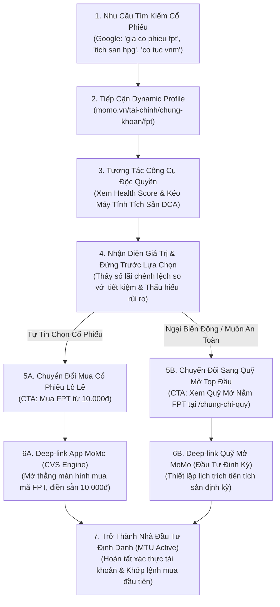
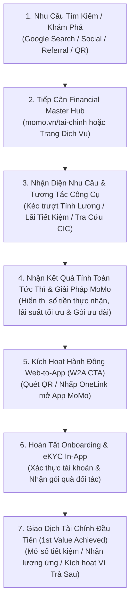

# BRD: Financial Master Hub (momo.vn/tai-chinh)

> - **Dự án:** Financial Master Hub (Cổng Khám Phá & Ra Quyết Định Dịch Vụ Tài Chính MoMo)
> - **Khối phụ trách:** Growth Platform Division x Financial Services Division (CreditTech)
> - **Đội ngũ triển khai:** Web Development Team, Backend Team, SEO & Content Team, Product Growth Team
> - **Phiên bản:** v3.1 - Tháng 8/2026
> - **Trạng thái:** Aligned & Production Ready (`momo.vn/tai-chinh`)

---

**MoMo Financial Master Hub:** Rút ngắn hành trình từ nhu cầu tìm kiếm đến quyết định sử dụng dịch vụ tài chính MoMo (Pre-install Discovery & Decision Gateway).

---

## 1. PHÁT BIỂU VẤN ĐỀ (PROBLEM STATEMENT)

1. **Người dùng không nhận diện được hệ sinh thái tài chính toàn diện của MoMo để giải quyết JTBD (Jobs-To-Be-Done):** Trước đây, các sản phẩm tài chính trên Web tồn tại dưới dạng 11 trang đích độc lập nằm rời rạc (`/tiet-kiem-online`, `/vay-nhanh`, `/vi-tra-sau`, `/the-tin-dung`...). Khi người dùng có nhu cầu tài chính tổng thể (như tính toán thu nhập ròng, tìm kênh tiết kiệm sinh lời, kiểm tra lịch sử tín dụng CIC để vay vốn, hay quản lý thuế), họ chỉ tiếp cận một trang đơn lẻ từ Google rồi rời đi, hoàn toàn không biết MoMo có đầy đủ giải pháp từ Tín Dụng, Tiết Kiệm, Đầu Tư đến Ngân Hàng.
2. **Khoảng cách lớn giữa Tra cứu thông tin và Kích hoạt giao dịch đầu tiên (Time-to-First-Value):** Người dùng bị đẩy quá nhanh sang bước tải app hoặc yêu cầu định danh (eKYC) phức tạp trong khi chưa được trải nghiệm giá trị cụ thể của sản phẩm trên Web, dẫn đến tỷ lệ bỏ cuộc (drop-off) cao sau khi cài đặt.
3. **Chưa khai thác tối đa dung lượng tìm kiếm toàn ngành 101.89 triệu lượt/tháng:** Nhu cầu tìm kiếm tài chính tại Việt Nam rất lớn nhưng phân tán. Thiếu một Cổng Trung Tâm (Master Hub) có năng lực kết nối chuyên đề để bao phủ các từ khóa có lượng truy cập cao và chuyển đổi thành người dùng định danh.

---

## 2. GIẢ THUYẾT GIẢI PHÁP (SOLUTION HYPOTHESIS)

Nếu MoMo xây dựng **Financial Master Hub (`momo.vn/tai-chinh`)** làm cổng khám phá tập trung, bao phủ toàn diện 4 trụ cột dịch vụ tài chính (*Tín Dụng & Vay, Tích Lũy & Lãi Suất, Đầu Tư & Tích Sản, Chi Tiêu & Dòng Tiền*), đồng thời cung cấp **Bộ Công Cụ Tiện Ích Tương Tác Trực Tiếp (Interactive Tools & Calculators)** không cần đăng nhập cho từng bài toán thực tế:
* Người dùng sẽ tự nhận diện nhu cầu và trải nghiệm giá trị tính toán ngay lập tức trên Web (Instant Value).
* Hiểu rõ sản phẩm tài chính của MoMo giải quyết bài toán của mình như thế nào trước khi tải app.
* Tạo động lực rõ ràng để mở App, hoàn tất eKYC và kích hoạt Giao dịch Tài chính Đầu tiên (1st Financial Transaction).

---

## 3. MỤC TIÊU KINH DOANH & BÁO CÁO HIỆU SUẤT TỪ ĐẦU NĂM ĐẾN GIỜ (BUSINESS OBJECTIVES & YTD PERFORMANCE AUDIT)

### 3.1 Dual North Star Metrics & Web Platform Metric Tree

<table style="width:100%; border-collapse:collapse; border:1.5px solid #64748b; margin:1em 0; font-size:0.9em;">
  <thead>
    <tr style="background-color:#f1f5f9;">
      <th style="border:1.5px solid #64748b; padding:8px 12px; text-align:left; font-weight:700;">Platform Layer</th>
      <th style="border:1.5px solid #64748b; padding:8px 12px; text-align:left; font-weight:700;">North Star Metric</th>
      <th style="border:1.5px solid #64748b; padding:8px 12px; text-align:left; font-weight:700;">Định Nghĩa Chỉ Số</th>
      <th style="border:1.5px solid #64748b; padding:8px 12px; text-align:left; font-weight:700;">Target H2/2026</th>
      <th style="border:1.5px solid #64748b; padding:8px 12px; text-align:left; font-weight:700;">Vai Trò Chiến Lược</th>
    </tr>
  </thead>
  <tbody>
    <tr>
      <td style="border:1px solid #94a3b8; padding:8px 12px; text-align:left;"><strong>Web Platform</strong> <em>(Primary Goal)</em></td>
      <td style="border:1px solid #94a3b8; padding:8px 12px; text-align:left;"><strong>Total Organic Financial Traffic</strong></td>
      <td style="border:1px solid #94a3b8; padding:8px 12px; text-align:left;">Tổng số lượt truy cập tự nhiên từ Google Search và AI Search vào Financial Hub và các trang tài chính MoMo mỗi tháng.</td>
      <td style="border:1px solid #94a3b8; padding:8px 12px; text-align:left;"><strong>>800.000 Visits/H2</strong> <em>(Tăng trưởng +100% vs H1)</em></td>
      <td style="border:1px solid #94a3b8; padding:8px 12px; text-align:left;">Mục tiêu cốt lõi: Thu hút trọn vẹn nhu cầu tìm kiếm tài chính ngoài Open Web, mở rộng tệp Acquisition người dùng mới.</td>
    </tr>
    <tr style="background-color:#f8fafc;">
      <td style="border:1px solid #94a3b8; padding:8px 12px; text-align:left;"><strong>In-App Activation</strong> <em>(Secondary Layer)</em></td>
      <td style="border:1px solid #94a3b8; padding:8px 12px; text-align:left;"><strong>Total Financial Activations (W2A)</strong></td>
      <td style="border:1px solid #94a3b8; padding:8px 12px; text-align:left;">Tổng số hồ sơ vay được duyệt, tài khoản Ví Trả Sau kích hoạt, sổ tiết kiệm mở mới và tài khoản chứng chỉ quỹ đăng ký thành công qua luồng Web-to-App.</td>
      <td style="border:1px solid #94a3b8; padding:8px 12px; text-align:left;"><strong>>50.000 Activations/H2</strong></td>
      <td style="border:1px solid #94a3b8; padding:8px 12px; text-align:left;">Đo lường hiệu quả chuyển đổi kinh doanh thực chất cho Khối Dịch Vụ Tài Chính (CreditTech & Wealth).</td>
    </tr>
  </tbody>
</table>

### 3.2 Báo Cáo Hiệu Suất Lưu Lượng Chuỗi 2026 (Bóc Tách Non-Paid vs. Paid Chuẩn Master Sheet & GA4)

Căn cứ dữ liệu đối soát chuẩn hóa từ Master Performance Sheet (sheet  trong  và Google Sheets SSOT tab ) kết hợp dữ liệu kênh chi tiết từ Google Analytics 4 (Property 270743103, đồng bộ tại file SSOT [financial_monthly_pv_ga4.json](file:///Users/hienhv/HienHv/Klaus/Hienho_MoMo-Base/05_HUBS/financial/data/financial_monthly_pv_ga4.json)), toàn bộ lưu lượng của Financial Hub từ Tháng 1/2026 đến nay được ghi nhận chuẩn mực theo định nghĩa dịch vụ tài chính thống nhất toàn chuỗi, bao gồm cổng Master Hub , 18 use cases tài chính và toàn bộ bài viết, cẩm nang nghiệp vụ tài chính vệ tinh:

<table style="width:100%; border-collapse:collapse; border:1.5px solid #64748b; margin:1em 0; font-size:0.88em;">
  <thead>
    <tr style="background-color:#f1f5f9;">
      <th style="border:1.5px solid #64748b; padding:6px 10px; text-align:left; font-weight:700;">Kỳ Báo Cáo</th>
      <th style="border:1.5px solid #64748b; padding:6px 10px; text-align:right; font-weight:700;">Tổng Traffic (PV)</th>
      <th style="border:1.5px solid #64748b; padding:6px 10px; text-align:center; font-weight:700;">Tăng Trưởng MoM</th>
      <th style="border:1.5px solid #64748b; padding:6px 10px; text-align:right; font-weight:700;">Non-Paid (PV)</th>
      <th style="border:1.5px solid #64748b; padding:6px 10px; text-align:right; font-weight:700;">Trong Đó: Organic</th>
      <th style="border:1.5px solid #64748b; padding:6px 10px; text-align:right; font-weight:700;">Direct / Ref / Khác</th>
      <th style="border:1.5px solid #64748b; padding:6px 10px; text-align:center; font-weight:700;">Tỷ Trọng Non-Paid</th>
      <th style="border:1.5px solid #64748b; padding:6px 10px; text-align:right; font-weight:700;">Paid Ads (PV)</th>
      <th style="border:1.5px solid #64748b; padding:6px 10px; text-align:center; font-weight:700;">Tỷ Trọng Paid</th>
      <th style="border:1.5px solid #64748b; padding:6px 10px; text-align:right; font-weight:700;">Target Tháng</th>
      <th style="border:1.5px solid #64748b; padding:6px 10px; text-align:center; font-weight:700;">Tỷ Lệ Đạt</th>
    </tr>
  </thead>
  <tbody>
    <tr>
      <td style="border:1px solid #94a3b8; padding:6px 10px; text-align:left;">Tháng 1/2026</td>
      <td style="border:1px solid #94a3b8; padding:6px 10px; text-align:right;">330.429</td>
      <td style="border:1px solid #94a3b8; padding:6px 10px; text-align:center;">-</td>
      <td style="border:1px solid #94a3b8; padding:6px 10px; text-align:right;">93.660</td>
      <td style="border:1px solid #94a3b8; padding:6px 10px; text-align:right;">74.747</td>
      <td style="border:1px solid #94a3b8; padding:6px 10px; text-align:right;">18.913</td>
      <td style="border:1px solid #94a3b8; padding:6px 10px; text-align:center;">28.3%</td>
      <td style="border:1px solid #94a3b8; padding:6px 10px; text-align:right;">236.769</td>
      <td style="border:1px solid #94a3b8; padding:6px 10px; text-align:center; color:#be123c; font-weight:600;">71.7%</td>
      <td style="border:1px solid #94a3b8; padding:6px 10px; text-align:right;">-</td>
      <td style="border:1px solid #94a3b8; padding:6px 10px; text-align:center;">-</td>
    </tr>
    <tr style="background-color:#f8fafc;">
      <td style="border:1px solid #94a3b8; padding:6px 10px; text-align:left;">Tháng 2/2026</td>
      <td style="border:1px solid #94a3b8; padding:6px 10px; text-align:right;">379.594</td>
      <td style="border:1px solid #94a3b8; padding:6px 10px; text-align:center;">+14.9%</td>
      <td style="border:1px solid #94a3b8; padding:6px 10px; text-align:right;">80.615</td>
      <td style="border:1px solid #94a3b8; padding:6px 10px; text-align:right;">57.163</td>
      <td style="border:1px solid #94a3b8; padding:6px 10px; text-align:right;">23.452</td>
      <td style="border:1px solid #94a3b8; padding:6px 10px; text-align:center;">21.2%</td>
      <td style="border:1px solid #94a3b8; padding:6px 10px; text-align:right;">298.979</td>
      <td style="border:1px solid #94a3b8; padding:6px 10px; text-align:center; color:#be123c; font-weight:600;">78.8%</td>
      <td style="border:1px solid #94a3b8; padding:6px 10px; text-align:right;">-</td>
      <td style="border:1px solid #94a3b8; padding:6px 10px; text-align:center;">-</td>
    </tr>
    <tr>
      <td style="border:1px solid #94a3b8; padding:6px 10px; text-align:left;">Tháng 3/2026</td>
      <td style="border:1px solid #94a3b8; padding:6px 10px; text-align:right;">233.227</td>
      <td style="border:1px solid #94a3b8; padding:6px 10px; text-align:center;">-38.6%</td>
      <td style="border:1px solid #94a3b8; padding:6px 10px; text-align:right;">86.668</td>
      <td style="border:1px solid #94a3b8; padding:6px 10px; text-align:right;">69.272</td>
      <td style="border:1px solid #94a3b8; padding:6px 10px; text-align:right;">17.396</td>
      <td style="border:1px solid #94a3b8; padding:6px 10px; text-align:center;">37.2%</td>
      <td style="border:1px solid #94a3b8; padding:6px 10px; text-align:right;">146.559</td>
      <td style="border:1px solid #94a3b8; padding:6px 10px; text-align:center; color:#be123c; font-weight:600;">62.8%</td>
      <td style="border:1px solid #94a3b8; padding:6px 10px; text-align:right;">-</td>
      <td style="border:1px solid #94a3b8; padding:6px 10px; text-align:center;">-</td>
    </tr>
    <tr style="background-color:#f8fafc;">
      <td style="border:1px solid #94a3b8; padding:6px 10px; text-align:left;">Tháng 4/2026</td>
      <td style="border:1px solid #94a3b8; padding:6px 10px; text-align:right;">202.714</td>
      <td style="border:1px solid #94a3b8; padding:6px 10px; text-align:center;">-13.1%</td>
      <td style="border:1px solid #94a3b8; padding:6px 10px; text-align:right;">80.023</td>
      <td style="border:1px solid #94a3b8; padding:6px 10px; text-align:right;">53.930</td>
      <td style="border:1px solid #94a3b8; padding:6px 10px; text-align:right;">26.093</td>
      <td style="border:1px solid #94a3b8; padding:6px 10px; text-align:center;">39.5%</td>
      <td style="border:1px solid #94a3b8; padding:6px 10px; text-align:right;">122.691</td>
      <td style="border:1px solid #94a3b8; padding:6px 10px; text-align:center;">60.5%</td>
      <td style="border:1px solid #94a3b8; padding:6px 10px; text-align:right;">-</td>
      <td style="border:1px solid #94a3b8; padding:6px 10px; text-align:center;">-</td>
    </tr>
    <tr>
      <td style="border:1px solid #94a3b8; padding:6px 10px; text-align:left;">Tháng 5/2026</td>
      <td style="border:1px solid #94a3b8; padding:6px 10px; text-align:right;">164.829</td>
      <td style="border:1px solid #94a3b8; padding:6px 10px; text-align:center;">-18.7%</td>
      <td style="border:1px solid #94a3b8; padding:6px 10px; text-align:right;">72.043</td>
      <td style="border:1px solid #94a3b8; padding:6px 10px; text-align:right;">59.966</td>
      <td style="border:1px solid #94a3b8; padding:6px 10px; text-align:right;">12.077</td>
      <td style="border:1px solid #94a3b8; padding:6px 10px; text-align:center;">43.7%</td>
      <td style="border:1px solid #94a3b8; padding:6px 10px; text-align:right;">92.786</td>
      <td style="border:1px solid #94a3b8; padding:6px 10px; text-align:center;">56.3%</td>
      <td style="border:1px solid #94a3b8; padding:6px 10px; text-align:right;">-</td>
      <td style="border:1px solid #94a3b8; padding:6px 10px; text-align:center;">-</td>
    </tr>
    <tr style="background-color:#f8fafc;">
      <td style="border:1px solid #94a3b8; padding:6px 10px; text-align:left;">Tháng 6/2026</td>
      <td style="border:1px solid #94a3b8; padding:6px 10px; text-align:right;">140.683</td>
      <td style="border:1px solid #94a3b8; padding:6px 10px; text-align:center;">-14.6%</td>
      <td style="border:1px solid #94a3b8; padding:6px 10px; text-align:right;">70.456</td>
      <td style="border:1px solid #94a3b8; padding:6px 10px; text-align:right;">58.716</td>
      <td style="border:1px solid #94a3b8; padding:6px 10px; text-align:right;">11.740</td>
      <td style="border:1px solid #94a3b8; padding:6px 10px; text-align:center;">50.1%</td>
      <td style="border:1px solid #94a3b8; padding:6px 10px; text-align:right;">70.227</td>
      <td style="border:1px solid #94a3b8; padding:6px 10px; text-align:center;">49.9%</td>
      <td style="border:1px solid #94a3b8; padding:6px 10px; text-align:right;">-</td>
      <td style="border:1px solid #94a3b8; padding:6px 10px; text-align:center;">-</td>
    </tr>
    <tr>
      <td style="border:1px solid #94a3b8; padding:6px 10px; text-align:left;">Tháng 7/2026</td>
      <td style="border:1px solid #94a3b8; padding:6px 10px; text-align:right;">142.660</td>
      <td style="border:1px solid #94a3b8; padding:6px 10px; text-align:center;">+1.4%</td>
      <td style="border:1px solid #94a3b8; padding:6px 10px; text-align:right;">107.426</td>
      <td style="border:1px solid #94a3b8; padding:6px 10px; text-align:right;">77.628</td>
      <td style="border:1px solid #94a3b8; padding:6px 10px; text-align:right;">29.798</td>
      <td style="border:1px solid #94a3b8; padding:6px 10px; text-align:center; color:#15803d; font-weight:700;">75.3%</td>
      <td style="border:1px solid #94a3b8; padding:6px 10px; text-align:right;">35.234</td>
      <td style="border:1px solid #94a3b8; padding:6px 10px; text-align:center;">24.7%</td>
      <td style="border:1px solid #94a3b8; padding:6px 10px; text-align:right;">-</td>
      <td style="border:1px solid #94a3b8; padding:6px 10px; text-align:center;">-</td>
    </tr>
    <tr style="background-color:#f8fafc;">
      <td style="border:1px solid #94a3b8; padding:6px 10px; text-align:left;">Tháng 8/2026</td>
      <td style="border:1px solid #94a3b8; padding:6px 10px; text-align:right;">250.620</td>
      <td style="border:1px solid #94a3b8; padding:6px 10px; text-align:center;">+75.7%</td>
      <td style="border:1px solid #94a3b8; padding:6px 10px; text-align:right;">149.462</td>
      <td style="border:1px solid #94a3b8; padding:6px 10px; text-align:right;">70.285</td>
      <td style="border:1px solid #94a3b8; padding:6px 10px; text-align:right;">79.177</td>
      <td style="border:1px solid #94a3b8; padding:6px 10px; text-align:center; color:#15803d; font-weight:700;">59.6%</td>
      <td style="border:1px solid #94a3b8; padding:6px 10px; text-align:right;">101.158</td>
      <td style="border:1px solid #94a3b8; padding:6px 10px; text-align:center;">40.4%</td>
      <td style="border:1px solid #94a3b8; padding:6px 10px; text-align:right;">250.000</td>
      <td style="border:1px solid #94a3b8; padding:6px 10px; text-align:center; color:#15803d; font-weight:600;">100.2%</td>
    </tr>
    <tr>
      <td style="border:1px solid #94a3b8; padding:6px 10px; text-align:left;">Tháng 9/2026</td>
      <td style="border:1px solid #94a3b8; padding:6px 10px; text-align:right;">254.281</td>
      <td style="border:1px solid #94a3b8; padding:6px 10px; text-align:center;">+1.5%</td>
      <td style="border:1px solid #94a3b8; padding:6px 10px; text-align:right;">156.783</td>
      <td style="border:1px solid #94a3b8; padding:6px 10px; text-align:right;">77.057</td>
      <td style="border:1px solid #94a3b8; padding:6px 10px; text-align:right;">79.726</td>
      <td style="border:1px solid #94a3b8; padding:6px 10px; text-align:center; color:#15803d; font-weight:700;">61.7%</td>
      <td style="border:1px solid #94a3b8; padding:6px 10px; text-align:right;">97.498</td>
      <td style="border:1px solid #94a3b8; padding:6px 10px; text-align:center;">38.3%</td>
      <td style="border:1px solid #94a3b8; padding:6px 10px; text-align:right;">250.000</td>
      <td style="border:1px solid #94a3b8; padding:6px 10px; text-align:center; color:#15803d; font-weight:600;">101.7%</td>
    </tr>
    <tr style="background-color:#f0fdf4;">
      <td style="border:1px solid #94a3b8; padding:6px 10px; text-align:left;">Tháng 10/2026</td>
      <td style="border:1px solid #94a3b8; padding:6px 10px; text-align:right; font-weight:700;">260.381</td>
      <td style="border:1px solid #94a3b8; padding:6px 10px; text-align:center; color:#15803d; font-weight:700;">+2.4%</td>
      <td style="border:1px solid #94a3b8; padding:6px 10px; text-align:right; font-weight:700; color:#15803d;">172.857</td>
      <td style="border:1px solid #94a3b8; padding:6px 10px; text-align:right; font-weight:700;">132.891</td>
      <td style="border:1px solid #94a3b8; padding:6px 10px; text-align:right;">39.966</td>
      <td style="border:1px solid #94a3b8; padding:6px 10px; text-align:center; color:#15803d; font-weight:700;">66.4%</td>
      <td style="border:1px solid #94a3b8; padding:6px 10px; text-align:right;">87.524</td>
      <td style="border:1px solid #94a3b8; padding:6px 10px; text-align:center;">33.6%</td>
      <td style="border:1px solid #94a3b8; padding:6px 10px; text-align:right;">450.000</td>
      <td style="border:1px solid #94a3b8; padding:6px 10px; text-align:center; font-weight:600;">57.9%</td>
    </tr>
    <tr style="background-color:#fefce8;">
      <td style="border:1px solid #94a3b8; padding:6px 10px; text-align:left;">Tháng 11/2026 (MTD 9N)</td>
      <td style="border:1px solid #94a3b8; padding:6px 10px; text-align:right;">41.504</td>
      <td style="border:1px solid #94a3b8; padding:6px 10px; text-align:center;">-</td>
      <td style="border:1px solid #94a3b8; padding:6px 10px; text-align:right;">34.927</td>
      <td style="border:1px solid #94a3b8; padding:6px 10px; text-align:right;">25.408</td>
      <td style="border:1px solid #94a3b8; padding:6px 10px; text-align:right;">9.519</td>
      <td style="border:1px solid #94a3b8; padding:6px 10px; text-align:center; color:#15803d; font-weight:700;">84.2%</td>
      <td style="border:1px solid #94a3b8; padding:6px 10px; text-align:right;">6.577</td>
      <td style="border:1px solid #94a3b8; padding:6px 10px; text-align:center;">15.8%</td>
      <td style="border:1px solid #94a3b8; padding:6px 10px; text-align:right;">700.000</td>
      <td style="border:1px solid #94a3b8; padding:6px 10px; text-align:center;">5.9%</td>
    </tr>
    <tr style="background-color:#e2e8f0;">
      <td style="border:1.5px solid #64748b; padding:8px 10px; text-align:left;"><strong>Lũy Kế 10 Tháng (YTD T1-T10)</strong></td>
      <td style="border:1.5px solid #64748b; padding:8px 10px; text-align:right;"><strong>2.359.418</strong></td>
      <td style="border:1.5px solid #64748b; padding:8px 10px; text-align:center;"><strong>-</strong></td>
      <td style="border:1.5px solid #64748b; padding:8px 10px; text-align:right;"><strong>1.069.993</strong></td>
      <td style="border:1.5px solid #64748b; padding:8px 10px; text-align:right;"><strong>731.655</strong></td>
      <td style="border:1.5px solid #64748b; padding:8px 10px; text-align:right;"><strong>338.338</strong></td>
      <td style="border:1.5px solid #64748b; padding:8px 10px; text-align:center;"><strong>45.3%</strong></td>
      <td style="border:1.5px solid #64748b; padding:8px 10px; text-align:right;"><strong>1.289.425</strong></td>
      <td style="border:1.5px solid #64748b; padding:8px 10px; text-align:center;"><strong>54.7%</strong></td>
      <td style="border:1.5px solid #64748b; padding:8px 10px; text-align:right;"><strong>950.000</strong></td>
      <td style="border:1.5px solid #64748b; padding:8px 10px; text-align:center; color:#15803d; font-weight:700;"><strong>248.4%</strong></td>
    </tr>
  </tbody>
</table>

*Ghi chú nguồn dữ liệu:* Số liệu đối soát chuẩn hóa 100% với Master Performance Sheet ( sheet , Google Sheets SSOT tab ) và Bảng 3.3 bóc tách chi tiết. Số liệu Tháng 11/2026 hiển thị theo lũy kế 9 ngày sạch (01-09/11/2026, loại trừ dữ liệu nhiễu vòng lặp GTM ngày 10-11/11); số ghi nhận thô 11 ngày trên Master Sheet là 65.172 PV (Paid: 21.464, Non-Paid: 43.708). Định nghĩa kênh trả phí: Paid = Paid Search + Paid Social + Paid Other + Cross-network. Toàn bộ các tháng đều đảm bảo tính toàn vẹn: Paid + Non-Paid = Tổng Traffic và Tổng các kênh = Tổng Traffic.

### 3.3 Bảng Phân Bổ Lưu Lượng Theo Cụm Sản Phẩm & Trụ Cột Tài Chính (H2/2026)

Bảng đối soát cơ cấu lưu lượng 6 tháng liên tiếp (Tháng 5 đến Tháng 10/2026) phản ánh sự hình thành và trỗi dậy của Cổng Financial Master Hub:

<table style="width:100%; border-collapse:collapse; border:1.5px solid #64748b; margin:1em 0; font-size:0.88em;">
  <thead>
    <tr style="background-color:#f1f5f9;">
      <th style="border:1.5px solid #64748b; padding:6px 10px; text-align:left; font-weight:700;">Cụm Dịch Vụ / Use Case</th>
      <th style="border:1.5px solid #64748b; padding:6px 10px; text-align:right; font-weight:700;">T5/2026</th>
      <th style="border:1.5px solid #64748b; padding:6px 10px; text-align:right; font-weight:700;">T6/2026</th>
      <th style="border:1.5px solid #64748b; padding:6px 10px; text-align:right; font-weight:700;">T7/2026</th>
      <th style="border:1.5px solid #64748b; padding:6px 10px; text-align:right; font-weight:700;">T8/2026</th>
      <th style="border:1.5px solid #64748b; padding:6px 10px; text-align:right; font-weight:700;">T9/2026</th>
      <th style="border:1.5px solid #64748b; padding:6px 10px; text-align:right; font-weight:700;">T10/2026</th>
      <th style="border:1.5px solid #64748b; padding:6px 10px; text-align:center; font-weight:700;">Tăng Trưởng MoM</th>
      <th style="border:1.5px solid #64748b; padding:6px 10px; text-align:center; font-weight:700;">Tỷ Trọng T10</th>
      <th style="border:1.5px solid #64748b; padding:6px 10px; text-align:left; font-weight:700;">Kênh Chủ Lực</th>
    </tr>
  </thead>
  <tbody>
    <tr>
      <td style="border:1px solid #94a3b8; padding:6px 10px; text-align:left;"><strong>Điểm Tín Dụng (CIC)</strong></td>
      <td style="border:1px solid #94a3b8; padding:6px 10px; text-align:right;">12.059</td>
      <td style="border:1px solid #94a3b8; padding:6px 10px; text-align:right;">12.097</td>
      <td style="border:1px solid #94a3b8; padding:6px 10px; text-align:right;">34.678</td>
      <td style="border:1px solid #94a3b8; padding:6px 10px; text-align:right;">91.484</td>
      <td style="border:1px solid #94a3b8; padding:6px 10px; text-align:right;">79.092</td>
      <td style="border:1px solid #94a3b8; padding:6px 10px; text-align:right; font-weight:700;">79.987</td>
      <td style="border:1px solid #94a3b8; padding:6px 10px; text-align:center;">+1.1%</td>
      <td style="border:1px solid #94a3b8; padding:6px 10px; text-align:center;">30.7%</td>
      <td style="border:1px solid #94a3b8; padding:6px 10px; text-align:left;">Paid (70.6K) & Organic (8.0K)</td>
    </tr>
    <tr style="background-color:#f8fafc;">
      <td style="border:1px solid #94a3b8; padding:6px 10px; text-align:left;"><strong>Vay Nhanh</strong></td>
      <td style="border:1px solid #94a3b8; padding:6px 10px; text-align:right;">127.284</td>
      <td style="border:1px solid #94a3b8; padding:6px 10px; text-align:right;">76.228</td>
      <td style="border:1px solid #94a3b8; padding:6px 10px; text-align:right;">65.899</td>
      <td style="border:1px solid #94a3b8; padding:6px 10px; text-align:right;">112.353</td>
      <td style="border:1px solid #94a3b8; padding:6px 10px; text-align:right;">109.955</td>
      <td style="border:1px solid #94a3b8; padding:6px 10px; text-align:right; font-weight:700;">64.210</td>
      <td style="border:1px solid #94a3b8; padding:6px 10px; text-align:center; color:#be123c;">-41.6%</td>
      <td style="border:1px solid #94a3b8; padding:6px 10px; text-align:center;">24.7%</td>
      <td style="border:1px solid #94a3b8; padding:6px 10px; text-align:left;">Organic (49.0K) & Referral (9.6K)</td>
    </tr>
    <tr>
      <td style="border:1px solid #94a3b8; padding:6px 10px; text-align:left;"><strong>Ví Trả Sau</strong></td>
      <td style="border:1px solid #94a3b8; padding:6px 10px; text-align:right;">10.440</td>
      <td style="border:1px solid #94a3b8; padding:6px 10px; text-align:right;">38.053</td>
      <td style="border:1px solid #94a3b8; padding:6px 10px; text-align:right;">23.582</td>
      <td style="border:1px solid #94a3b8; padding:6px 10px; text-align:right;">20.633</td>
      <td style="border:1px solid #94a3b8; padding:6px 10px; text-align:right;">42.174</td>
      <td style="border:1px solid #94a3b8; padding:6px 10px; text-align:right; font-weight:700; color:#15803d;">59.537</td>
      <td style="border:1px solid #94a3b8; padding:6px 10px; text-align:center; color:#15803d; font-weight:700;">+41.2%</td>
      <td style="border:1px solid #94a3b8; padding:6px 10px; text-align:center;">22.9%</td>
      <td style="border:1px solid #94a3b8; padding:6px 10px; text-align:left;">Organic (43.8K, +73.3% MoM)</td>
    </tr>
    <tr style="background-color:#f0fdf4;">
      <td style="border:1px solid #94a3b8; padding:6px 10px; text-align:left;"><strong>Tài Chính (Master Hub)</strong></td>
      <td style="border:1px solid #94a3b8; padding:6px 10px; text-align:right;">5.430</td>
      <td style="border:1px solid #94a3b8; padding:6px 10px; text-align:right;">5.568</td>
      <td style="border:1px solid #94a3b8; padding:6px 10px; text-align:right;">6.701</td>
      <td style="border:1px solid #94a3b8; padding:6px 10px; text-align:right;">9.107</td>
      <td style="border:1px solid #94a3b8; padding:6px 10px; text-align:right;">8.025</td>
      <td style="border:1px solid #94a3b8; padding:6px 10px; text-align:right; font-weight:700; color:#15803d;">39.872</td>
      <td style="border:1px solid #94a3b8; padding:6px 10px; text-align:center; color:#15803d; font-weight:700;">+396.8%</td>
      <td style="border:1px solid #94a3b8; padding:6px 10px; text-align:center;">15.3%</td>
      <td style="border:1px solid #94a3b8; padding:6px 10px; text-align:left;">Organic (19.2K) & Paid (9.2K)</td>
    </tr>
    <tr>
      <td style="border:1px solid #94a3b8; padding:6px 10px; text-align:left;"><strong>Mở Thẻ Tín Dụng</strong></td>
      <td style="border:1px solid #94a3b8; padding:6px 10px; text-align:right;">1.637</td>
      <td style="border:1px solid #94a3b8; padding:6px 10px; text-align:right;">1.429</td>
      <td style="border:1px solid #94a3b8; padding:6px 10px; text-align:right;">1.646</td>
      <td style="border:1px solid #94a3b8; padding:6px 10px; text-align:right;">1.432</td>
      <td style="border:1px solid #94a3b8; padding:6px 10px; text-align:right;">1.464</td>
      <td style="border:1px solid #94a3b8; padding:6px 10px; text-align:right;">3.397</td>
      <td style="border:1px solid #94a3b8; padding:6px 10px; text-align:center;">+132.0%</td>
      <td style="border:1px solid #94a3b8; padding:6px 10px; text-align:center;">1.3%</td>
      <td style="border:1px solid #94a3b8; padding:6px 10px; text-align:left;">Organic (2.6K) & Paid (461)</td>
    </tr>
    <tr style="background-color:#f8fafc;">
      <td style="border:1px solid #94a3b8; padding:6px 10px; text-align:left;"><strong>Túi Thần Tài / Túi Sinh Lời</strong></td>
      <td style="border:1px solid #94a3b8; padding:6px 10px; text-align:right;">1.131</td>
      <td style="border:1px solid #94a3b8; padding:6px 10px; text-align:right;">1.029</td>
      <td style="border:1px solid #94a3b8; padding:6px 10px; text-align:right;">2.339</td>
      <td style="border:1px solid #94a3b8; padding:6px 10px; text-align:right;">2.332</td>
      <td style="border:1px solid #94a3b8; padding:6px 10px; text-align:right;">2.077</td>
      <td style="border:1px solid #94a3b8; padding:6px 10px; text-align:right;">2.135</td>
      <td style="border:1px solid #94a3b8; padding:6px 10px; text-align:center;">+2.8%</td>
      <td style="border:1px solid #94a3b8; padding:6px 10px; text-align:center;">0.8%</td>
      <td style="border:1px solid #94a3b8; padding:6px 10px; text-align:left;">Organic (1.8K) & Direct (179)</td>
    </tr>
    <tr>
      <td style="border:1px solid #94a3b8; padding:6px 10px; text-align:left;"><strong>Chứng Khoán</strong></td>
      <td style="border:1px solid #94a3b8; padding:6px 10px; text-align:right;">693</td>
      <td style="border:1px solid #94a3b8; padding:6px 10px; text-align:right;">672</td>
      <td style="border:1px solid #94a3b8; padding:6px 10px; text-align:right;">705</td>
      <td style="border:1px solid #94a3b8; padding:6px 10px; text-align:right;">622</td>
      <td style="border:1px solid #94a3b8; padding:6px 10px; text-align:right;">470</td>
      <td style="border:1px solid #94a3b8; padding:6px 10px; text-align:right;">1.927</td>
      <td style="border:1px solid #94a3b8; padding:6px 10px; text-align:center;">+310.0%</td>
      <td style="border:1px solid #94a3b8; padding:6px 10px; text-align:center;">0.7%</td>
      <td style="border:1px solid #94a3b8; padding:6px 10px; text-align:left;">Organic (1.4K) & Paid (231)</td>
    </tr>
    <tr style="background-color:#f8fafc;">
      <td style="border:1px solid #94a3b8; padding:6px 10px; text-align:left;"><strong>Tiết Kiệm Online</strong></td>
      <td style="border:1px solid #94a3b8; padding:6px 10px; text-align:right;">431</td>
      <td style="border:1px solid #94a3b8; padding:6px 10px; text-align:right;">408</td>
      <td style="border:1px solid #94a3b8; padding:6px 10px; text-align:right;">550</td>
      <td style="border:1px solid #94a3b8; padding:6px 10px; text-align:right;">520</td>
      <td style="border:1px solid #94a3b8; padding:6px 10px; text-align:right;">481</td>
      <td style="border:1px solid #94a3b8; padding:6px 10px; text-align:right;">1.579</td>
      <td style="border:1px solid #94a3b8; padding:6px 10px; text-align:center;">+228.3%</td>
      <td style="border:1px solid #94a3b8; padding:6px 10px; text-align:center;">0.6%</td>
      <td style="border:1px solid #94a3b8; padding:6px 10px; text-align:left;">Organic (1.0K) & Paid (268)</td>
    </tr>
    <tr>
      <td style="border:1px solid #94a3b8; padding:6px 10px; text-align:left;"><strong>Tỷ Giá (FX Rates)</strong></td>
      <td style="border:1px solid #94a3b8; padding:6px 10px; text-align:right;">0</td>
      <td style="border:1px solid #94a3b8; padding:6px 10px; text-align:right;">0</td>
      <td style="border:1px solid #94a3b8; padding:6px 10px; text-align:right;">0</td>
      <td style="border:1px solid #94a3b8; padding:6px 10px; text-align:right;">0</td>
      <td style="border:1px solid #94a3b8; padding:6px 10px; text-align:right;">101</td>
      <td style="border:1px solid #94a3b8; padding:6px 10px; text-align:right;">963</td>
      <td style="border:1px solid #94a3b8; padding:6px 10px; text-align:center;">+853.5%</td>
      <td style="border:1px solid #94a3b8; padding:6px 10px; text-align:center;">0.4%</td>
      <td style="border:1px solid #94a3b8; padding:6px 10px; text-align:left;">Organic (856 PV - Mới go-live)</td>
    </tr>
    <tr style="background-color:#f8fafc;">
      <td style="border:1px solid #94a3b8; padding:6px 10px; text-align:left;"><strong>Lãi Suất (Interest Rates)</strong></td>
      <td style="border:1px solid #94a3b8; padding:6px 10px; text-align:right;">0</td>
      <td style="border:1px solid #94a3b8; padding:6px 10px; text-align:right;">0</td>
      <td style="border:1px solid #94a3b8; padding:6px 10px; text-align:right;">0</td>
      <td style="border:1px solid #94a3b8; padding:6px 10px; text-align:right;">0</td>
      <td style="border:1px solid #94a3b8; padding:6px 10px; text-align:right;">77</td>
      <td style="border:1px solid #94a3b8; padding:6px 10px; text-align:right;">809</td>
      <td style="border:1px solid #94a3b8; padding:6px 10px; text-align:center;">+950.6%</td>
      <td style="border:1px solid #94a3b8; padding:6px 10px; text-align:center;">0.3%</td>
      <td style="border:1px solid #94a3b8; padding:6px 10px; text-align:left;">Organic (605 PV - Mới go-live)</td>
    </tr>
    <tr>
      <td style="border:1px solid #94a3b8; padding:6px 10px; text-align:left;"><strong>Nhóm Bổ Trợ (9 SP Còn Lại)</strong></td>
      <td style="border:1px solid #94a3b8; padding:6px 10px; text-align:right;">5.924</td>
      <td style="border:1px solid #94a3b8; padding:6px 10px; text-align:right;">1.191</td>
      <td style="border:1px solid #94a3b8; padding:6px 10px; text-align:right;">6.760</td>
      <td style="border:1px solid #94a3b8; padding:6px 10px; text-align:right;">12.237</td>
      <td style="border:1px solid #94a3b8; padding:6px 10px; text-align:right;">9.541</td>
      <td style="border:1px solid #94a3b8; padding:6px 10px; text-align:right;">6.775</td>
      <td style="border:1px solid #94a3b8; padding:6px 10px; text-align:center;">-29.0%</td>
      <td style="border:1px solid #94a3b8; padding:6px 10px; text-align:center;">2.6%</td>
      <td style="border:1px solid #94a3b8; padding:6px 10px; text-align:left;">Quỹ Nhóm, Nhận Tiền QT, Vàng...</td>
    </tr>
    <tr style="background-color:#e2e8f0;">
      <td style="border:1.5px solid #64748b; padding:8px 10px; text-align:left;"><strong>Tổng Cộng Toàn Hub</strong></td>
      <td style="border:1.5px solid #64748b; padding:8px 10px; text-align:right;"><strong>164.829</strong></td>
      <td style="border:1.5px solid #64748b; padding:8px 10px; text-align:right;"><strong>140.683</strong></td>
      <td style="border:1.5px solid #64748b; padding:8px 10px; text-align:right;"><strong>142.660</strong></td>
      <td style="border:1.5px solid #64748b; padding:8px 10px; text-align:right;"><strong>250.620</strong></td>
      <td style="border:1.5px solid #64748b; padding:8px 10px; text-align:right;"><strong>254.281</strong></td>
      <td style="border:1.5px solid #64748b; padding:8px 10px; text-align:right;"><strong>260.381</strong></td>
      <td style="border:1.5px solid #64748b; padding:8px 10px; text-align:center;"><strong>+2.4%</strong></td>
      <td style="border:1.5px solid #64748b; padding:8px 10px; text-align:center;"><strong>100.0%</strong></td>
      <td style="border:1.5px solid #64748b; padding:8px 10px; text-align:left;"><strong>Non-Paid 66.4% / Paid 33.6%</strong></td>
    </tr>
  </tbody>
</table>

### 3.4 Đánh Giá Chuyển Dịch Cơ Cấu & Chất Lượng Tăng Trưởng (Executive Growth Quality Audit)

1. **Chuyển dịch cơ cấu vững chắc từ phụ thuộc Paid sang tự lực Non-Paid:**
   * Trong giai đoạn Q1/2026 (Tháng 1 đến Tháng 4), các landing page tài chính hoạt động rời rạc phụ thuộc tới **72.8%** vào quảng cáo trả phí (Paid Ads bình quân ~189K PV/tháng).
   * Kể từ khi khởi động Financial Hub (Tháng 7/2026) và ra mắt Gateway tập trung (Tháng 8/2026), tỷ trọng Non-Paid đã tăng vọt từ 27.2% lên **66.4%** vào Tháng 10/2026 (172.857 PVs), trong đó lưu lượng tìm kiếm tự nhiên (Organic Search) đạt kỷ lục **132.891 PVs** (chiếm 51.0% toàn Hub, tăng hơn gấp đôi so với 59.966 PVs của Tháng 5).
2. **Sự trỗi dậy của Cổng Điều Hướng Master Hub và Bộ Công Cụ Tiện Ích (Utilities):**
   * Trang Cổng Trung Tâm (`/tai-chinh`) tăng trưởng đột biến từ 8.025 PVs (Tháng 9) lên **39.872 PVs** (Tháng 10, tăng **+396.8% MoM**), chứng minh năng lực điều hướng và sức hút của Mega Menu mới.
   * Các trang tiện ích mới go-live cuối Tháng 9 bắt đầu phát huy hiệu quả kéo traffic tự nhiên trong Tháng 10: Tỷ Giá đạt 963 PVs (+853.5%), Bảng Lãi Suất 40 Ngân Hàng đạt 809 PVs (+950.6%), Giá Vàng đạt 387 PVs (+555.9%).
3. **Phân tích rủi ro & Sức bền bù đắp lưu lượng (Lowlights & Buffer Analysis):**
   * *Điểm nghẽn:* Sản phẩm Vay Nhanh sụt giảm -41.6% lưu lượng (từ 109.955 PVs xuống 64.210 PVs) khi dừng các chiến dịch quảng cáo trả phí.
   * *Khả năng tự bù đắp:* Thay vì làm sụt giảm tổng lưu lượng của Hub, sự tăng trưởng mạnh mẽ của Ví Trả Sau (+41.2% lên 59.537 PVs, trong đó Organic tăng +73.3% đạt 43.795 PVs) cùng với sự bứt phá của Master Hub (+31.8K PVs) đã tự động hấp thu và bù đắp hoàn toàn lượng suy giảm của Vay Nhanh, giúp toàn Hub vẫn duy trì tăng trưởng dương **+2.4% MoM**.

### 3.5 Cột Mốc Tiến Độ Sản Phẩm & Lộ Trình Triển Khai Thực Tế

1. **Đã Go-Live Chính Thức (Production Live):**
   * **Bảng Lãi Suất 40 Ngân Hàng & Tool Tính Tiền Lãi (`/tai-chinh/lai-suat`):** Cung cấp bảng tra cứu lãi suất 40 bank toàn cảnh thị trường và công cụ tính lãi gửi tiết kiệm theo số tiền nhập vào, tự động gợi ý ngân hàng có lãi suất tối ưu nhất.
   * **Phân Bổ Lương 50/30/20 & Hũ Tài Chính (`/tai-chinh/phan-bo-luong`):** Chính thức Go-live phục vụ chia ngân sách tự động và kết nối Hũ Chi Tiêu in-app.
   * **Bộ 3 Cổng Tiện Ích Lương - Tỷ Giá - Vàng:** Tính Lương Gross-Net (`/tai-chinh/tinh-luong`), Tỷ Giá (`/tai-chinh/ty-gia`), Giá Vàng SJC/9999 (`/tai-chinh/gia-vang`).
   * **Cỗ Máy Content Engine Always-on Blog:** Cụm Blog Hub (`/tai-chinh/blog`) và bài viết chi tiết (`/tai-chinh/blog/[slug]`) chuẩn SEO E-E-A-T nuôi dưỡng traffic tự nhiên dài hạn.
2. **Đang Triển Khai Trong Sprint Tháng 11/2026 (Phase 3 Focus):**
   * **Cổng Chứng Chỉ Quỹ (`/tai-chinh/chung-chi-quy` - In Progress):** Go-live Phase 1 với dữ liệu danh mục tĩnh/bán tự động của 30 quỹ mở đối tác CVS, công cụ đầu tư định kỳ từ 10.000đ/ngày kết nối phễu mở tài khoản in-app.
   * **Tiện Ích Thuế TNCN (`/tai-chinh/thue-thu-nhap-ca-nhan` - Planned):** Tool tính thuế TNCN lũy tiến 7 bậc, cập nhật mức giảm trừ gia cảnh mới 2026 và luồng hoàn thuế cuối năm.
   * **Tiện Ích Thuế Hộ Kinh Doanh (`/tai-chinh/thue-ho-kinh-doanh` - Planned):** Tool tính thuế khoán theo Thông tư 40/2021/TT-BTC, kết nối giải pháp MoMo QR kinh doanh.
   * **Di Chuyển & 301 Redirect 7 Trang Standalone (Not Started):** Lập bảng ánh xạ và rule Edge CDN chuyển các trang standalone về cấu trúc chuẩn `/tai-chinh/*`.
3. **Hạ Tầng Công Cụ Tiện Ích Dùng Chung (Embeddable Widgets):** Chuẩn hóa các bộ công cụ tính toán để nhúng linh hoạt vào mọi điểm chạm trên toàn bộ Kênh Web MoMo.

### 3.6 Audit Click OneLink Utility Tools & W2A (Số Liệu MTD 14/11/2026)

Căn cứ dữ liệu GA4 Property 270743103, kỳ báo cáo **MTD 01/11/2026 - 14/11/2026**, tổng hợp các sự kiện chuyển đổi Web-to-App (`click_to_app`, `click_outbound_link`, `click_link_url`, `click_cta`, `component_click_cta`) có `linkUrl`/`click_url` chứa OneLink, phân bổ về Project theo URL resolver SSOT (`web_dim_page_url.csv`). Phạm vi: toàn bộ 22 projects thuộc Financial Hub, loại trừ Bảo Hiểm Y Tế, Bảo Hiểm Xã Hội và Phạt Nguội (thuộc hub khác).

**Tổng click OneLink Financial Hub MTD 14/11: 20.804 clicks** (trong đó 18.568 clicks trên trang tool/landing, ~2.236 clicks từ trang blog/hỏi đáp/tin tức vệ tinh).

#### 3.6.1 Click OneLink Theo Công Cụ Tiện Ích (Utility Tools)

| Công Cụ / Trang Đích | OneLink Đang Gắn | Clicks MTD | Trạng Thái Gắn Link |
| :--- | :--- | ---: | :--- |
| CIC - Điểm Tín Dụng (`/diem-tin-dung`) | `onelink.momo.vn/WZPv/6OKONic9` | 8.374 | Chuẩn: 1 tool - 1 OneLink riêng |
| Trung Tâm Tài Chính (`/tai-chinh`) | `6OKONic9` + `68rtnbrt` (VTS) | 3.657 | Hub page dùng CTA CIC + VTS |
| Ví Trả Sau (`/vi-tra-sau` + spoke) | `sP2W5Qui`, `PpuBkl2R`, `SnxpGPrG`, `3bW8pqmk` | ~3.900 | Chuẩn: mỗi spoke/use case 1 OneLink riêng |
| Vay Nhanh (`/vay-nhanh` + amount pages) | `momoapp.onelink.me/7UUy/gb07c9la` (generic) | ~2.000 | Chưa có OneLink riêng cho tool vay |
| Tỷ Giá (`/tai-chinh/ty-gia/*` - 15+ cặp tiền) | `onelink.momo.vn/WZPv/gmfyvcnA` | ~616 | Chuẩn tuyệt đối: mọi cặp tiền về 1 OneLink tool |
| Tiết Kiệm (`/tai-chinh/gui-tiet-kiem`) | `WZPv/EoWoWJ1G` | 52 | Có OneLink riêng, volume thấp |
| Lãi Suất (`/tai-chinh/lai-suat`) | `EoWoWJ1G` + `EowWdqm6` | 20 | Dùng chung OneLink nhóm tiết kiệm |
| Tính Lương / Phân Bổ Lương 50/30/20 | `gb07c9la`, `EoWoWJ1G` | ~10 | Chưa có OneLink riêng cho calculator |
| Giá Vàng (`/tai-chinh/gia-vang`) | `gb07c9la` (generic) | 65 | Chưa có OneLink riêng |
| Chứng Chỉ Quỹ / Chứng Khoán / Sàn Đầu Tư | `6OKONic9`, `e15fJnQ1`, generic | <15 mỗi dự án | Gần như không đo được W2A theo tool |
| Mở TK Ngân Hàng / Quỹ Nhóm / Túi Thần Tài | `obsim6ud`, `gb07c9la` | ~95 | Generic fallback |

#### 3.6.2 Click OneLink Theo Dự Án (Financial Hub, MTD 14/11/2026)

| Dự Án | Clicks | Ghi Chú |
| :--- | ---: | :--- |
| Điểm Tín Dụng | 8.769 | Áp đảo bởi CIC tool (`6OKONic9` = 8.448 clicks) |
| Trung Tâm Tài Chính | 4.950 | Hub chứa cụm utility embed |
| Ví Trả Sau | 3.953 | Onelink đa dạng nhất hub (30+ template) |
| Vay Nhanh | 2.202 | ~70% click về generic new-user link, mất granularity intent |
| Tỷ Giá | 616 | Gần như 100% về `gmfyvcnA` - đúng chuẩn 1 tool 1 OneLink |
| Tiết Kiệm Online | 77 | |
| Giá Vàng | 71 | Đang dùng generic link, chưa có OneLink tool riêng |
| Mở TK Ngân Hàng | 48 | |
| Quỹ Nhóm | 38 | |
| Còn lại (<40 mỗi dự án) | ~160 | Lãi Suất, Túi Thần Tài, Quản Lý Chi Tiêu, Thanh Toán Thẻ TD, Trả Góp Apple, Mở Thẻ TD, Chứng Khoán, Sàn ĐT, Nhận Tiền QT, Thanh Toán Khoản Vay, Chứng Chỉ Quỹ |
| **TỔNG** | **20.804** | |

#### 3.6.3 Utility Engagement - Embed Widgets Theo Tool ID (`af_sub1`, MTD 14/11/2026)

Bóc tách click OneLink phát sinh từ utility widget nhúng (tham số `af_sub1=<tool_id>&af_sub2=<placement>&c=embed`), đo được cả trên trang ads lẫn trang organic:

| Tool ID (`af_sub1`) | Toàn Site | Trong Fin Hub | OneLink | Nhận Định |
| :--- | ---: | ---: | :--- | :--- |
| `cic_calc` | 9.649 | 9.053 | `WZPv/6OKONic9` | Embed engine lớn nhất toàn site, sống ở `/diem-tin-dung`, `/tai-chinh`, blog no-xau và cả trang game ads |
| `pay_later` (VTS) | 1.395 | 492 | `7UUy/68rtnbrt` | Phân tán tốt nhiều placement ngoài Fin Hub (game, tiện ích giao thông) |
| `salary_calc` | 1.104 | 168 | `WZPv/EoWoWJ1G` | Phần lớn click ở placement ngoài hub |
| `saving_calc` | 877 | 86 | `EoWoWJ1G` / `9NCKFGgW` | Volume thấp trong hub |
| `exchange_rate` | 501 | 465 | `WZPv/gmfyvcnA` | Gần như toàn bộ trong hub, đúng chuẩn |
| `best_bank_saving` | 79 | 25 | `WZPv/EowWdqm6` | |
| `bhxh_calc` | 70 | ~0 | `WZPv/J3hhwGSR` | Chủ yếu placement ngoài Fin Hub |
| `fund_certificate` | 43 | 33 | - | Mới ở mức thử nghiệm |

**Placements embed chính:** `/diem-tin-dung` (6.495), `/tai-chinh` (2.951), cụm `/tai-chinh/ty-gia/*` (~370), blog tài chính (~350), `/game/mot-mua-quyt` (~2.000 clicks utility finance từ trang ads).

**Kết luận utility engagement:** Thực chất chỉ 3 nhóm tool tạo engagement đáng kể (`cic_calc`, `pay_later`, nhóm lương-kiệm-tỷ giá ~2.4K). 5 tool còn lại gần như không đo được click. Trang `/game/mot-mua-quyt` (Google Search Ads ~90K sessions) đồng thời là placement lớn cho ~2K clicks utility finance - ads budget Game Hub đang gián tiếp generate W2A cho Financial Hub.

#### 3.6.4 Phân Tích & Hành Động Theo Dõi

1. **Hai tool gánh gần hết click:** CIC (8,4K clicks riêng trang `/diem-tin-dung`) và cụm Vay/VTS/TTTC (~10K). Phần còn lại của 22 projects trong Financial Hub gần như không có click đo được theo use case.
2. **Gap attribution cần đóng:** Vay Nhanh (priority CAO, SoV 6%) đang đẩy ~70% click qua `gb07c9la`/`obsim6ud` - OneLink generic new-user không tách được intent vay tiền vs cài app thường. Tương tự Giá Vàng, Chứng Khoán, Chứng Chỉ Quỹ, Tính Lương, Phân Bổ Lương chưa có OneLink riêng theo `mospark_tool_id`.
3. **Chuẩn tham chiếu nội bộ:** Embed widget đã chuẩn hóa tốt với `af_sub1=<tool_id>&af_sub2=<placement>&c=embed` (chuẩn do CTA Builder/DA triển khai) - Tỷ Giá (`gmfyvcnA`) và các spoke Ví Trả Sau là mô hình đúng cần nhân rộng cho CTA dạng link tĩnh.
4. **Blog vệ tinh:** 2.236 clicks MTD từ bài viết blog/tin tức tài chính, phần lớn là inline CTA generic trong article chứ không phải utility widget nhúng; content plan đã chuẩn hóa `btn_click` theo use case (xem `content_plan_config.py`).
5. **Việc cần làm (đề xuất):** Web Platform cấp OneLink riêng cho Vay Nhanh CTA trong tool/simulation, Giá Vàng (`gold_price_lookup`), Chứng Khoán, Chứng Chỉ Quỹ theo `mospark_tool_id`; DA verify `gb07c9la`/`obsim6ud` có `deep_link_value`/`pid` phân biệt tool hay không.

*Caveat dữ liệu: số liệu là GA4 event count, có thể dư nhẹ do event bắn đồng thời cả `linkUrl` lẫn `click_url`; event Umami `web_*_btn_click` không nằm trong GA4 nên chưa đối chiếu chéo được.*

---

## 4. MA TRẬN BỐI CẢNH (CONTEXT MATRIX)

| Phân Loại | Nội Dung Chi Tiết |
| :--- | :--- |
| **FACT (Sự Thật Hệ Thống)** | - MoMo là sản phẩm App-first; Web không thay thế App.<br/>- Trang Web <code style="background:#f1f5f9;padding:2px 4px;border-radius:4px;font-family:monospace;">momo.vn</code> không yêu cầu đăng nhập.<br/>- Người dùng bắt buộc phải hoàn tất định danh eKYC trên App MoMo trước khi đủ điều kiện mở sổ tiết kiệm, mở ví trả sau, vay tiêu dùng hoặc đầu tư chứng chỉ quỹ. |
| **OBSERVATION (Quan Sát Dữ Liệu)** | - Các trang sản phẩm độc lập trước đây chủ yếu thúc đẩy tải app nhanh nhưng thiếu bước giáo dục và trải nghiệm sản phẩm trước cài đặt, dẫn đến tỷ lệ drop-off lớn sau khi cài đặt/mở App.<br/>- Phần lớn nhu cầu tìm kiếm tài chính tập trung vào dạng tra cứu/công cụ tính toán (Tool Intent) thay vì đọc bài viết chữ đơn thuần. |
| **AVAILABLE SIGNALS (Tín Hiệu Có Sẵn)** | - Nguồn truy cập (Source / Referrer / UTM Campaign).<br/>- Chủ đề tìm kiếm (Search Query / Topic Cluster).<br/>- Dữ liệu người dùng tự nhập trên công cụ Web (Mức lương, Số tiền gửi, Số tiền vay, Nhóm nợ tín dụng).<br/>- Thiết bị và bối cảnh truy cập (Mobile vs Desktop). |
| **ASSUMPTION (Giả Định Cần Test)** | - Cung cấp công cụ tính toán miễn phí không cần đăng nhập (No-login Tool) trên Web sẽ tạo ra nhóm người dùng tải app có ý định sử dụng (Intent) và độ gắn kết sản phẩm cao hơn đáng kể so với việc chỉ hiển thị bài viết giới thiệu tĩnh. |

---

## 5. TỔNG QUAN SẢN PHẨM & CÁC TRỤ CỘT DỊCH VỤ (PRODUCT OVERVIEW)

### 5.1 Bốn Trụ Cột Dịch Vụ Tài Chính Tại Financial Hub

Financial Hub quy hoạch toàn bộ giải pháp tài chính MoMo thành 4 trụ cột chiến lược:

1. **Trụ Cột Tín Dụng (Credit & Borrowing):**
   * *Dịch vụ:* Chuyên trang Điểm Tín Dụng & Tra Cứu CIC (`momo.vn/diem-tin-dung`), Vay Nhanh (`momo.vn/vay-nhanh`), Ví Trả Sau (`momo.vn/vi-tra-sau`), Thẻ Tín Dụng Hoàn Tiền (`momo.vn/the-tin-dung`).
   * *Nguyên tắc bất biến về URL:* Nhóm sản phẩm Tín Dụng này giữ nguyên URL root độc lập, tuyệt đối không di chuyển về under URL `/tai-chinh/*` để bảo toàn 100% thứ hạng SEO và lưu lượng chiến dịch hiện có. Financial Hub chỉ đóng vai trò Discovery Gateway điều hướng sang.
   * *Công cụ cốt lõi:* Máy tính lịch trả nợ giảm dần, Máy tính trả góp 0%, Widget tự đánh giá nhóm nợ 1-5, Bảng lãi suất vay ngân hàng.
2. **Trụ Cột Tích Lũy (Savings & Accumulation):**
   * *Dịch vụ:* Gửi Tiết Kiệm Online MoMo (Đối tác Bản Việt, VPBank với ưu đãi +0.2% lãi suất - `/tai-chinh/gui-tiet-kiem`), Bảng So Sánh Lãi Suất 40 Ngân Hàng Toàn Cảnh (`/tai-chinh/lai-suat`), Túi Sinh Lời (`/tai-chinh/tui-sinh-loi` - lộ trình chuyển đổi bảo toàn SEO từ `/tui-than-tai`).
   * *Công cụ cốt lõi:* Bảng tra cứu lãi suất 40 bank và Tool tính tiền lãi gửi tiết kiệm theo số tiền người dùng tự nhập (hiển thị ngân hàng tối ưu nhất), Bộ tính quỹ dự phòng khẩn cấp.
3. **Trụ Cột Đầu Tư (Investment & Wealth Building):**
   * *Dịch vụ:* Giá Vàng SJC/9999 Realtime (`/tai-chinh/gia-vang`), Tỷ Giá Ngoại Tệ & Đổi Tiền (`/tai-chinh/ty-gia`), Cổng Chứng Khoán Master & 30 Dynamic Ticker Profiles VN30 (`/tai-chinh/chung-khoan` & `/tai-chinh/chung-khoan/[ticker]`), Chứng Chỉ Quỹ (`/tai-chinh/chung-chi-quy` & `/tai-chinh/chung-chi-quy/[fund-slug]`), Tự Do Tài Chính FIRE (`/tai-chinh/tu-do-tai-chinh`).
   * *Công cụ cốt lõi:* Bảng giá vàng realtime & công cụ quy đổi, Cổng tra cứu tỷ giá 30+ ngoại tệ và 8 sub-page cặp tiền, Máy tính Giả lập Tích sản Cổ phiếu Lịch sử (Stock DCA Backtester), Thước đo Sức khỏe Doanh nghiệp (MoMo Stock Health Score 1-100), Bảng giá NAV và Máy tính tích sản Chứng Chỉ Quỹ từ 10.000đ/ngày, Bộ giả lập FIRE.
4. **Trụ Cột Chi Tiêu & Dòng Tiền (Spending & Cash Flow):**
   * *Dịch vụ:* Tính Lương Gross - Net luật mới 2026 (`/tai-chinh/tinh-luong`), Phân Bổ Lương 50/30/20 & Hũ Tài Chính (`/tai-chinh/phan-bo-luong`), Cổng Quản Lý Chi Tiêu Cá Nhân (`/tai-chinh/quan-ly-chi-tieu`), Quỹ Nhóm & Quản Lý Quỹ Chung (`/tai-chinh/quy-nhom`), Cổng Nhận Tiền Quốc Tế (`/tai-chinh/nhan-tien-quoc-te`), Thanh Toán Thẻ Tín Dụng Đa Ngân Hàng (`/tai-chinh/thanh-toan-the-tin-dung`), Dự Toán Lương Hưu (`/tai-chinh/luong-huu`), Cổng Danh Bạ 34 Ngân Hàng (`/tai-chinh/ngan-hang`).
   * *Công cụ cốt lõi:* Máy tính Gross-Net 2026 tích hợp khấu trừ bảo hiểm 10.5% và thuế TNCN 7 bậc, Tool chia ngân sách 50/30/20 và 6 hũ tài chính kết nối Hũ Chi Tiêu in-app, Tool tính dòng tiền tự do FCF, Tool dự toán lương hưu và an sinh xã hội.

### 5.1.1 Nguyên Tắc Phân Định Phạm Vi & Ranh Giới URL (Scope Boundaries & URL Exclusions)

1. **Tách biệt hoàn toàn nhóm Bảo hiểm thương mại khỏi Financial Hub:**
   - Financial Hub (`/tai-chinh`) hoàn toàn KHÔNG bao gồm các sản phẩm bảo hiểm thương mại (Bảo hiểm nhân thọ, phi nhân thọ, bảo hiểm xe máy, ô tô, sức khỏe, du lịch...).
   - Toàn bộ dịch vụ Bảo hiểm thuộc thẩm quyền quản trị và lộ trình phát triển độc lập của **Insurtech Hub** (`05_HUBS/insurtech/`).
   - Các khoản khấu trừ bảo hiểm bắt buộc (BHXH 8%, BHYT 1.5%, BHTN 1%) trên công cụ Tính Lương Gross-Net chỉ đóng vai trò là tham số khấu trừ thu nhập theo quy định pháp luật lao động; các tính toán về lương hưu và trợ cấp an sinh xã hội được tích hợp tập trung tại `/tai-chinh/luong-huu`, tuyệt đối không tạo URL riêng biệt về bảo hiểm trong Financial Hub.

2. **Nguyên tắc bảo toàn URL Root cho 3 Sản Phẩm CreditTech Trọng Điểm:**
   - Ví Trả Sau: Duy trì độc lập tại `momo.vn/vi-tra-sau`.
   - Vay Nhanh: Duy trì độc lập tại `momo.vn/vay-nhanh`.
   - Điểm Tín Dụng CIC: Duy trì độc lập tại `momo.vn/diem-tin-dung`.
   - Thẻ Tín Dụng: Duy trì độc lập tại `momo.vn/the-tin-dung`.
   - Cổng `momo.vn/tai-chinh` chỉ đóng vai trò là Cổng Khám Phá & Điều Hướng (Discovery & Decision Gateway) dẫn link sang các trang này qua Mega Menu Header và Động cơ Gợi ý (AI Proposal Engine). Tuyệt đối **KHÔNG đổi URL** thành `/tai-chinh/vi-tra-sau`, `/tai-chinh/vay-nhanh`, `/tai-chinh/diem-tin-dung`.

### 5.2 Cơ Chế Điều Hướng Trọng Tâm Đến 3 Sản Phẩm FinHub (Driven-Traffic Engine)

### 5.2.1 Quy Chuẩn "MoMo Gợi Ý (AI)" Cá Nhân Hóa Theo Hành Vi Nhập (Dynamic Rule Engine)

Khối **MoMo Gợi Ý** tuyệt đối không sử dụng câu chữ tĩnh (Static Text), mà vận hành bằng **Động cơ Phân tích Ngữ cảnh Thời gian thực (Client-side Dynamic Rule Engine)**: Text gợi ý tự động thay đổi tức thì (Reactive UI / Debounce 150ms) khớp chính xác với từng mốc giá trị mà người dùng vừa nhập vào công cụ.

#### Ma Trận Phân Tầng Gợi Ý Mẫu Cho Công Cụ Tính Lương:
1. **Phân khúc Thu nhập Khởi điểm (< 11 triệu/tháng - Chưa chịu thuế TNCN):**
   - *Logic:* Lương thực nhận = Lương Gross trừ BHXH (10.5%). Thuế TNCN = 0đ do dưới mức giảm trừ gia cảnh 11 triệu.
   - *Câu gợi ý động:* "Với mức lương [10 triệu]/tháng, bạn chưa phải nộp thuế TNCN. Mẹo tối ưu: Hãy trích ngay [2 triệu] (20%) vào Túi Thần Tài để sau 1 năm tích lũy được quỹ dự phòng khẩn cấp [24 triệu] có sinh lời mỗi ngày."
   - *Icon ưu tiên:* Túi Thần Tài, Hũ Chi Tiêu.

2. **Phân khúc Thu nhập Trung bình - Khá (15 - 30 triệu/tháng - Chịu thuế bậc 1 & 2):**
   - *Logic:* Bắt đầu phát sinh thuế TNCN từ vài trăm ngàn đến 2-3 triệu/tháng. Đã có thặng dư tài chính tích lũy.
   - *Câu gợi ý động:* "Với mức lương [30 triệu]/tháng, bạn đang nộp khoảng [2.15 triệu] tiền thuế TNCN. Dòng tiền thặng dư sau sinh hoạt ước đạt [9 triệu]/tháng. Mẹo tối ưu: Chia [6 triệu] vào Tiết Kiệm Online Bản Việt/VPBank nhận lãi suất cao và [3 triệu] vào Thực Tập Sinh Đầu Tư để gia tăng tài sản dài hạn."
   - *Icon ưu tiên:* Tiết Kiệm Online, Thực Tập Sinh Đầu Tư, Thẻ Tín Dụng Hoàn Tiền.

3. **Phân khúc Thu nhập Cao (> 40 triệu/tháng - Chịu thuế bậc 3 trở lên):**
   - *Logic:* Chịu thuế suất biên cao (20% - 35%). Nhu cầu quản trị thuế, tối ưu chi phí và đầu tư đa kênh.
   - *Câu gợi ý động:* "Với mức lương [50 triệu]/tháng, bạn đang đóng [6.4 triệu] tiền thuế TNCN mỗi tháng. Mẹo tối ưu: Hãy khai báo tối đa người phụ thuộc hợp lệ để giảm trừ thuế, đồng thời phân bổ 40% dòng tiền thặng dư vào danh mục tích sản cân bằng (50% Tiết Kiệm an toàn + 50% Quỹ Mở tăng trưởng)."
   - *Icon ưu tiên:* Thực Tập Sinh Đầu Tư Quỹ Mở, Tiết Kiệm Kỳ Hạn Lớn, Báo Cáo CIC Hạng Cao.

> [!NOTE] **Tài Liệu Đặc Tả Kỹ Thuật & Bộ Ma Trận Copy Catchy Đầy Đủ:**
> Toàn bộ logic công thức, cơ chế Toggle Cà Khịa (Roast Mode), nút Lắc Quẻ Re-roll, mã nguồn TypeScript (`src/utils/aiProposalEngine.ts`) và mã Umami Tracking chuẩn hóa được tổng hợp độc lập tại:
> [momo-ai-proposal-engine-prd.md](file:///Users/hienhv/HienHv/Klaus/Hienho_MoMo-Base/09_PRD/momo-ai-proposal-engine-prd.md).

#### Quy Chuẩn Đề Xuất Trợ Lý MoMo AI Cho Utility Tính Lãi Tiết Kiệm (Công Thức Bù Đắp Chênh Lệch Lãi Ròng - Net Yield Gap):

Thay vì hiển thị câu chữ đếm số lượng ngân hàng hình thức gây trùng lặp với bảng so sánh, khối Trợ lý MoMo AI vận hành theo kịch bản chung duy nhất: **Bù đắp chênh lệch lãi ròng giữa phương án người dùng chọn và giải pháp tối ưu trên MoMo**.

1. **Công thức toán học:**
   $$\Delta \text{Lãi} = P \times (r_{\text{tối ưu}} - r_{\text{người dùng}}) \times \frac{T}{12}$$
   - $P$: Số tiền người dùng nhập (VND).
   - $T$: Kỳ hạn gửi được chọn (tháng).
   - $r_{\text{người dùng}}$: Lãi suất của ngân hàng người dùng đang chọn (%).
   - $r_{\text{tối ưu}}$: Lãi suất cao nhất trong danh mục đối tác Tiết Kiệm Online trên MoMo (hoặc Top 1 thị trường) cho cùng kỳ hạn $T$ (%).

2. **Ma trận hiển thị động (Dynamic Content):**
   - **Khi $\Delta \text{Lãi} > 0$ (chiếm >95% lượt tra cứu):**
     - *Nội dung hiển thị:* "Gửi tại **[Tên Bank Tối Ưu]** giúp bạn nhận thêm **+[Delta Lãi] đ** tiền lãi (đạt **[r tối ưu]%**/năm). Mở sổ online ngay trên MoMo, không cần đến quầy."
     - *Ví dụ thực tế:* *"Gửi tại **BVBank trên MoMo** giúp bạn nhận thêm **+1.000.000 đ** tiền lãi (đạt **5,70%**/năm). Mở sổ online ngay trên MoMo, không cần đến quầy."*
     - *Nút CTA:* `Gửi Tiết Kiệm Nhận Thêm +[Delta Lãi] đ` *(Ví dụ: `Gửi Tiết Kiệm Nhận Thêm +1.000.000 đ`)*
     - *Đích đến:* Deeplink mở sổ Tiết Kiệm Online trên App MoMo điền sẵn số tiền $P$ và kỳ hạn $T$.
   - **Khi $\Delta \text{Lãi} \le 0$ (người dùng đã chọn ngân hàng Top 1):**
     - *Nội dung hiển thị:* "[Tên Bank] đang có mức lãi suất tốt nhất thị trường cho kỳ hạn này (**[r tối ưu]%**/năm). Mở sổ online trên MoMo để nhận thêm quà tặng tài chính."
     - *Nút CTA:* `Mở Sổ Tiết Kiệm Online Ngay`
     - *Đích đến:* Deeplink mở danh mục Tiết Kiệm trên App MoMo.

3. **Cấu trúc dữ liệu Frontend Contract:**
   ```typescript
   interface SavingRecommendation {
     diffAmount: number;         // Tiền chênh lệch (VND), ví dụ: 1000000
     optimalBankName: string;    // Tên ngân hàng tối ưu, ví dụ: "BVBank"
     optimalRate: number;        // Lãi suất tối ưu, ví dụ: 5.70
     message: string;            // Đoạn text hiển thị trong Box AI
     ctaText: string;            // Nhãn hiển thị trên nút CTA
     deeplink: string;           // Deeplink mở App MoMo kèm tham số
   }
   ```

Toàn bộ các công cụ tính toán (Tools) và trang đích trên Kênh Web đóng vai trò là "Cỗ Máy Thu Hút Lưu Lượng" để phân luồng và đề xuất theo ngữ cảnh (Contextual Suggestion) trực tiếp vào **3 Sản Phẩm Trọng Điểm Cần Đẩy Của FinHub**:

1. **Sức Khỏe Tín Dụng (CIC & Điểm Tín Dụng MoMo):**
   - *Điểm chạm kích hoạt:* Công cụ Tính Lương, Mã Số Thuế, Tra Cứu CIC, Phân Bổ Ngân Sách, Quản Lý Dòng Tiền.
   - *Cơ chế điều hướng:* Sau khi người dùng tính toán thu nhập hoặc nợ ➔ Hệ thống tự động đo lường chỉ số an toàn đòn bẩy và hiển thị CTA *"Kiểm Tra Báo Cáo Tín Dụng CIC Miễn Phí 100% Trên MoMo"* để thẩm định hồ sơ trước khi vay.

2. **Tích Lũy An Toàn (Gửi Tiết Kiệm Online TKO - Bản Việt & VPBank):**
   - *Điểm chạm kích hoạt:* Bảng So Sánh Lãi Suất 30 Bank, Công Cụ Tính Lương Gross-Net, Quản Lý Dòng Tiền & Tiêu Dùng, Giá Vàng, Tỷ Giá Ngoại Tệ.
   - *Cơ chế điều hướng:* Khi công cụ tính toán ra Dòng Tiền Tự Do (Free Cash Flow), lương Net hoặc số tiền thặng dư ➔ Tự động tính tiền lãi sinh lời và đề xuất *"Gửi Tiết Kiệm Bản Việt / VPBank Trên MoMo (Nhận Thêm +0.2% Lãi Suất)"*.

3. **Tăng Trưởng Tài Sản (Chương Trình Thực Tập Sinh Đầu Tư - Chứng Khoán Lô Lẻ & Chứng Chỉ Quỹ):**
   - *Điểm chạm kích hoạt:* Cổng Chứng Khoán Master (`/tai-chinh/chung-khoan`), Dynamic Ticker Profiles (`/tai-chinh/chung-khoan/[ticker]`), Tích Sản FIRE (`/tai-chinh/tu-do-tai-chinh`), Quy Đổi Vàng, Phân Bổ Lương 50/30/20.
   - *Cơ chế điều hướng:* Cơ chế chuyển đổi kép (Dual-Conversion Hook): Sau khi người dùng chạy giả lập tích sản cổ phiếu DCA ➔ Nếu sẵn sàng tự đầu tư cổ phiếu: Kích hoạt CTA *"Tích Sản Cổ Phiếu [Mã] Từ 10.000đ Trên MoMo"* (mở App kết nối đối tác Chứng khoán CVS); Nếu lo ngại biến động thị trường: Kích hoạt CTA *"Ủy Thác Danh Mục VN30 Cho Quỹ Mở Top Đầu Chỉ Từ 10.000đ/Ngày"* (điều hướng sang `/tai-chinh/chung-chi-quy`).

### 5.3 Cơ Chế Hợp Nhất Hệ Sinh Thái & Bảo Toàn Thẩm Quyền SEO

Để bảo vệ 100% thứ hạng SEO và lượng truy cập hiện có của các trang sản phẩm độc lập (`/tiet-kiem-online`, `/vay-nhanh`, `/vi-tra-sau`, `/the-tin-dung`...), hệ thống giữ nguyên cấu trúc URL gốc và thực hiện hợp nhất trải nghiệm qua **3 Cơ Chế**:
* **Trang Cổng Trung Tâm (`momo.vn/tai-chinh`):** Đóng vai trò là mặt tiền tổng hợp Dashboard thị trường và điều hướng phân luồng theo đúng JTBD.
* **Thanh Điều Hướng Thống Nhất (Global Financial Navigation Bar):** Xuất hiện đồng bộ trên tất cả các trang sản phẩm, kết nối liền mạch 4 trụ cột dịch vụ.
* **Cơ Chế Bán Chéo Theo Ngữ Cảnh (Contextual Cross-Sell Engine):** Nhúng đề xuất giải pháp liên quan ngay sau khi người dùng nhận kết quả tính toán trên công cụ.

### 5.4 Chiến Lược Cổng Chứng Khoán & Dynamic Ticker Profiles (/tai-chinh/chung-khoan)

> [!NOTE] **Tài Liệu Đặc Tả Kỹ Thuật Chi Tiết (PRD Reference):**
> Toàn bộ logic thuật toán chấm điểm sức khỏe doanh nghiệp, mô hình giả lập DCA, hợp đồng API dữ liệu giá và schema sự kiện Umami được quy định chi tiết tại:
> [chung-khoan-profile-prd.md](file:///Users/hienhv/HienHv/Klaus/Hienho_MoMo-Base/09_PRD/chung-khoan-profile-prd.md) (và liên kết nội bộ tại [05_HUBS/financial/chung-khoan-profile-prd.md](file:///Users/hienhv/HienHv/Klaus/Hienho_MoMo-Base/05_HUBS/financial/chung-khoan-profile-prd.md)).

#### 5.4.1 Định Vị Độc Đạo: Tích Sản Lô Lẻ Dành Cho 95% Dân Số Đại Chúng (F0 Wealth Accumulation)

- **Strategic Positioning:** MoMo không cạnh tranh trực diện với các công ty chứng khoán truyền thống (VPS, SSI, VNDirect, TCBS) trong việc xây dựng bảng giá giao dịch realtime phức tạp, công cụ phân tích kỹ thuật đa khung thời gian hay đòn bẩy Margin cao cho nhóm nhà đầu tư lướt sóng ngắn hạn (Day-traders / T+2.5).
- **Core Path (Con đường độc đạo):** Định vị Chứng Khoán trên Web Platform MoMo là **"Cổng Tích Sản Doanh Nghiệp Tốt Dành Cho Người Đại Chúng"**. Biến việc đầu tư cổ phần doanh nghiệp thành hành động tích lũy tài sản định kỳ, an toàn và dễ hiểu như bỏ ống heo hàng tháng.
- **Bốn Trụ Cột Đột Phá:**
  1. *Lô lẻ từ 10.000đ:* Xóa bỏ rào cản lô chẵn 100 cổ phiếu (vốn cần 10-14 triệu đồng đối với FPT, VCB). Người dùng có thể sở hữu cổ phần của các tập đoàn đầu ngành Việt Nam chỉ từ 10.000đ thông qua đối tác Chứng khoán CVS tích hợp in-app.
  2. *Zero-Jargon (Bình dân hóa ngôn ngữ tài chính):* Loại bỏ các thuật ngữ chuyên môn gây quá tải nhận thức. Toàn bộ chỉ số tài chính (P/E, P/B, ROE, D/E) được diễn giải thành câu trả lời trực tiếp ("Cổ phiếu đang Đắt hay Rẻ", "Công ty nợ nhiều hay ít", "Khả năng sinh lời so với lãi ngân hàng").
  3. *Tập trung vào Dòng tiền Cổ tức & Tăng trưởng dài hạn:* Giáo dục người dùng tập trung vào giá trị nội tại doanh nghiệp và dòng tiền cổ tức tiền mặt đều đặn thay vì tâm lý hoảng loạn theo biến động xanh đỏ từng phiên.
  4. *Cơ chế Chuyển đổi Kép (Dual-Conversion Hook):* Tạo lối thoát an toàn cho người dùng quan tâm đến ngành nhưng lo ngại biến động mã đơn lẻ bằng cách dẫn dắt sang ủy thác qua Quỹ Mở (`/tai-chinh/chung-chi-quy`).

#### 5.4.2 Kiến Trúc URL & Hệ Thống Programmatic SEO VN30

- **Cổng Tổng Quan Master Hub:** `momo.vn/tai-chinh/chung-khoan`
  - Đóng vai trò trang tổng quan thị trường, bảng phân loại cổ phiếu VN30 theo khẩu vị đầu tư (Tích sản an toàn, Cổ tức tiền mặt cao, Tăng trưởng công nghệ), và cẩm nang giáo dục F0.
- **Dynamic Ticker Profile (Programmatic SEO 30 Mã VN30):** `momo.vn/tai-chinh/chung-khoan/[ticker]`
  - URL chuẩn hóa viết thường (ví dụ: `/tai-chinh/chung-khoan/fpt`, `/tai-chinh/chung-khoan/vnm`, `/tai-chinh/chung-khoan/hpg`, `/tai-chinh/chung-khoan/vcb`, `/tai-chinh/chung-khoan/mwg`...).
  - Triển khai toàn diện 30 mã thuộc rổ chỉ số VN30 nhằm bao phủ toàn bộ lượng tìm kiếm thương hiệu và mã chứng khoán (quy mô hơn 4.1 triệu lượt tìm kiếm/tháng).

#### 5.4.4 Chi Tiết Kỹ Thuật Hai Công Cụ Tương Tác Cốt Lõi

1. **Máy Tính Giả Lập Tích Sản Lịch Sử (Stock DCA Backtester):**
   - *Tham số đầu vào:* Mã cổ phiếu (`ticker`), Số tiền tích lũy mỗi tháng (`monthlyAmount`, mặc định: 1.000.000 VND, min: 10.000 VND), Thời gian tích sản (`durationYears`: 1, 3, 5 năm), Ngày tích sản cố định hàng tháng (Ngày 5).
   - *Công thức giá trị tích lũy thực tế:*
     Tại mỗi tháng $t$, số cổ phiếu mua được theo giá đóng cửa điều chỉnh $P_{\text{adj}, t}$:
     $$\text{Shares}_t = \frac{\text{monthlyAmount}}{P_{\text{adj}, t}}, \quad \text{Total Shares} = \sum_{t=1}^{N} \text{Shares}_t$$
     $$\text{Current Portfolio Value} = \text{Total Shares} \times P_{\text{current}}$$
   - *Công thức đối chuẩn gửi tiết kiệm (Benchmark Savings 6.0%/năm):*
     $$\text{Savings Value} = \text{monthlyAmount} \times \left[ \frac{(1 + r_{\text{month}})^N - 1}{r_{\text{month}}} \right] \times (1 + r_{\text{month}}) \quad \text{với } r_{\text{month}} = \frac{0.06}{12}$$
   - *Output hiển thị:* Tổng vốn đầu tư, Giá trị danh mục cổ phiếu đạt được, Giá trị nếu gửi tiết kiệm, Số tiền chênh lệch dôi dư và Tỷ suất sinh lời kép (CAGR).

2. **Thước Đo Sức Khỏe Doanh Nghiệp (MoMo Stock Health Score 1-100):**

<table style="width:100%; border-collapse:collapse; border:1.5px solid #64748b; margin:1em 0; font-size:0.85em;">
  <thead>
    <tr style="background-color:#f1f5f9;">
      <th style="border:1.5px solid #64748b; padding:6px; text-align:left; font-weight:700;">Trụ Cột Đánh Giá</th>
      <th style="border:1.5px solid #64748b; padding:6px; text-align:center; font-weight:700;">Trọng Số</th>
      <th style="border:1.5px solid #64748b; padding:6px; text-align:left; font-weight:700;">Chỉ Số Cốt Lõi</th>
      <th style="border:1.5px solid #64748b; padding:6px; text-align:left; font-weight:700;">Ngưỡng Tối Ưu (Max Điểm)</th>
      <th style="border:1.5px solid #64748b; padding:6px; text-align:left; font-weight:700;">Diễn Giải Ngôn Ngữ F0 (No-Jargon)</th>
    </tr>
  </thead>
  <tbody>
    <tr>
      <td style="border:1px solid #94a3b8; padding:6px;"><strong>1. Sức Mạnh Tài Chính</strong></td>
      <td style="border:1px solid #94a3b8; padding:6px; text-align:center;">25%</td>
      <td style="border:1px solid #94a3b8; padding:6px;">Debt-to-Equity, Current Ratio, Dự trữ tiền mặt</td>
      <td style="border:1px solid #94a3b8; padding:6px;">D/E &lt; 1.0, Current Ratio &gt; 1.5</td>
      <td style="border:1px solid #94a3b8; padding:6px;">Công ty nợ rất ít, lượng tiền mặt dồi dào, an tâm không lo phá sản hoặc áp lực trả lãi vay.</td>
    </tr>
    <tr style="background-color:#f8fafc;">
      <td style="border:1px solid #94a3b8; padding:6px;"><strong>2. Tăng Trưởng Kinh Doanh</strong></td>
      <td style="border:1px solid #94a3b8; padding:6px; text-align:center;">25%</td>
      <td style="border:1px solid #94a3b8; padding:6px;">Tăng trưởng doanh thu &amp; LNST 3 năm</td>
      <td style="border:1px solid #94a3b8; padding:6px;">Doanh thu &gt; 15%/năm, Lợi nhuận &gt; 15%/năm</td>
      <td style="border:1px solid #94a3b8; padding:6px;">Doanh nghiệp liên tục bán được nhiều hàng hơn và thu về lợi nhuận thật tăng trưởng đều đặn.</td>
    </tr>
    <tr>
      <td style="border:1px solid #94a3b8; padding:6px;"><strong>3. Lịch Sử Cổ Tức</strong></td>
      <td style="border:1px solid #94a3b8; padding:6px; text-align:center;">25%</td>
      <td style="border:1px solid #94a3b8; padding:6px;">Tính liên tục tiền mặt, Dividend Yield</td>
      <td style="border:1px solid #94a3b8; padding:6px;">Trả tiền mặt liên tục 3-5 năm, Yield &gt; 4.5%</td>
      <td style="border:1px solid #94a3b8; padding:6px;">Làm ăn có lãi thật và chia tiền sòng phẳng cho cổ đông đều đặn như nhận tiền lãi hàng năm.</td>
    </tr>
    <tr style="background-color:#f8fafc;">
      <td style="border:1px solid #94a3b8; padding:6px;"><strong>4. Hiệu Quả &amp; Vị Thế Ngành</strong></td>
      <td style="border:1px solid #94a3b8; padding:6px; text-align:center;">25%</td>
      <td style="border:1px solid #94a3b8; padding:6px;">ROE, ROA, Thị phần trong rổ VN30</td>
      <td style="border:1px solid #94a3b8; padding:6px;">ROE &gt; 20% liên tục, Top 1-3 ngành</td>
      <td style="border:1px solid #94a3b8; padding:6px;">Sử dụng vốn kinh doanh cực kỳ hiệu quả, tiền đẻ ra tiền vượt trội so với gửi ngân hàng.</td>
    </tr>
  </tbody>
</table>

#### 5.4.5 Sơ Đồ Luồng Chuyển Đổi Người Dùng Chứng Khoán (Stock Conversion Flow)



#### 5.4.6 Bảng Phân Tích Kỹ Thuật Các Bước Trong Luồng Chuyển Đổi Chứng Khoán

<table style="width:100%; border-collapse:collapse; border:1.5px solid #64748b; margin:1em 0; font-size:0.85em;">
  <thead>
    <tr style="background-color:#f1f5f9;">
      <th style="border:1.5px solid #64748b; padding:6px; text-align:center; font-weight:700;">Bước</th>
      <th style="border:1.5px solid #64748b; padding:6px; text-align:left; font-weight:700;">Tên Giai Đoạn</th>
      <th style="border:1.5px solid #64748b; padding:6px; text-align:left; font-weight:700;">Trải Nghiệm Người Dùng (UX)</th>
      <th style="border:1.5px solid #64748b; padding:6px; text-align:left; font-weight:700;">Hạ Tầng / Cơ Chế Kỹ Thuật</th>
      <th style="border:1.5px solid #64748b; padding:6px; text-align:center; font-weight:700;">Nền Tảng</th>
    </tr>
  </thead>
  <tbody>
    <tr>
      <td style="border:1px solid #94a3b8; padding:6px; text-align:center;">1</td>
      <td style="border:1px solid #94a3b8; padding:6px;"><strong>Tìm Kiếm & Khám Phá</strong></td>
      <td style="border:1px solid #94a3b8; padding:6px;">Tìm kiếm từ khóa mã cổ phiếu hoặc cổ tức VN30 trên Google và nhấp vào kết quả MoMo.</td>
      <td style="border:1px solid #94a3b8; padding:6px;">Programmatic SEO Next.js ISR, Schema Corporation &amp; FinancialProduct.</td>
      <td style="border:1px solid #94a3b8; padding:6px; text-align:center;">Google ➔ Web</td>
    </tr>
    <tr style="background-color:#f8fafc;">
      <td style="border:1px solid #94a3b8; padding:6px; text-align:center;">2</td>
      <td style="border:1px solid #94a3b8; padding:6px;"><strong>Đánh Giá Sức Khỏe</strong></td>
      <td style="border:1px solid #94a3b8; padding:6px;">Xem điểm MoMo Stock Health Score 1-100, nắm bắt nhanh doanh nghiệp tốt hay yếu không cần đọc báo cáo tài chính dài.</td>
      <td style="border:1px solid #94a3b8; padding:6px;">Client-side Visual Radial Score, Cached Financial Scoring API.</td>
      <td style="border:1px solid #94a3b8; padding:6px; text-align:center;">Web</td>
    </tr>
    <tr>
      <td style="border:1px solid #94a3b8; padding:6px; text-align:center;">3</td>
      <td style="border:1px solid #94a3b8; padding:6px;"><strong>Giả Lập Tích Sản DCA</strong></td>
      <td style="border:1px solid #94a3b8; padding:6px;">Kéo thanh trượt chọn số tiền tích lũy mỗi tháng (ví dụ 1 triệu) để nhìn thấy số tiền tạo ra so với gửi tiết kiệm.</td>
      <td style="border:1px solid #94a3b8; padding:6px;">No-login Interactive Calculator, Historical Price Database with Dividend Adjustment.</td>
      <td style="border:1px solid #94a3b8; padding:6px; text-align:center;">Web</td>
    </tr>
    <tr style="background-color:#f8fafc;">
      <td style="border:1px solid #94a3b8; padding:6px; text-align:center;">4</td>
      <td style="border:1px solid #94a3b8; padding:6px;"><strong>Lựa Chọn Chuyển Đổi Kép</strong></td>
      <td style="border:1px solid #94a3b8; padding:6px;">Người dùng tự tin thì nhấp mua cổ phiếu lô lẻ; người dùng thận trọng nhấp chọn phương án ủy thác qua Quỹ Mở đa dạng hóa.</td>
      <td style="border:1px solid #94a3b8; padding:6px;">Dual-Conversion Component, Intent Tracking, Contextual Deep-link Generator.</td>
      <td style="border:1px solid #94a3b8; padding:6px; text-align:center;">Web</td>
    </tr>
    <tr>
      <td style="border:1px solid #94a3b8; padding:6px; text-align:center;">5</td>
      <td style="border:1px solid #94a3b8; padding:6px;"><strong>Mở App & Khớp Lệnh</strong></td>
      <td style="border:1px solid #94a3b8; padding:6px;">Ứng dụng MoMo mở thẳng màn hình đặt lệnh mua lô lẻ (CVS) hoặc màn hình đăng ký tích sản Chứng Chỉ Quỹ, điền sẵn thông tin.</td>
      <td style="border:1px solid #94a3b8; padding:6px;">AppsFlyer OneLink, In-App Stock Core CVS API / Mutual Fund Engine.</td>
      <td style="border:1px solid #94a3b8; padding:6px; text-align:center;">Web ➔ App MoMo</td>
    </tr>
  </tbody>
</table>

### 5.5 Sơ Đồ Luồng Trải Nghiệm Người Dùng Tổng Thể (Master Financial User Flow)



### 5.6 Bảng Phân Tích Chi Tiết Các Bước Trải Nghiệm Tổng Thể

<table style="width:100%; border-collapse:collapse; border:1.5px solid #64748b; margin:1em 0; font-size:0.85em;">
  <thead>
    <tr style="background-color:#f1f5f9;">
      <th style="border:1.5px solid #64748b; padding:6px; text-align:center; font-weight:700;">Bước</th>
      <th style="border:1.5px solid #64748b; padding:6px; text-align:left; font-weight:700;">Tên Giai Đoạn</th>
      <th style="border:1.5px solid #64748b; padding:6px; text-align:left; font-weight:700;">Trải Nghiệm Người Dùng (UX)</th>
      <th style="border:1.5px solid #64748b; padding:6px; text-align:left; font-weight:700;">Hạ Tầng / Cơ Chế Kỹ Thuật</th>
      <th style="border:1.5px solid #64748b; padding:6px; text-align:center; font-weight:700;">Nền Tảng</th>
    </tr>
  </thead>
  <tbody>
    <tr>
      <td style="border:1px solid #94a3b8; padding:6px; text-align:center;">1</td>
      <td style="border:1px solid #94a3b8; padding:6px;"><strong>Tìm Kiếm & Tiếp Cận</strong></td>
      <td style="border:1px solid #94a3b8; padding:6px;">Tìm kiếm từ khóa nhu cầu trên Google (ví dụ: "tính lương net", "lãi suất tiết kiệm cao nhất", "tra cứu cic") và click vào kết quả MoMo.</td>
      <td style="border:1px solid #94a3b8; padding:6px;">SEO Hub-and-Spoke, Schema Markup, Programmatic SEO.</td>
      <td style="border:1px solid #94a3b8; padding:6px; text-align:center;">Web</td>
    </tr>
    <tr style="background-color:#f8fafc;">
      <td style="border:1px solid #94a3b8; padding:6px; text-align:center;">2</td>
      <td style="border:1px solid #94a3b8; padding:6px;"><strong>Khám Phá & Tương Tác</strong></td>
      <td style="border:1px solid #94a3b8; padding:6px;">Sử dụng ngay các công cụ tính toán trực quan, kéo thanh trượt chọn số tiền/kỳ hạn mà không bị chặn bởi màn hình đăng nhập.</td>
      <td style="border:1px solid #94a3b8; padding:6px;">Client-side Javascript Widgets, Mobase Component System, Zero-Latency UI.</td>
      <td style="border:1px solid #94a3b8; padding:6px; text-align:center;">Web</td>
    </tr>
    <tr>
      <td style="border:1px solid #94a3b8; padding:6px; text-align:center;">3</td>
      <td style="border:1px solid #94a3b8; padding:6px;"><strong>Nhận Diện Giá Trị</strong></td>
      <td style="border:1px solid #94a3b8; padding:6px;">Xem kết quả chi tiết kèm đề xuất giải pháp tài chính MoMo phù hợp (lãi suất gửi tiết kiệm 7.0%, hạn mức Ví Trả Sau 20 triệu).</td>
      <td style="border:1px solid #94a3b8; padding:6px;">Dynamic Recommendation Engine, Dynamic CTA Rendering.</td>
      <td style="border:1px solid #94a3b8; padding:6px; text-align:center;">Web</td>
    </tr>
    <tr style="background-color:#f8fafc;">
      <td style="border:1px solid #94a3b8; padding:6px; text-align:center;">4</td>
      <td style="border:1px solid #94a3b8; padding:6px;"><strong>Chuyển Đổi Web-to-App</strong></td>
      <td style="border:1px solid #94a3b8; padding:6px;">Nhấp nút CTA hoặc quét mã QR để mở thẳng màn hình tính năng tương ứng trên App MoMo.</td>
      <td style="border:1px solid #94a3b8; padding:6px;">Appsflyer OneLink, Deep Linking, UTM Context Passing.</td>
      <td style="border:1px solid #94a3b8; padding:6px; text-align:center;">Web ➔ App</td>
    </tr>
    <tr>
      <td style="border:1px solid #94a3b8; padding:6px; text-align:center;">5</td>
      <td style="border:1px solid #94a3b8; padding:6px;"><strong>Kích Hoạt Giá Trị Đầu Tiên</strong></td>
      <td style="border:1px solid #94a3b8; padding:6px;">Hoàn tất eKYC và thực hiện giao dịch tài chính đầu tiên (mở sổ, rút tiền ứng, thanh toán hóa đơn).</td>
      <td style="border:1px solid #94a3b8; padding:6px;">In-App Onboarding Flow, Financial Partner Core Banking APIs.</td>
      <td style="border:1px solid #94a3b8; padding:6px; text-align:center;">App MoMo</td>
    </tr>
  </tbody>
</table>

---

## 6. ĐỐI SOÁT BENCHMARK QUỐC TẾ (REFERENCE & BENCHMARK)

* **NerdWallet & Bankrate (Hoa Kỳ):** Cổng tài chính hàng đầu chuyển đổi hàng triệu lượt tìm kiếm thành người dùng sản phẩm tài chính nhờ hệ thống **Interactive Calculators** và so sánh minh bạch theo từng bài toán của người dùng (Mua nhà, Mở thẻ, Gửi tiết kiệm).
* **Revolut (<18 & Products Hub):** Tiếp cận người dùng bằng định vị giải pháp theo từng phân khúc, giải thích rõ năng lực sản phẩm (Product Capabilities) trước khi dùng phần thưởng (Reward) để thúc đẩy hoàn tất cài đặt và định danh.

---

## 7. CƠ SỞ ĐẶT CƯỢC SẢN PHẨM (WHY BETTING ON THIS MVP)

* **`[HYPOTHESIS]`** Một phần lớn tỷ lệ drop-off sau cài đặt bắt nguồn từ việc người dùng chưa thấy đủ sự liên quan của sản phẩm (Product Relevance) trước khi phải đầu tư công sức vào quy trình eKYC phức tạp.
* **`[HYPOTHESIS]`** Xây dựng Financial Hub tập trung sẽ tạo sức mạnh liên kết chuyên đề (Topical Authority), giúp website MoMo vượt mặt các bài viết tĩnh của đối thủ và chiếm lĩnh Top 1-3 Google.
* **`[HYPOTHESIS]`** Việc triển khai công cụ tính toán không cần đăng nhập (No-login Client-side Tools) sẽ giữ chân người dùng lâu hơn gấp 3-5 lần (Dwell time) và thúc đẩy tỷ lệ nhấp chuyển đổi sang App có chủ đích cao hơn.
* **`[RECOMMENDATION]`** Tập trung toàn lực triển khai **4 Cụm Quick Win** (Tính Lương, Thuế TNCN, Tra cứu CIC, Tiết Kiệm Live, Programmatic 34 Bank) trong Sprint 1 & 2 để gặt hái kết quả tăng trưởng MAU ngay lập tức trước khi đầu tư hạ tầng Realtime phức tạp cho các Big Bet (Giá Vàng, Tỷ Giá).

---

## 8. KẾT QUẢ KỲ VỌNG & KHUNG CHỈ SỐ ĐO LƯỜNG (EXPECTED OUTCOME & TARGET METRICS)

<table style="width:100%; border-collapse:collapse; border:1.5px solid #64748b; margin:1em 0; font-size:0.85em;">
  <thead>
    <tr style="background-color:#f1f5f9;">
      <th style="border:1.5px solid #64748b; padding:6px; text-align:left; font-weight:700;">Tầng Chỉ Số</th>
      <th style="border:1.5px solid #64748b; padding:6px; text-align:left; font-weight:700;">Tên Chỉ Số Cốt Lõi</th>
      <th style="border:1.5px solid #64748b; padding:6px; text-align:center; font-weight:700;">Mục Tiêu Cam Kết (Targets)</th>
      <th style="border:1.5px solid #64748b; padding:6px; text-align:left; font-weight:700;">Ý Nghĩa Nghiệp Vụ & Đo Lường</th>
    </tr>
  </thead>
  <tbody>
    <tr>
      <td style="border:1px solid #94a3b8; padding:6px;"><strong>Kênh Web (Top-of-Funnel)</strong></td>
      <td style="border:1px solid #94a3b8; padding:6px;"><strong>Monthly Pageviews (MPV)</strong></td>
      <td style="border:1px solid #94a3b8; padding:6px; text-align:center;"><strong>≥ 1.000.000 lượt/tháng</strong></td>
      <td style="border:1px solid #94a3b8; padding:6px;">Quy mô truy cập toàn bộ hệ thống Financial Hub (<code style="background:#f1f5f9;padding:2px 4px;border-radius:4px;font-family:monospace;">momo.vn/tai-chinh</code> và các trang tiện ích liên quan).</td>
    </tr>
    <tr style="background-color:#f8fafc;">
      <td style="border:1px solid #94a3b8; padding:6px;"><strong>Kênh Web (Engagement)</strong></td>
      <td style="border:1px solid #94a3b8; padding:6px;"><strong>Utility Engagement Rate</strong></td>
      <td style="border:1px solid #94a3b8; padding:6px; text-align:center;"><strong>≥ 25% tổng session</strong></td>
      <td style="border:1px solid #94a3b8; padding:6px;">Tỷ lệ người dùng thực hiện tính toán trên các công cụ (Tính Lương, Thuế, Lãi Tiết Kiệm, CIC).</td>
    </tr>
    <tr>
      <td style="border:1px solid #94a3b8; padding:6px;"><strong>Kênh Web (Conversion)</strong></td>
      <td style="border:1px solid #94a3b8; padding:6px;"><strong>Web-to-App CTR</strong></td>
      <td style="border:1px solid #94a3b8; padding:6px; text-align:center;"><strong>15% - 25%</strong></td>
      <td style="border:1px solid #94a3b8; padding:6px;">Tỷ lệ người dùng nhấp nút CTA chuyển đổi mở App MoMo sau khi sử dụng công cụ.</td>
    </tr>
    <tr style="background-color:#f8fafc;">
      <td style="border:1px solid #94a3b8; padding:6px;"><strong>In-App (Downstream)</strong></td>
      <td style="border:1px solid #94a3b8; padding:6px;"><strong>Web-to-App Activated Users</strong></td>
      <td style="border:1px solid #94a3b8; padding:6px; text-align:center;"><strong>Tăng trưởng 30% MoM</strong></td>
      <td style="border:1px solid #94a3b8; padding:6px;">Số lượng người dùng mở App thành công và hoàn tất eKYC định danh qua liên kết Web.</td>
    </tr>
    <tr>
      <td style="border:1px solid #94a3b8; padding:6px;"><strong>In-App (Business Value)</strong></td>
      <td style="border:1px solid #94a3b8; padding:6px;"><strong>1st Financial Transactions</strong></td>
      <td style="border:1px solid #94a3b8; padding:6px; text-align:center;"><strong>Tăng trưởng 25% MoM</strong></td>
      <td style="border:1px solid #94a3b8; padding:6px;">Số lượng giao dịch tài chính đầu tiên được kích hoạt (Mở sổ tiết kiệm, Mở Ví Trả Sau, Vay Nhanh, Đầu tư Quỹ Mở).</td>
    </tr>
  </tbody>
</table>

---

## 9. MA TRẬN 24 DỊCH VỤ CREDITTECH & ĐỘ KHÓ ĐÁNH CHIẾM

Tổng hợp toàn bộ 24 thị trường dịch vụ của Phân khối CreditTech (đã khử trùng lặp và tính điểm theo 8 tiêu chí chuẩn):

<table style="width:100%; border-collapse:collapse; border:1.5px solid #64748b; margin:1em 0; font-size:0.82em;">
  <thead>
    <tr style="background-color:#f1f5f9;">
      <th style="border:1.5px solid #64748b; padding:6px; text-align:center; font-weight:700;">STT</th>
      <th style="border:1.5px solid #64748b; padding:6px; text-align:left; font-weight:700;">Thị Trường / Dịch Vụ</th>
      <th style="border:1.5px solid #64748b; padding:6px; text-align:left; font-weight:700;">Khối Nghiệp Vụ</th>
      <th style="border:1.5px solid #64748b; padding:6px; text-align:right; font-weight:700;">Search Volume / Tháng</th>
      <th style="border:1.5px solid #64748b; padding:6px; text-align:center; font-weight:700;">Độ Khó (1-10)</th>
      <th style="border:1.5px solid #64748b; padding:6px; text-align:center; font-weight:700;">Xếp Loại Độ Khó</th>
      <th style="border:1.5px solid #64748b; padding:6px; text-align:center; font-weight:700;">Điểm QW Index</th>
      <th style="border:1.5px solid #64748b; padding:6px; text-align:center; font-weight:700;">Phân Nhóm Chiến Lược</th>
      <th style="border:1.5px solid #64748b; padding:6px; text-align:center; font-weight:700;">Đợt Triển Khai</th>
    </tr>
  </thead>
  <tbody>
    <tr>
      <td style="border:1px solid #94a3b8; padding:5px; text-align:center;">1</td>
      <td style="border:1px solid #94a3b8; padding:5px;"><strong>Giá Vàng</strong></td>
      <td style="border:1px solid #94a3b8; padding:5px;">Đầu Tư & Tích Sản</td>
      <td style="border:1px solid #94a3b8; padding:5px; text-align:right;"><strong>78,879,270</strong></td>
      <td style="border:1px solid #94a3b8; padding:5px; text-align:center;">7.95</td>
      <td style="border:1px solid #94a3b8; padding:5px; text-align:center;">Rất Khó</td>
      <td style="border:1px solid #94a3b8; padding:5px; text-align:center;">10.6</td>
      <td style="border:1px solid #94a3b8; padding:5px; text-align:center;">Big Bet</td>
      <td style="border:1px solid #94a3b8; padding:5px; text-align:center;">Đợt 2</td>
    </tr>
    <tr style="background-color:#f8fafc;">
      <td style="border:1px solid #94a3b8; padding:5px; text-align:center;">2</td>
      <td style="border:1px solid #94a3b8; padding:5px;"><strong>Tỷ Giá</strong></td>
      <td style="border:1px solid #94a3b8; padding:5px;">Tiền Tệ & Ngoại Hối</td>
      <td style="border:1px solid #94a3b8; padding:5px; text-align:right;"><strong>8,516,910</strong></td>
      <td style="border:1px solid #94a3b8; padding:5px; text-align:center;">7.65</td>
      <td style="border:1px solid #94a3b8; padding:5px; text-align:center;">Rất Khó</td>
      <td style="border:1px solid #94a3b8; padding:5px; text-align:center;">10.3</td>
      <td style="border:1px solid #94a3b8; padding:5px; text-align:center;">Big Bet</td>
      <td style="border:1px solid #94a3b8; padding:5px; text-align:center;">Đợt 2</td>
    </tr>
    <tr>
      <td style="border:1px solid #94a3b8; padding:5px; text-align:center;">3</td>
      <td style="border:1px solid #94a3b8; padding:5px;"><strong>Ngân Hàng</strong></td>
      <td style="border:1px solid #94a3b8; padding:5px;">Ngân Hàng & Thẻ</td>
      <td style="border:1px solid #94a3b8; padding:5px; text-align:right;"><strong>6,629,420</strong></td>
      <td style="border:1px solid #94a3b8; padding:5px; text-align:center;">6.08</td>
      <td style="border:1px solid #94a3b8; padding:5px; text-align:center;">Trung Bình</td>
      <td style="border:1px solid #94a3b8; padding:5px; text-align:center;">14.8</td>
      <td style="border:1px solid #94a3b8; padding:5px; text-align:center;">Big Bet (Programmatic)</td>
      <td style="border:1px solid #94a3b8; padding:5px; text-align:center;">Đợt 2</td>
    </tr>
    <tr style="background-color:#f8fafc;">
      <td style="border:1px solid #94a3b8; padding:5px; text-align:center;">4</td>
      <td style="border:1px solid #94a3b8; padding:5px;"><strong>Chứng Khoán</strong></td>
      <td style="border:1px solid #94a3b8; padding:5px;">Đầu Tư & Tích Sản</td>
      <td style="border:1px solid #94a3b8; padding:5px; text-align:right;"><strong>3,026,340</strong></td>
      <td style="border:1px solid #94a3b8; padding:5px; text-align:center;">7.28</td>
      <td style="border:1px solid #94a3b8; padding:5px; text-align:center;">Khó</td>
      <td style="border:1px solid #94a3b8; padding:5px; text-align:center;">11.8</td>
      <td style="border:1px solid #94a3b8; padding:5px; text-align:center;">Big Bet</td>
      <td style="border:1px solid #94a3b8; padding:5px; text-align:center;">Đợt 2</td>
    </tr>
    <tr>
      <td style="border:1px solid #94a3b8; padding:5px; text-align:center;">5</td>
      <td style="border:1px solid #94a3b8; padding:5px;"><strong>Lãi Suất</strong></td>
      <td style="border:1px solid #94a3b8; padding:5px;">Tiết Kiệm & Lãi Suất</td>
      <td style="border:1px solid #94a3b8; padding:5px; text-align:right;"><strong>1,246,620</strong></td>
      <td style="border:1px solid #94a3b8; padding:5px; text-align:center;">6.78</td>
      <td style="border:1px solid #94a3b8; padding:5px; text-align:center;">Khó</td>
      <td style="border:1px solid #94a3b8; padding:5px; text-align:center;">12.7</td>
      <td style="border:1px solid #94a3b8; padding:5px; text-align:center;">Big Bet</td>
      <td style="border:1px solid #94a3b8; padding:5px; text-align:center;">Đợt 2</td>
    </tr>
    <tr style="background-color:#eff6ff;">
      <td style="border:1px solid #94a3b8; padding:5px; text-align:center;">6</td>
      <td style="border:1px solid #94a3b8; padding:5px;"><strong>Thuế (TNCN)</strong></td>
      <td style="border:1px solid #94a3b8; padding:5px;">Thu Nhập & Thuế</td>
      <td style="border:1px solid #94a3b8; padding:5px; text-align:right;"><strong>1,159,450</strong></td>
      <td style="border:1px solid #94a3b8; padding:5px; text-align:center;">5.80</td>
      <td style="border:1px solid #94a3b8; padding:5px; text-align:center;">Trung Bình</td>
      <td style="border:1px solid #94a3b8; padding:5px; text-align:center; font-weight:700; color:#1e40af;">13.8</td>
      <td style="border:1px solid #94a3b8; padding:5px; text-align:center; font-weight:700; color:#15803d;">High-Impact Quick Win</td>
      <td style="border:1px solid #94a3b8; padding:5px; text-align:center; font-weight:700; color:#b91c1c;">Đợt 1</td>
    </tr>
    <tr style="background-color:#f8fafc;">
      <td style="border:1px solid #94a3b8; padding:5px; text-align:center;">7</td>
      <td style="border:1px solid #94a3b8; padding:5px;"><strong>Cổ Phiếu</strong></td>
      <td style="border:1px solid #94a3b8; padding:5px;">Đầu Tư & Tích Sản</td>
      <td style="border:1px solid #94a3b8; padding:5px; text-align:right;"><strong>1,077,540</strong></td>
      <td style="border:1px solid #94a3b8; padding:5px; text-align:center;">7.13</td>
      <td style="border:1px solid #94a3b8; padding:5px; text-align:center;">Khó</td>
      <td style="border:1px solid #94a3b8; padding:5px; text-align:center;">11.2</td>
      <td style="border:1px solid #94a3b8; padding:5px; text-align:center;">Big Bet</td>
      <td style="border:1px solid #94a3b8; padding:5px; text-align:center;">Đợt 2</td>
    </tr>
    <tr>
      <td style="border:1px solid #94a3b8; padding:5px; text-align:center;">8</td>
      <td style="border:1px solid #94a3b8; padding:5px;"><strong>Ngoại Tệ</strong></td>
      <td style="border:1px solid #94a3b8; padding:5px;">Tiền Tệ & Ngoại Hối</td>
      <td style="border:1px solid #94a3b8; padding:5px; text-align:right;"><strong>959,340</strong></td>
      <td style="border:1px solid #94a3b8; padding:5px; text-align:center;">6.33</td>
      <td style="border:1px solid #94a3b8; padding:5px; text-align:center;">Khó</td>
      <td style="border:1px solid #94a3b8; padding:5px; text-align:center;">11.1</td>
      <td style="border:1px solid #94a3b8; padding:5px; text-align:center;">Standard Feature</td>
      <td style="border:1px solid #94a3b8; padding:5px; text-align:center;">Đợt 3</td>
    </tr>
    <tr style="background-color:#f8fafc;">
      <td style="border:1px solid #94a3b8; padding:5px; text-align:center;">9</td>
      <td style="border:1px solid #94a3b8; padding:5px;"><strong>Crypto</strong></td>
      <td style="border:1px solid #94a3b8; padding:5px;">Tài Sản Số</td>
      <td style="border:1px solid #94a3b8; padding:5px; text-align:right;"><strong>469,420</strong></td>
      <td style="border:1px solid #94a3b8; padding:5px; text-align:center;">5.90</td>
      <td style="border:1px solid #94a3b8; padding:5px; text-align:center;">Trung Bình</td>
      <td style="border:1px solid #94a3b8; padding:5px; text-align:center;">6.4</td>
      <td style="border:1px solid #94a3b8; padding:5px; text-align:center;">Low Priority</td>
      <td style="border:1px solid #94a3b8; padding:5px; text-align:center;">Đợt 3</td>
    </tr>
    <tr>
      <td style="border:1px solid #94a3b8; padding:5px; text-align:center;">10</td>
      <td style="border:1px solid #94a3b8; padding:5px;"><strong>Thẻ Tín Dụng</strong></td>
      <td style="border:1px solid #94a3b8; padding:5px;">Ngân Hàng & Thẻ</td>
      <td style="border:1px solid #94a3b8; padding:5px; text-align:right;"><strong>394,590</strong></td>
      <td style="border:1px solid #94a3b8; padding:5px; text-align:center;">6.38</td>
      <td style="border:1px solid #94a3b8; padding:5px; text-align:center;">Khó</td>
      <td style="border:1px solid #94a3b8; padding:5px; text-align:center;">12.9</td>
      <td style="border:1px solid #94a3b8; padding:5px; text-align:center;">Big Bet</td>
      <td style="border:1px solid #94a3b8; padding:5px; text-align:center;">Đợt 2</td>
    </tr>
    <tr style="background-color:#f8fafc;">
      <td style="border:1px solid #94a3b8; padding:5px; text-align:center;">11</td>
      <td style="border:1px solid #94a3b8; padding:5px;"><strong>Vay Tín Chấp</strong></td>
      <td style="border:1px solid #94a3b8; padding:5px;">Tín Dụng & Vay Vốn</td>
      <td style="border:1px solid #94a3b8; padding:5px; text-align:right;"><strong>389,820</strong></td>
      <td style="border:1px solid #94a3b8; padding:5px; text-align:center;">6.65</td>
      <td style="border:1px solid #94a3b8; padding:5px; text-align:center;">Khó</td>
      <td style="border:1px solid #94a3b8; padding:5px; text-align:center;">12.3</td>
      <td style="border:1px solid #94a3b8; padding:5px; text-align:center;">Big Bet</td>
      <td style="border:1px solid #94a3b8; padding:5px; text-align:center;">Đợt 2</td>
    </tr>
    <tr>
      <td style="border:1px solid #94a3b8; padding:5px; text-align:center;">12</td>
      <td style="border:1px solid #94a3b8; padding:5px;"><strong>Thẻ Visa</strong></td>
      <td style="border:1px solid #94a3b8; padding:5px;">Ngân Hàng & Thẻ</td>
      <td style="border:1px solid #94a3b8; padding:5px; text-align:right;"><strong>243,110</strong></td>
      <td style="border:1px solid #94a3b8; padding:5px; text-align:center;">5.27</td>
      <td style="border:1px solid #94a3b8; padding:5px; text-align:center;">Trung Bình</td>
      <td style="border:1px solid #94a3b8; padding:5px; text-align:center;">13.5</td>
      <td style="border:1px solid #94a3b8; padding:5px; text-align:center;">Core Driver</td>
      <td style="border:1px solid #94a3b8; padding:5px; text-align:center;">Đợt 2</td>
    </tr>
    <tr style="background-color:#eff6ff;">
      <td style="border:1px solid #94a3b8; padding:5px; text-align:center;">13</td>
      <td style="border:1px solid #94a3b8; padding:5px;"><strong>Gửi Tiết Kiệm</strong></td>
      <td style="border:1px solid #94a3b8; padding:5px;">Tiết Kiệm & Lãi Suất</td>
      <td style="border:1px solid #94a3b8; padding:5px; text-align:right;"><strong>230,110</strong></td>
      <td style="border:1px solid #94a3b8; padding:5px; text-align:center;">5.67</td>
      <td style="border:1px solid #94a3b8; padding:5px; text-align:center;">Trung Bình</td>
      <td style="border:1px solid #94a3b8; padding:5px; text-align:center; font-weight:700; color:#1e40af;">14.5</td>
      <td style="border:1px solid #94a3b8; padding:5px; text-align:center; font-weight:700; color:#15803d;">High-Impact Quick Win</td>
      <td style="border:1px solid #94a3b8; padding:5px; text-align:center; font-weight:700; color:#b91c1c;">Đợt 1</td>
    </tr>
    <tr style="background-color:#eff6ff;">
      <td style="border:1px solid #94a3b8; padding:5px; text-align:center;">14</td>
      <td style="border:1px solid #94a3b8; padding:5px;"><strong>Tính Lương</strong></td>
      <td style="border:1px solid #94a3b8; padding:5px;">Thu Nhập & Thuế</td>
      <td style="border:1px solid #94a3b8; padding:5px; text-align:right;"><strong>190,690</strong></td>
      <td style="border:1px solid #94a3b8; padding:5px; text-align:center;">5.13</td>
      <td style="border:1px solid #94a3b8; padding:5px; text-align:center;">Trung Bình</td>
      <td style="border:1px solid #94a3b8; padding:5px; text-align:center; font-weight:700; color:#1e40af;">13.1</td>
      <td style="border:1px solid #94a3b8; padding:5px; text-align:center; font-weight:700; color:#15803d;">Top Quick Win</td>
      <td style="border:1px solid #94a3b8; padding:5px; text-align:center; font-weight:700; color:#b91c1c;">Đợt 1</td>
    </tr>
    <tr>
      <td style="border:1px solid #94a3b8; padding:5px; text-align:center;">15</td>
      <td style="border:1px solid #94a3b8; padding:5px;"><strong>Vay Thế Chấp</strong></td>
      <td style="border:1px solid #94a3b8; padding:5px;">Tín Dụng & Vay Vốn</td>
      <td style="border:1px solid #94a3b8; padding:5px; text-align:right;"><strong>125,960</strong></td>
      <td style="border:1px solid #94a3b8; padding:5px; text-align:center;">6.00</td>
      <td style="border:1px solid #94a3b8; padding:5px; text-align:center;">Trung Bình</td>
      <td style="border:1px solid #94a3b8; padding:5px; text-align:center;">11.2</td>
      <td style="border:1px solid #94a3b8; padding:5px; text-align:center;">Core Driver</td>
      <td style="border:1px solid #94a3b8; padding:5px; text-align:center;">Đợt 2</td>
    </tr>
    <tr style="background-color:#eff6ff;">
      <td style="border:1px solid #94a3b8; padding:5px; text-align:center;">16</td>
      <td style="border:1px solid #94a3b8; padding:5px;"><strong>Trả Góp</strong></td>
      <td style="border:1px solid #94a3b8; padding:5px;">Tín Dụng & Vay Vốn</td>
      <td style="border:1px solid #94a3b8; padding:5px; text-align:right;"><strong>116,390</strong></td>
      <td style="border:1px solid #94a3b8; padding:5px; text-align:center;">5.23</td>
      <td style="border:1px solid #94a3b8; padding:5px; text-align:center;">Trung Bình</td>
      <td style="border:1px solid #94a3b8; padding:5px; text-align:center; font-weight:700; color:#1e40af;">13.8</td>
      <td style="border:1px solid #94a3b8; padding:5px; text-align:center; font-weight:700; color:#15803d;">Top Quick Win</td>
      <td style="border:1px solid #94a3b8; padding:5px; text-align:center; font-weight:700; color:#b91c1c;">Đợt 1</td>
    </tr>
    <tr style="background-color:#f8fafc;">
      <td style="border:1px solid #94a3b8; padding:5px; text-align:center;">17</td>
      <td style="border:1px solid #94a3b8; padding:5px;"><strong>Tiền Số & Tiền Ảo</strong></td>
      <td style="border:1px solid #94a3b8; padding:5px;">Tài Sản Số</td>
      <td style="border:1px solid #94a3b8; padding:5px; text-align:right;"><strong>104,500</strong></td>
      <td style="border:1px solid #94a3b8; padding:5px; text-align:center;">5.03</td>
      <td style="border:1px solid #94a3b8; padding:5px; text-align:center;">Trung Bình</td>
      <td style="border:1px solid #94a3b8; padding:5px; text-align:center;">6.0</td>
      <td style="border:1px solid #94a3b8; padding:5px; text-align:center;">Low Priority</td>
      <td style="border:1px solid #94a3b8; padding:5px; text-align:center;">Đợt 3</td>
    </tr>
    <tr style="background-color:#eff6ff;">
      <td style="border:1px solid #94a3b8; padding:5px; text-align:center;">18</td>
      <td style="border:1px solid #94a3b8; padding:5px;"><strong>CIC (Điểm tín dụng)</strong></td>
      <td style="border:1px solid #94a3b8; padding:5px;">Tín Dụng & Vay Vốn</td>
      <td style="border:1px solid #94a3b8; padding:5px; text-align:right;"><strong>339,000</strong></td>
      <td style="border:1px solid #94a3b8; padding:5px; text-align:center;">4.65</td>
      <td style="border:1px solid #94a3b8; padding:5px; text-align:center; font-weight:700; color:#15803d;">Dễ (Low)</td>
      <td style="border:1px solid #94a3b8; padding:5px; text-align:center; font-weight:700; color:#1e40af;">14.6</td>
      <td style="border:1px solid #94a3b8; padding:5px; text-align:center; font-weight:700; color:#15803d;">Top Quick Win</td>
      <td style="border:1px solid #94a3b8; padding:5px; text-align:center; font-weight:700; color:#b91c1c;">Đợt 1</td>
    </tr>
    <tr>
      <td style="border:1px solid #94a3b8; padding:5px; text-align:center;">19</td>
      <td style="border:1px solid #94a3b8; padding:5px;"><strong>Trái Phiếu</strong></td>
      <td style="border:1px solid #94a3b8; padding:5px;">Đầu Tư & Tích Sản</td>
      <td style="border:1px solid #94a3b8; padding:5px; text-align:right;"><strong>79,580</strong></td>
      <td style="border:1px solid #94a3b8; padding:5px; text-align:center;">5.65</td>
      <td style="border:1px solid #94a3b8; padding:5px; text-align:center;">Trung Bình</td>
      <td style="border:1px solid #94a3b8; padding:5px; text-align:center;">9.0</td>
      <td style="border:1px solid #94a3b8; padding:5px; text-align:center;">Standard Feature</td>
      <td style="border:1px solid #94a3b8; padding:5px; text-align:center;">Đợt 3</td>
    </tr>
    <tr style="background-color:#eff6ff;">
      <td style="border:1px solid #94a3b8; padding:5px; text-align:center;">20</td>
      <td style="border:1px solid #94a3b8; padding:5px;"><strong>Thẻ Ghi Nợ (ATM)</strong></td>
      <td style="border:1px solid #94a3b8; padding:5px;">Ngân Hàng & Thẻ</td>
      <td style="border:1px solid #94a3b8; padding:5px; text-align:right;"><strong>73,290</strong></td>
      <td style="border:1px solid #94a3b8; padding:5px; text-align:center;">4.50</td>
      <td style="border:1px solid #94a3b8; padding:5px; text-align:center; font-weight:700; color:#15803d;">Dễ (Low)</td>
      <td style="border:1px solid #94a3b8; padding:5px; text-align:center; font-weight:700; color:#1e40af;">13.8</td>
      <td style="border:1px solid #94a3b8; padding:5px; text-align:center; font-weight:700; color:#15803d;">Top Quick Win</td>
      <td style="border:1px solid #94a3b8; padding:5px; text-align:center; font-weight:700; color:#b91c1c;">Đợt 1</td>
    </tr>
    <tr style="background-color:#eff6ff;">
      <td style="border:1px solid #94a3b8; padding:5px; text-align:center;">21</td>
      <td style="border:1px solid #94a3b8; padding:5px;"><strong>Nợ Xấu</strong></td>
      <td style="border:1px solid #94a3b8; padding:5px;">Tín Dụng & Vay Vốn</td>
      <td style="border:1px solid #94a3b8; padding:5px; text-align:right;"><strong>59,890</strong></td>
      <td style="border:1px solid #94a3b8; padding:5px; text-align:center;">4.90</td>
      <td style="border:1px solid #94a3b8; padding:5px; text-align:center; font-weight:700; color:#15803d;">Dễ (Low)</td>
      <td style="border:1px solid #94a3b8; padding:5px; text-align:center; font-weight:700; color:#1e40af;">12.7</td>
      <td style="border:1px solid #94a3b8; padding:5px; text-align:center; font-weight:700; color:#15803d;">Top Quick Win</td>
      <td style="border:1px solid #94a3b8; padding:5px; text-align:center; font-weight:700; color:#b91c1c;">Đợt 1</td>
    </tr>
    <tr style="background-color:#eff6ff;">
      <td style="border:1px solid #94a3b8; padding:5px; text-align:center;">22</td>
      <td style="border:1px solid #94a3b8; padding:5px;"><strong>Napas</strong></td>
      <td style="border:1px solid #94a3b8; padding:5px;">Ngân Hàng & Thẻ</td>
      <td style="border:1px solid #94a3b8; padding:5px; text-align:right;"><strong>51,100</strong></td>
      <td style="border:1px solid #94a3b8; padding:5px; text-align:center;">4.33</td>
      <td style="border:1px solid #94a3b8; padding:5px; text-align:center; font-weight:700; color:#15803d;">Dễ (Low)</td>
      <td style="border:1px solid #94a3b8; padding:5px; text-align:center; font-weight:700; color:#1e40af;">14.3</td>
      <td style="border:1px solid #94a3b8; padding:5px; text-align:center; font-weight:700; color:#15803d;">Top Quick Win</td>
      <td style="border:1px solid #94a3b8; padding:5px; text-align:center; font-weight:700; color:#b91c1c;">Đợt 1</td>
    </tr>
    <tr style="background-color:#eff6ff;">
      <td style="border:1px solid #94a3b8; padding:5px; text-align:center;">23</td>
      <td style="border:1px solid #94a3b8; padding:5px;"><strong>Chứng Chỉ Quỹ</strong></td>
      <td style="border:1px solid #94a3b8; padding:5px;">Đầu Tư & Tích Sản</td>
      <td style="border:1px solid #94a3b8; padding:5px; text-align:right;"><strong>25,790</strong></td>
      <td style="border:1px solid #94a3b8; padding:5px; text-align:center;">5.00</td>
      <td style="border:1px solid #94a3b8; padding:5px; text-align:center;">Trung Bình</td>
      <td style="border:1px solid #94a3b8; padding:5px; text-align:center; font-weight:700; color:#1e40af;">12.6</td>
      <td style="border:1px solid #94a3b8; padding:5px; text-align:center; font-weight:700; color:#15803d;">Top Quick Win</td>
      <td style="border:1px solid #94a3b8; padding:5px; text-align:center; font-weight:700; color:#b91c1c;">Đợt 1</td>
    </tr>
    <tr>
      <td style="border:1px solid #94a3b8; padding:5px; text-align:center;">24</td>
      <td style="border:1px solid #94a3b8; padding:5px;"><strong>Mastercard</strong></td>
      <td style="border:1px solid #94a3b8; padding:5px;">Ngân Hàng & Thẻ</td>
      <td style="border:1px solid #94a3b8; padding:5px; text-align:right;"><strong>18,630</strong></td>
      <td style="border:1px solid #94a3b8; padding:5px; text-align:center;">4.85</td>
      <td style="border:1px solid #94a3b8; padding:5px; text-align:center; font-weight:700; color:#15803d;">Dễ (Low)</td>
      <td style="border:1px solid #94a3b8; padding:5px; text-align:center;">10.9</td>
      <td style="border:1px solid #94a3b8; padding:5px; text-align:center;">Core Driver</td>
      <td style="border:1px solid #94a3b8; padding:5px; text-align:center;">Đợt 2</td>
    </tr>
    <tr style="background-color:#f1f5f9; font-weight:700;">
      <td style="border:1.5px solid #64748b; padding:6px; text-align:center;" colspan="3">TỔNG CREDITTECH (DEDUPLICATED)</td>
      <td style="border:1.5px solid #64748b; padding:6px; text-align:right;"><strong>102,140,030</strong></td>
      <td style="border:1.5px solid #64748b; padding:6px; text-align:center;">-</td>
      <td style="border:1.5px solid #64748b; padding:6px; text-align:center;">-</td>
      <td style="border:1.5px solid #64748b; padding:6px; text-align:center;">-</td>
      <td style="border:1.5px solid #64748b; padding:6px; text-align:center;">58,164 Unique Keywords</td>
      <td style="border:1.5px solid #64748b; padding:6px; text-align:center;">Master SSOT</td>
    </tr>
  </tbody>
</table>

---

## 10. LỘ TRÌNH TRIỂN KHAI TOÀN DIỆN CÁC DỰ ÁN FINANCIAL HUB (THỰC TẾ TRIỂN KHAI)

<table style="width:100%; border-collapse:collapse; border:1.5px solid #64748b; margin:1em 0; font-size:0.85em;">
  <thead>
    <tr style="background-color:#1e3a5f; color:#ffffff;">
      <th style="border:1.5px solid #64748b; padding:6px; text-align:center; font-weight:700;">Giai Đoạn (Phase)</th>
      <th style="border:1.5px solid #64748b; padding:6px; text-align:center; font-weight:700;">Thời Gian</th>
      <th style="border:1.5px solid #64748b; padding:6px; text-align:left; font-weight:700;">Cụm Sản Phẩm (Track)</th>
      <th style="border:1.5px solid #64748b; padding:6px; text-align:left; font-weight:700;">Tên Tính Năng / Sản Phẩm</th>
      <th style="border:1.5px solid #64748b; padding:6px; text-align:left; font-weight:700;">Chi Tiết Triển Khai & Nhiệm Vụ Kỹ Thuật</th>
      <th style="border:1.5px solid #64748b; padding:6px; text-align:center; font-weight:700;">Trạng Thái</th>
    </tr>
  </thead>
  <tbody>
    <tr style="background-color:#f0fdf4;">
      <td style="border:1px solid #94a3b8; padding:6px; text-align:center; font-weight:700;"><strong>Phase 0</strong></td>
      <td style="border:1px solid #94a3b8; padding:6px; text-align:center;">Tháng 7/2026</td>
      <td style="border:1px solid #94a3b8; padding:6px; font-weight:600;">Tín Dụng & Tiêu Dùng</td>
      <td style="border:1px solid #94a3b8; padding:6px; font-weight:700;">Ví Trả Sau (/vi-tra-sau)</td>
      <td style="border:1px solid #94a3b8; padding:6px;">Tool tính trả góp Ví Trả Sau. Nhập giá trị món hàng và kỳ hạn (3 - 12 tháng) để xem số tiền thanh toán mỗi tháng, phí chuyển đổi và so sánh phương án miễn lãi 45 ngày. Giữ nguyên URL root độc lập.</td>
      <td style="border:1px solid #94a3b8; padding:6px; color:#15803d; background-color:#dcfce7; font-weight:700; text-align:center;">Done</td>
    </tr>
    <tr style="background-color:#f0fdf4;">
      <td style="border:1px solid #94a3b8; padding:6px; text-align:center; font-weight:700;"><strong>Phase 0</strong></td>
      <td style="border:1px solid #94a3b8; padding:6px; text-align:center;">Tháng 7/2026</td>
      <td style="border:1px solid #94a3b8; padding:6px; font-weight:600;">Tín Dụng & Cho Vay</td>
      <td style="border:1px solid #94a3b8; padding:6px; font-weight:700;">Vay Nhanh (/vay-nhanh)</td>
      <td style="border:1px solid #94a3b8; padding:6px;">Tool tính lịch trả nợ vay tiêu dùng. Nhập số tiền vay (5 - 100 triệu) và kỳ hạn (6 - 48 tháng) để tính số tiền trả hàng tháng theo dư nợ giảm dần, chi tiết tiền gốc, tiền lãi và tổng lãi thực tế. Giữ nguyên URL root độc lập.</td>
      <td style="border:1px solid #94a3b8; padding:6px; color:#15803d; background-color:#dcfce7; font-weight:700; text-align:center;">Done</td>
    </tr>
    <tr style="background-color:#f0fdf4;">
      <td style="border:1px solid #94a3b8; padding:6px; text-align:center; font-weight:700;"><strong>Phase 1</strong></td>
      <td style="border:1px solid #94a3b8; padding:6px; text-align:center;">Tháng 8/2026</td>
      <td style="border:1px solid #94a3b8; padding:6px; font-weight:600;">Master Gateway</td>
      <td style="border:1px solid #94a3b8; padding:6px; font-weight:700;">Financial Hub (/tai-chinh)</td>
      <td style="border:1px solid #94a3b8; padding:6px;">Cổng trung tâm điều hướng dịch vụ tài chính Kênh Web theo 4 trụ cột (Tín Dụng, Tích Lũy, Đầu Tư, Chi Tiêu). Đã triển khai Mega Menu Header responsive toàn cục.</td>
      <td style="border:1px solid #94a3b8; padding:6px; color:#15803d; background-color:#dcfce7; font-weight:700; text-align:center;">Done</td>
    </tr>
    <tr style="background-color:#f0fdf4;">
      <td style="border:1px solid #94a3b8; padding:6px; text-align:center; font-weight:700;"><strong>Phase 1</strong></td>
      <td style="border:1px solid #94a3b8; padding:6px; text-align:center;">Tháng 8/2026</td>
      <td style="border:1px solid #94a3b8; padding:6px; font-weight:600;">Sức Khỏe Tín Dụng</td>
      <td style="border:1px solid #94a3b8; padding:6px; font-weight:700;">Điểm Tín Dụng (/diem-tin-dung)</td>
      <td style="border:1px solid #94a3b8; padding:6px;">Tool tự đánh giá điểm tín dụng CIC (thang điểm 150 - 750), xếp hạng nhóm nợ 1-5 và nhận gợi ý cải thiện hồ sơ vay. Giữ nguyên URL root độc lập.</td>
      <td style="border:1px solid #94a3b8; padding:6px; color:#15803d; background-color:#dcfce7; font-weight:700; text-align:center;">Done</td>
    </tr>
    <tr style="background-color:#f0fdf4;">
      <td style="border:1px solid #94a3b8; padding:6px; text-align:center; font-weight:700;"><strong>Phase 1</strong></td>
      <td style="border:1px solid #94a3b8; padding:6px; text-align:center;">Tháng 8/2026</td>
      <td style="border:1px solid #94a3b8; padding:6px; font-weight:600;">Đầu Tư & Vàng</td>
      <td style="border:1px solid #94a3b8; padding:6px; font-weight:700;">Bảng Giá Vàng (/tai-chinh/gia-vang)</td>
      <td style="border:1px solid #94a3b8; padding:6px;">Bảng tra cứu giá vàng trực tuyến (SJC, DOJI, PNJ, nhẫn trơn 9999) theo thời gian thực kèm biểu đồ lịch sử và tool quy đổi chỉ, lượng ra tiền mặt.</td>
      <td style="border:1px solid #94a3b8; padding:6px; color:#15803d; background-color:#dcfce7; font-weight:700; text-align:center;">Done</td>
    </tr>
    <tr style="background-color:#f0fdf4;">
      <td style="border:1px solid #94a3b8; padding:6px; text-align:center; font-weight:700;"><strong>Phase 1</strong></td>
      <td style="border:1px solid #94a3b8; padding:6px; text-align:center;">Tháng 8/2026</td>
      <td style="border:1px solid #94a3b8; padding:6px; font-weight:600;">Thu Nhập & Lao Động</td>
      <td style="border:1px solid #94a3b8; padding:6px; font-weight:700;">Tính Lương Gross - Net (/tai-chinh/tinh-luong)</td>
      <td style="border:1px solid #94a3b8; padding:6px;">Tool tính lương Net từ lương Gross (tự động khấu trừ 10.5% bảo hiểm bắt buộc và thuế TNCN lũy tiến 7 bậc 2026 trên cùng một giao diện, kèm tính năng chuyển đổi ngược lại).</td>
      <td style="border:1px solid #94a3b8; padding:6px; color:#15803d; background-color:#dcfce7; font-weight:700; text-align:center;">Done</td>
    </tr>
    <tr style="background-color:#f0fdf4;">
      <td style="border:1px solid #94a3b8; padding:6px; text-align:center; font-weight:700;"><strong>Phase 1</strong></td>
      <td style="border:1px solid #94a3b8; padding:6px; text-align:center;">Tháng 8/2026</td>
      <td style="border:1px solid #94a3b8; padding:6px; font-weight:600;">Hưu Trí & Lao Động</td>
      <td style="border:1px solid #94a3b8; padding:6px; font-weight:700;">Dự Toán Lương Hưu & BHXH (/tai-chinh/luong-huu)</td>
      <td style="border:1px solid #94a3b8; padding:6px;">Tool dự toán lương hưu và tuổi nghỉ hưu theo lộ trình luật mới, tích hợp tiện ích tính tiền trợ cấp một lần (tích hợp trực tiếp trong trang Lương Hưu, không tạo URL bảo hiểm độc lập).</td>
      <td style="border:1px solid #94a3b8; padding:6px; color:#15803d; background-color:#dcfce7; font-weight:700; text-align:center;">Done</td>
    </tr>
    <tr style="background-color:#f0fdf4;">
      <td style="border:1px solid #94a3b8; padding:6px; text-align:center; font-weight:700;"><strong>Phase 1</strong></td>
      <td style="border:1px solid #94a3b8; padding:6px; text-align:center;">Tháng 9/2026</td>
      <td style="border:1px solid #94a3b8; padding:6px; font-weight:600;">Tiền Tệ & Ngoại Hối</td>
      <td style="border:1px solid #94a3b8; padding:6px; font-weight:700;">Cổng Tỷ Giá Master (/tai-chinh/ty-gia)</td>
      <td style="border:1px solid #94a3b8; padding:6px;">Đã Go-live: Cổng tra cứu tỷ giá thị trường và tool quy đổi ngoại tệ (30+ đồng tiền từ 20+ ngân hàng).</td>
      <td style="border:1px solid #94a3b8; padding:6px; color:#15803d; background-color:#dcfce7; font-weight:700; text-align:center;">Done</td>
    </tr>
    <tr style="background-color:#f0fdf4;">
      <td style="border:1px solid #94a3b8; padding:6px; text-align:center; font-weight:700;"><strong>Phase 1</strong></td>
      <td style="border:1px solid #94a3b8; padding:6px; text-align:center;">Tháng 9/2026</td>
      <td style="border:1px solid #94a3b8; padding:6px; font-weight:600;">Tiền Tệ & Ngoại Hối</td>
      <td style="border:1px solid #94a3b8; padding:6px; font-weight:700;">5 Sub-pages Tỷ Giá Cặp Tiền</td>
      <td style="border:1px solid #94a3b8; padding:6px;">Đã Go-live 5 cặp tiền tệ phổ biến nhất: USD/VND, EUR/VND, JPY/VND, GBP/VND, CNY/VND kèm tool đổi tiền trực tiếp, bảng tỷ giá đa ngân hàng và biểu đồ biến động.</td>
      <td style="border:1px solid #94a3b8; padding:6px; color:#15803d; background-color:#dcfce7; font-weight:700; text-align:center;">Done</td>
    </tr>
    <tr style="background-color:#f0fdf4;">
      <td style="border:1px solid #94a3b8; padding:6px; text-align:center; font-weight:700;"><strong>Phase 1</strong></td>
      <td style="border:1px solid #94a3b8; padding:6px; text-align:center;">Tháng 9/2026</td>
      <td style="border:1px solid #94a3b8; padding:6px; font-weight:600;">Quản Lý Chi Tiêu</td>
      <td style="border:1px solid #94a3b8; padding:6px; font-weight:700;">Phân Bổ Lương 50/30/20 (/tai-chinh/phan-bo-luong)</td>
      <td style="border:1px solid #94a3b8; padding:6px;">Đã Go-live: Tool lập ngân sách chi tiêu và chia hũ tiền lương theo quy tắc 50/30/20 và mô hình 6 Hũ tài chính, kết nối Hũ Chi Tiêu in-app.</td>
      <td style="border:1px solid #94a3b8; padding:6px; color:#15803d; background-color:#dcfce7; font-weight:700; text-align:center;">Done</td>
    </tr>
    <tr style="background-color:#f0fdf4;">
      <td style="border:1px solid #94a3b8; padding:6px; text-align:center; font-weight:700;"><strong>Phase 1</strong></td>
      <td style="border:1px solid #94a3b8; padding:6px; text-align:center;">Tháng 9/2026</td>
      <td style="border:1px solid #94a3b8; padding:6px; font-weight:600;">Tiết Kiệm & Lãi Suất</td>
      <td style="border:1px solid #94a3b8; padding:6px; font-weight:700;">Bảng Lãi Suất 40 Ngân Hàng (/tai-chinh/lai-suat)</td>
      <td style="border:1px solid #94a3b8; padding:6px;">Đã Go-live: Bảng tra cứu lãi suất 40 ngân hàng toàn cảnh thị trường và công cụ tính lãi gửi tiết kiệm theo số tiền, tự động hiển thị ngân hàng có lãi suất tối ưu nhất.</td>
      <td style="border:1px solid #94a3b8; padding:6px; color:#15803d; background-color:#dcfce7; font-weight:700; text-align:center;">Done</td>
    </tr>
    <tr style="background-color:#f0fdf4;">
      <td style="border:1px solid #94a3b8; padding:6px; text-align:center; font-weight:700;"><strong>Phase 2</strong></td>
      <td style="border:1px solid #94a3b8; padding:6px; text-align:center;">Tháng 10/2026</td>
      <td style="border:1px solid #94a3b8; padding:6px; font-weight:600;">Tăng Trưởng Nội Dung</td>
      <td style="border:1px solid #94a3b8; padding:6px; font-weight:700;">Cỗ Máy Content Engine Always-on</td>
      <td style="border:1px solid #94a3b8; padding:6px;">Đã hoàn thành Go-live: Cụm Blog Hub (/tai-chinh/blog) và hệ thống bài viết chi tiết (/tai-chinh/blog/[slug]), duy trì nhịp xuất bản chuẩn E-E-A-T nuôi dưỡng traffic tự nhiên.</td>
      <td style="border:1px solid #94a3b8; padding:6px; color:#15803d; background-color:#dcfce7; font-weight:700; text-align:center;">Done</td>
    </tr>
    <tr style="background-color:#fefce8;">
      <td style="border:1px solid #94a3b8; padding:6px; text-align:center; font-weight:700;"><strong>Phase 3</strong></td>
      <td style="border:1px solid #94a3b8; padding:6px; text-align:center;">Tháng 11/2026</td>
      <td style="border:1px solid #94a3b8; padding:6px; font-weight:600;">Đầu Tư & Tích Sản</td>
      <td style="border:1px solid #94a3b8; padding:6px; font-weight:700;">Chứng Chỉ Quỹ (/tai-chinh/chung-chi-quy)</td>
      <td style="border:1px solid #94a3b8; padding:6px;">Đẩy qua Tháng 11/2026: Triển khai Cổng tra cứu giá NAV và công cụ đầu tư định kỳ từ 10.000đ/ngày. Go-live Phase 1 với dữ liệu danh mục tĩnh/bán tự động của 30 quỹ mở đối tác CVS, kết nối phễu mở tài khoản in-app theo định hướng đồng thuận.</td>
      <td style="border:1px solid #94a3b8; padding:6px; color:#b45309; background-color:#fef9c3; font-weight:700; text-align:center;">In Progress</td>
    </tr>
    <tr style="background-color:#f8fafc;">
      <td style="border:1px solid #94a3b8; padding:6px; text-align:center; font-weight:700;"><strong>Phase 3</strong></td>
      <td style="border:1px solid #94a3b8; padding:6px; text-align:center;">Tháng 11/2026</td>
      <td style="border:1px solid #94a3b8; padding:6px; font-weight:600;">Thu Nhập & Thuế</td>
      <td style="border:1px solid #94a3b8; padding:6px; font-weight:700;">Thuế Thu Nhập Cá Nhân (/tai-chinh/thue-thu-nhap-ca-nhan)</td>
      <td style="border:1px solid #94a3b8; padding:6px;">Tool tính thuế TNCN, tra cứu mức giảm trừ gia cảnh 2026 (bản thân 11tr/15.5tr, người phụ thuộc 4.4tr/6.2tr), giải đáp biểu thuế lũy tiến từng phần 7 bậc và công cụ tính hoàn thuế TNCN. Chuẩn hóa URL không viết tắt.</td>
      <td style="border:1px solid #94a3b8; padding:6px; color:#4338ca; background-color:#e0e7ff; font-weight:700; text-align:center;">Planned</td>
    </tr>
    <tr style="background-color:#f8fafc;">
      <td style="border:1px solid #94a3b8; padding:6px; text-align:center; font-weight:700;"><strong>Phase 3</strong></td>
      <td style="border:1px solid #94a3b8; padding:6px; text-align:center;">Tháng 11/2026</td>
      <td style="border:1px solid #94a3b8; padding:6px; font-weight:600;">Thu Nhập & Thuế</td>
      <td style="border:1px solid #94a3b8; padding:6px; font-weight:700;">Thuế Hộ Kinh Doanh (/tai-chinh/thue-ho-kinh-doanh)</td>
      <td style="border:1px solid #94a3b8; padding:6px;">Bổ sung mới: Tool tính thuế khoán và thuế kê khai hộ kinh doanh cá thể theo Thông tư 40/2021/TT-BTC. Tự động tính thuế GTGT, thuế TNCN và lệ phí môn bài theo doanh thu và lĩnh vực (phân phối 1.5%, dịch vụ 7%, sản xuất 4.5%...), kết nối giải pháp tài khoản thanh toán và MoMo QR kinh doanh.</td>
      <td style="border:1px solid #94a3b8; padding:6px; color:#4338ca; background-color:#e0e7ff; font-weight:700; text-align:center;">Planned</td>
    </tr>
    <tr style="background-color:#f8fafc;">
      <td style="border:1px solid #94a3b8; padding:6px; text-align:center; font-weight:700;"><strong>Phase 3</strong></td>
      <td style="border:1px solid #94a3b8; padding:6px; text-align:center;">Tháng 11/2026</td>
      <td style="border:1px solid #94a3b8; padding:6px; font-weight:600;">Kiến Trúc & Tái Định Tuyến URL</td>
      <td style="border:1px solid #94a3b8; padding:6px; font-weight:700;">Di Chuyển & 301 Redirect 7 Trang Standalone</td>
      <td style="border:1px solid #94a3b8; padding:6px;">Đẩy qua Tháng 11/2026: Lập bảng mapping và rule Edge CDN 301 Redirect cho các trang standalone về /tai-chinh/* (/nhan-tien-quoc-te, /quy-nhom, /thanh-toan-the-tin-dung, /quan-ly-chi-tieu, /chung-khoan, /chung-chi-quy, /tui-sinh-loi). Cam kết giữ nguyên URL root CreditTech. Hiện trạng chưa triển khai di chuyển.</td>
      <td style="border:1px solid #94a3b8; padding:6px; color:#475569; background-color:#f1f5f9; font-weight:700; text-align:center;">Not Started</td>
    </tr>
    <tr style="background-color:#fff1f2;">
      <td style="border:1px solid #94a3b8; padding:6px; text-align:center; font-weight:700;"><strong>Phase 3</strong></td>
      <td style="border:1px solid #94a3b8; padding:6px; text-align:center;">Tháng 11/2026</td>
      <td style="border:1px solid #94a3b8; padding:6px; font-weight:600;">Đầu Tư & Cổ Phiếu</td>
      <td style="border:1px solid #94a3b8; padding:6px; font-weight:700;">Cổng Chứng Khoán Master & 30 Profiles VN30</td>
      <td style="border:1px solid #94a3b8; padding:6px;">Xây dựng Cổng Master /tai-chinh/chung-khoan và 30 trang Dynamic Ticker Profile cho rổ VN30 (/tai-chinh/chung-khoan/[ticker]). Tích hợp máy tính Stock DCA Backtester và Thước đo Sức khỏe MoMo Stock Health Score 1-100 phục vụ tích sản cổ phiếu lô lẻ từ 10.000đ. Đang pending phản hồi nghiệp vụ từ Cell Team (FinHub BU / CVS), dời mốc Go-live sang Tháng 11/2026.</td>
      <td style="border:1px solid #94a3b8; padding:6px; color:#be123c; background-color:#ffe4e6; font-weight:700; text-align:center;">Pending</td>
    </tr>
    <tr style="background-color:#f8fafc;">
      <td style="border:1px solid #94a3b8; padding:6px; text-align:center; font-weight:700;"><strong>Phase 3</strong></td>
      <td style="border:1px solid #94a3b8; padding:6px; text-align:center;">Tháng 11/2026</td>
      <td style="border:1px solid #94a3b8; padding:6px; font-weight:600;">Tiết Kiệm & Lãi Suất</td>
      <td style="border:1px solid #94a3b8; padding:6px; font-weight:700;">Gửi Tiết Kiệm Online (/tai-chinh/gui-tiet-kiem)</td>
      <td style="border:1px solid #94a3b8; padding:6px;">Hoàn tất thẩm định API lãi suất tiền gửi ưu đãi đối tác (+0.2% Bản Việt, VPBank) và tích hợp cổng mở sổ online, so sánh gói gửi tiết kiệm sinh lời.</td>
      <td style="border:1px solid #94a3b8; padding:6px; color:#4338ca; background-color:#e0e7ff; font-weight:700; text-align:center;">Planned</td>
    </tr>
    <tr style="background-color:#f8fafc;">
      <td style="border:1px solid #94a3b8; padding:6px; text-align:center; font-weight:700;"><strong>Phase 3</strong></td>
      <td style="border:1px solid #94a3b8; padding:6px; text-align:center;">Tháng 11/2026</td>
      <td style="border:1px solid #94a3b8; padding:6px; font-weight:600;">Dòng Tiền & Tiêu Dùng</td>
      <td style="border:1px solid #94a3b8; padding:6px; font-weight:700;">Quản Lý Dòng Tiền & Quỹ Khẩn Cấp (/tai-chinh/dong-tien)</td>
      <td style="border:1px solid #94a3b8; padding:6px;">Tool tính dòng tiền tự do (Free Cash Flow), quy mô quỹ dự phòng rủi ro cần có (3 - 6 tháng chi phí) và số tháng tài chính cầm cự nếu mất nguồn thu. Định tuyến trang /tai-chinh/dong-tien trong Sitemap.</td>
      <td style="border:1px solid #94a3b8; padding:6px; color:#4338ca; background-color:#e0e7ff; font-weight:700; text-align:center;">Planned</td>
    </tr>
    <tr style="background-color:#f8fafc;">
      <td style="border:1px solid #94a3b8; padding:6px; text-align:center; font-weight:700;"><strong>Phase 3</strong></td>
      <td style="border:1px solid #94a3b8; padding:6px; text-align:center;">Tháng 11/2026</td>
      <td style="border:1px solid #94a3b8; padding:6px; font-weight:600;">Tích Sản & Hưu Trí</td>
      <td style="border:1px solid #94a3b8; padding:6px; font-weight:700;">Đầu Tư & Tích Sản FIRE (/tai-chinh/tu-do-tai-chinh)</td>
      <td style="border:1px solid #94a3b8; padding:6px;">Tool lập kế hoạch tự do tài chính và nghỉ hưu sớm. Tạo trang độc lập /tai-chinh/tu-do-tai-chinh trong Sitemap theo quy tắc rút 4% an toàn và lộ trình tích sản hàng tháng.</td>
      <td style="border:1px solid #94a3b8; padding:6px; color:#4338ca; background-color:#e0e7ff; font-weight:700; text-align:center;">Planned</td>
    </tr>
    <tr style="background-color:#f8fafc;">
      <td style="border:1px solid #94a3b8; padding:6px; text-align:center; font-weight:700;"><strong>Phase 3</strong></td>
      <td style="border:1px solid #94a3b8; padding:6px; text-align:center;">Tháng 11/2026</td>
      <td style="border:1px solid #94a3b8; padding:6px; font-weight:600;">Ngân Hàng & Đối Tác</td>
      <td style="border:1px solid #94a3b8; padding:6px; font-weight:700;">pSEO Cổng Danh Bạ 34 Ngân Hàng (/tai-chinh/ngan-hang/*)</td>
      <td style="border:1px solid #94a3b8; padding:6px;">Đòn bẩy tăng trưởng 700K Traffic: Triển khai Programmatic SEO cho Cổng Danh bạ và 34 Sub-page ngân hàng chi tiết (/tai-chinh/ngan-hang/[bank-slug]), đánh chiếm dung lượng tìm kiếm 19.49M volume/tháng từ mạng lưới chi nhánh, hotline và mã ngân hàng.</td>
      <td style="border:1px solid #94a3b8; padding:6px; color:#4338ca; background-color:#e0e7ff; font-weight:700; text-align:center;">Planned</td>
    </tr>
    <tr style="background-color:#f8fafc;">
      <td style="border:1px solid #94a3b8; padding:6px; text-align:center; font-weight:700;"><strong>Phase 4</strong></td>
      <td style="border:1px solid #94a3b8; padding:6px; text-align:center;">Tháng 12/2026</td>
      <td style="border:1px solid #94a3b8; padding:6px; font-weight:600;">Chuyển Đổi Nâng Cao</td>
      <td style="border:1px solid #94a3b8; padding:6px; font-weight:700;">Trợ Lý MoMo AI Suggestion Engine</td>
      <td style="border:1px solid #94a3b8; padding:6px;">Đòn bẩy tăng trưởng 1M Traffic: Triển khai engine gợi ý thông minh tính toán chênh lệch lợi suất thực (Net Yield Gap) nhúng trực tiếp vào các tiện ích tính toán, tự động gợi ý giải pháp tài chính MoMo tối ưu theo mức tiền người dùng nhập vào.</td>
      <td style="border:1px solid #94a3b8; padding:6px; color:#4338ca; background-color:#e0e7ff; font-weight:700; text-align:center;">Planned</td>
    </tr>
  </tbody>
</table>

